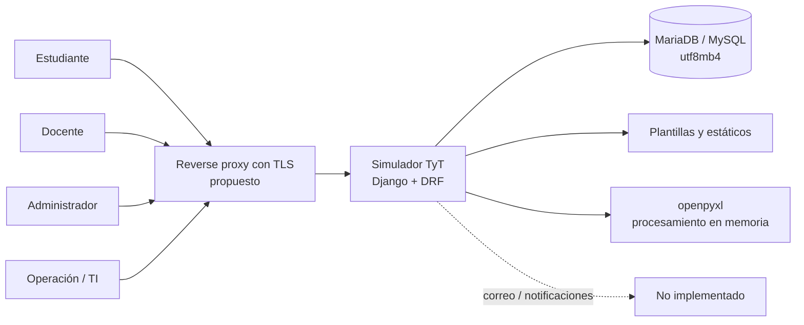
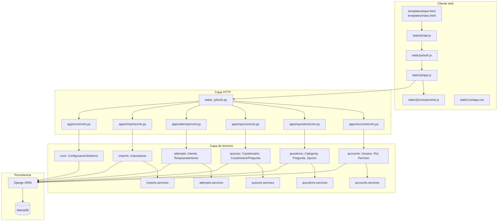
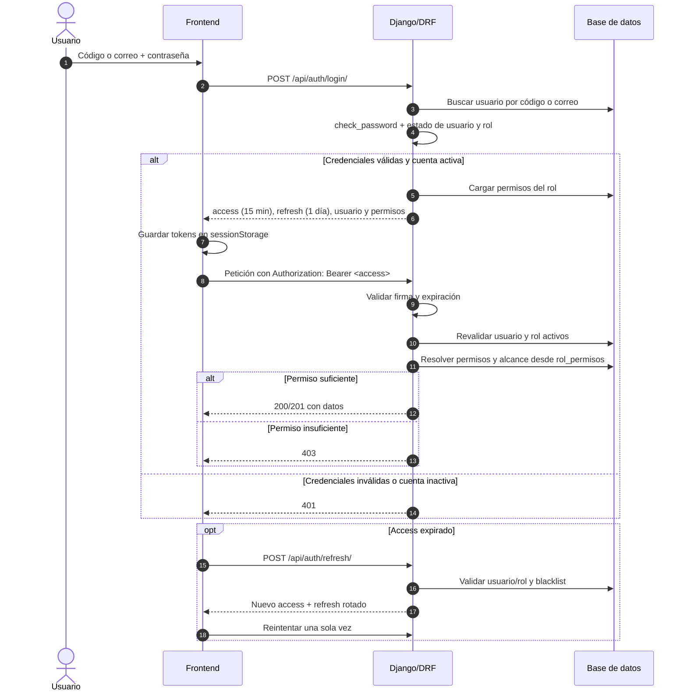
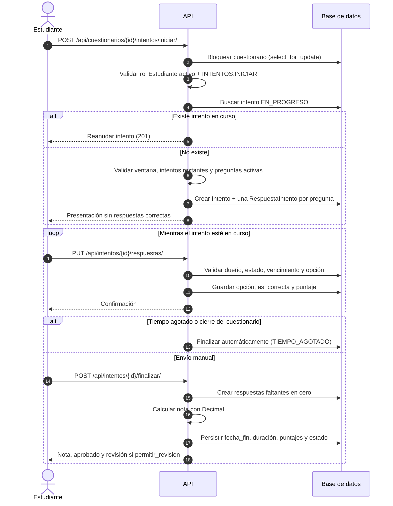
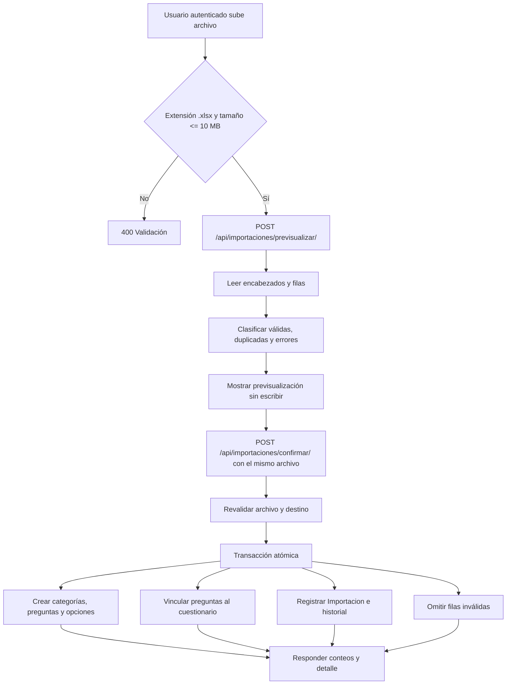
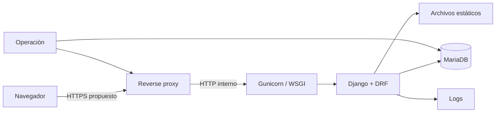
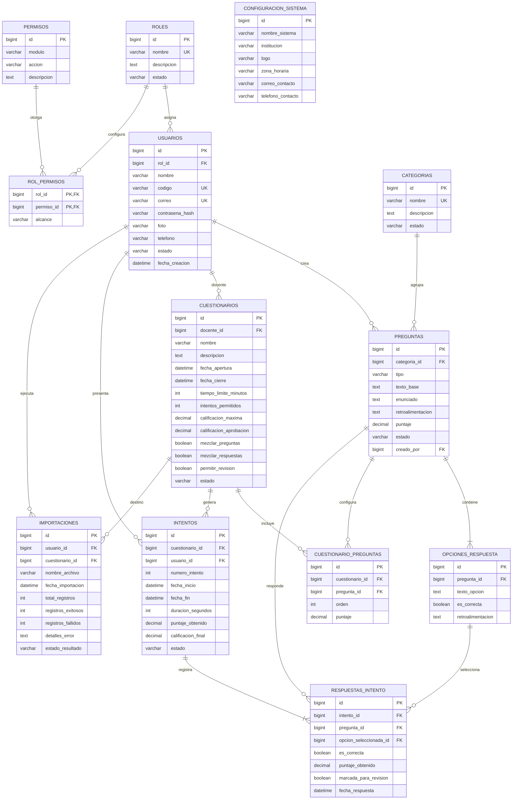
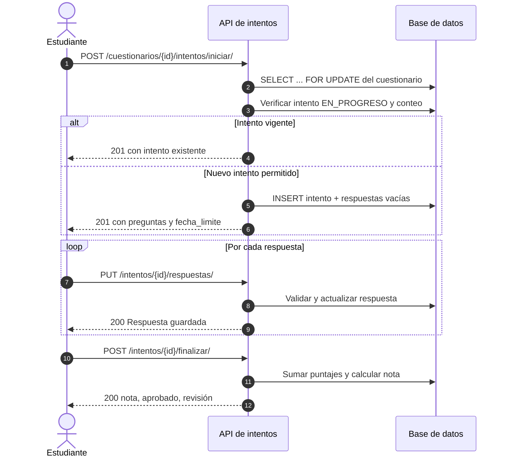
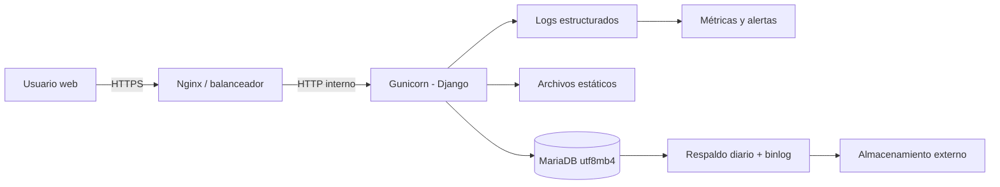

# Especificación de Requisitos de Software (SRS)

## Simulador de Pruebas Saber TyT

---

## Control del documento

| Atributo | Valor |
| --- | --- |
| Código | `SRS-SIMTYT-001` |
| Versión | `1.0` |
| Estado | Línea base para revisión y aprobación |
| Fecha de emisión | 2026-11-05 |
| Autor | Arquitectura de Software — Full Stack / Scrum |
| Revisores propuestos | Product Owner, Tech Lead, QA, Coordinación académica |
| Clasificación | Uso interno |
| Idioma | Español |
| Repositorio | `SimuladorTyT` |
| Rama analizada | `main` |
| Commit de referencia | `18970f0` |
| Norma de referencia | IEEE 830 / ISO/IEC/IEEE 29148, adaptada |
| Fuente de verdad | Código, migraciones y pruebas del repositorio |

### Historial de revisiones

| Versión | Fecha | Autor | Descripción |
| --- | --- | --- | --- |
| 0.1 | 2026-11-05 | Arquitectura de Software | Análisis inicial del repositorio y borrador de estructura. |
| 1.0 | 2026-11-05 | Arquitectura de Software | Especificación completa, trazabilidad, riesgos y anexo Scrum. |

### Nota de evidencia

Este documento se elaboró mediante **ingeniería inversa del repositorio** en el commit indicado. No describe una intención futura sin sustento: cada requisito marcado como **Implementado** se verificó en modelos, servicios, serializadores, vistas, rutas, migraciones, plantillas, JavaScript o pruebas.

Las metas de rendimiento, disponibilidad, capacidad, accesibilidad y el plan Scrum del anexo son **objetivos propuestos de arquitectura**, no resultados medidos ni compromisos históricos del equipo. Las brechas y la deuda técnica se documentan de forma explícita para que la línea base sea honesta y accionable.

### Evidencia de verificación

| Verificación | Comando | Resultado |
| --- | --- | --- |
| Chequeo de configuración | `python manage.py check --settings=saber_tyt.settings.test` | `System check identified no issues (0 silenced).` |
| Migraciones pendientes | `python manage.py makemigrations --check --dry-run --settings=saber_tyt.settings.test` | `No changes detected` |
| Suite automatizada | `python manage.py test --settings=saber_tyt.settings.test` | `Ran 78 tests` — `OK` (1.689 s en la ejecución registrada; 0.761 s en la reverificación) |
| Versión local verificada | `python --version` / `django --version` | Python `3.13.2` / Django `5.2.18` |

---

## Tabla de contenido

1. [Introducción](#1-introducción)
2. [Descripción general del producto](#2-descripción-general-del-producto)
3. [Arquitectura del sistema](#3-arquitectura-del-sistema)
4. [Modelo de datos](#4-modelo-de-datos)
5. [Actores, roles y permisos](#5-actores-roles-y-permisos)
6. [Requisitos funcionales](#6-requisitos-funcionales)
7. [Casos de uso detallados](#7-casos-de-uso-detallados)
8. [Escenarios de aceptación (Gherkin)](#8-escenarios-de-aceptación-gherkin)
9. [Especificación de la API](#9-especificación-de-la-api)
10. [Requisitos no funcionales](#10-requisitos-no-funcionales)
11. [Reglas de negocio](#11-reglas-de-negocio)
12. [Trazabilidad](#12-trazabilidad)
13. [Calidad, verificación y CI](#13-calidad-verificación-y-ci)
14. [Riesgos, deuda técnica y brechas](#14-riesgos-deuda-técnica-y-brechas)
15. [Anexo Scrum: plan de entrega propuesto](#15-anexo-scrum-plan-de-entrega-propuesto)
16. [Operación, despliegue y soporte](#16-operación-despliegue-y-soporte)
17. [Anexos](#17-anexos)

---

# 1. Introducción

## 1.1 Propósito

Este documento especifica los requisitos funcionales y no funcionales del **Simulador de Pruebas Saber TyT**, una aplicación web académica para administrar un banco de preguntas, configurar cuestionarios, presentar intentos cronometrados, calificar automáticamente y consultar resultados con control de acceso basado en roles y alcances.

La SRS sirve como:

- contrato funcional entre negocio, arquitectura, desarrollo y QA;
- línea base para planificación, estimación y validación;
- referencia de aceptación para historias de usuario y pruebas;
- inventario explícito de brechas, riesgos y deuda técnica;
- insumo para operación, auditoría y continuidad.

## 1.2 Alcance del producto

### 1.2.1 Dentro del alcance

El sistema cubre:

1. Autenticación con código institucional o correo y contraseña, mediante JWT.
2. Administración de usuarios, roles, permisos granulares y alcances.
3. Banco de categorías y preguntas de selección múltiple y verdadero/falso.
4. Configuración, publicación, cierre y consulta de cuestionarios.
5. Presentación de intentos con temporizador, mezcla determinista y guardado de respuestas.
6. Calificación automática en el servidor y consulta de resultados según alcance.
7. Importación masiva de preguntas desde archivos Excel `.xlsx`.
8. Configuración institucional básica.
9. Interfaz web responsive servida por Django, con navegación condicionada por permisos.
10. Registro de importaciones y conservación del historial académico.

### 1.2.2 Fuera del alcance

No forman parte de esta versión:

- aplicación móvil nativa;
- pagos, facturación o matrícula;
- videovigilancia, biometría o proctoring;
- mensajería por correo, SMS o notificaciones push;
- recuperación de contraseña por correo electrónico;
- analítica avanzada, tableros estadísticos o reportería exportable;
- integración con sistemas externos de admisiones o LMS;
- multiinstitución o multiinquilino;
- edición colaborativa en tiempo real;
- carga de imágenes o archivos adjuntos a preguntas;
- versionado de preguntas más allá del bloqueo por intentos existentes;
- firma digital o certificados de resultados.

> Estas exclusiones son límites de la versión actual, no una prohibición para futuras iteraciones. Cualquier inclusión requiere análisis de impacto, migración y actualización de esta SRS.

## 1.3 Audiencia y lectores previstos

| Lector | Uso principal |
| --- | --- |
| Product Owner / Coordinación académica | Validar alcance, reglas y criterios de aceptación. |
| Arquitectura / Tech Lead | Revisar decisiones, riesgos, deuda y evolución. |
| Desarrollo backend / frontend | Implementar y mantener el comportamiento especificado. |
| QA | Derivar casos de prueba funcionales y no funcionales. |
| Operación / TI | Desplegar, respaldar, monitorear y recuperar el servicio. |
| Auditoría / Seguridad | Verificar controles de acceso, trazabilidad y exposición de datos. |
| Docentes y estudiantes | Comprender el comportamiento esperado del simulador. |

## 1.4 Definiciones, acrónimos y abreviaturas

| Término | Definición |
| --- | --- |
| **SRS** | Software Requirements Specification; especificación de requisitos de software. |
| **TyT** | Prueba Saber de competencias para programas técnicos y tecnológicos. |
| **Django** | Framework web de Python usado como base del monolito modular. |
| **DRF** | Django REST Framework; capa de API REST. |
| **JWT** | JSON Web Token; credencial firmada usada para autenticación. |
| **Access token** | Token de corta duración para invocar la API. |
| **Refresh token** | Token de mayor duración para renovar el access token. |
| **Rotación** | Emisión de un refresh nuevo al renovar e invalidación del anterior. |
| **Lista negra** | Registro de refresh tokens revocados; impide su reutilización. |
| **RBAC** | Control de acceso basado en roles. |
| **Permiso granular** | Par `MODULO.ACCION`, por ejemplo `PREGUNTAS.CREAR`. |
| **Alcance** | Límite de datos sobre el que aplica un permiso: `TODOS`, `A_SU_CARGO` o `PROPIOS`. |
| **A_SU_CARGO** | El usuario solo opera sobre registros cuyo propietario es él; en cuestionarios y resultados se traduce en `docente`. |
| **PROPIOS** | El usuario solo opera sobre sus propios registros; en intentos y resultados se traduce en `usuario`. |
| **Rol** | Agrupación lógica de permisos asignada a un usuario. |
| **Categoría** | Clasificación temática de preguntas. |
| **Pregunta** | Ítem evaluable con enunciado, tipo, puntaje y opciones. |
| **Opción** | Alternativa de respuesta de una pregunta. |
| **Cuestionario** | Configuración de evaluación con fechas, duración, nota e intentos. |
| **Intento** | Ejecución individual de un cuestionario por un estudiante. |
| **Respuesta** | Selección registrada para una pregunta dentro de un intento. |
| **Nota** | Calificación final normalizada a la escala definida por el cuestionario. |
| **Soft delete** | Desactivación lógica; el registro no se elimina físicamente. |
| **Normalización de texto** | Comparación que ignora mayúsculas, tildes y espacios repetidos. |
| **Seed** | Datos iniciales cargados por migración o comando de gestión. |
| **MoSCoW** | Priorización Must / Should / Could / Won't. |
| **DoR / DoD** | Definition of Ready / Definition of Done. |
| **CI** | Integración continua. |
| **P95** | Percentil 95 de latencia; el 95 % de las solicitudes debe completarse por debajo del valor. |
| **RPO / RTO** | Recovery Point Objective / Recovery Time Objective. |

## 1.5 Referencias

| Referencia | Uso |
| --- | --- |
| `README.md` | Descripción operativa, API, autenticación y reglas del proyecto. |
| `.github/AGENTS.md` | Reglas de arquitectura, capas, negocio, ramas, CI y DoD. |
| `apps/*/models.py` | Esquema real, restricciones e invariantes. |
| `apps/*/services.py` | Casos de uso y reglas transaccionales. |
| `apps/*/serializers.py` | Contratos de entrada y salida. |
| `apps/*/views.py`, `apps/*/urls.py` | Superficie HTTP y permisos por acción. |
| `apps/*/migrations/*.py` | Evolución del esquema y datos semilla. |
| `apps/*/tests.py` | Comportamiento verificado. |
| `saber_tyt/settings/*.py` | Stack, base de datos, JWT, zona horaria e i18n. |
| `.github/workflows/ci.yml` | Puerta de calidad y matriz de Python. |
| ISO/IEC/IEEE 29148:2018 | Estructura y calidad de requisitos. |
| IEEE 830-1998 | Referencia clásica de SRS. |
| Scrum Guide 2020 | Marco de entrega del anexo Scrum. |
| OWASP ASVS 4.0 | Referencia de verificación de seguridad. |

## 1.6 Convenciones del documento

### 1.6.1 Identificadores

- **FR-XXX-NN**: requisito funcional.
- **RNF-XXX-NN**: requisito no funcional.
- **RN-NN**: regla de negocio.
- **CU-NN**: caso de uso.
- **AD-NN**: decisión de arquitectura.
- **R-NN**: riesgo.
- **DT-NN**: deuda técnica.
- **EC-NN**: escenario de aceptación.
- **HU-NN**: historia de usuario propuesta en el anexo Scrum.

### 1.6.2 Prioridad

| Prioridad | Significado |
| --- | --- |
| **Must** | Imprescindible para que el producto sea operable y seguro en el alcance actual. |
| **Should** | Importante; su ausencia degrada la experiencia o la operación, pero existe una alternativa. |
| **Could** | Deseable; se prioriza si hay capacidad. |
| **Won't** | Excluido explícitamente de esta versión. |

### 1.6.3 Estado de implementación

| Estado | Significado |
| --- | --- |
| **Implementado** | Verificado en código y, cuando aplica, cubierto por pruebas. |
| **Parcial** | Existe una implementación, pero no cubre todo el requisito o no está probada de extremo a extremo. |
| **Brecha** | El requisito no está implementado en el repositorio actual. |
| **Propuesto** | Objetivo de arquitectura u operación; no es una funcionalidad existente. |

### 1.6.4 Lenguaje normativo

- **Debe**: obligatorio.
- **No debe**: prohibido.
- **Debería**: recomendado; requiere justificación si se omite.
- **Puede**: opcional.

---

# 2. Descripción general del producto

## 2.1 Perspectiva del producto

El Simulador TyT es un **monolito modular web con arquitectura API-first**, implementado con Django 5.2 y Django REST Framework 3.16. El servidor expone una API REST consumida por una interfaz web servida por el mismo Django. La interfaz usa HTML, CSS y JavaScript vanilla, sin bundler ni paso de compilación.

El producto se apoya en MariaDB/MySQL con `utf8mb4` y usa SQLite en memoria exclusivamente para pruebas automatizadas. La autenticación es stateless mediante JWT con rotación de refresh y lista negra. La autorización es stateful respecto de la base de datos: aunque el token incluye permisos, el servidor vuelve a resolver el rol y sus permisos en cada petición, de modo que una desactivación o revocación surte efecto sin esperar a que expire el access token.

La propuesta de valor es **evaluar y calificar con reglas confiables en el servidor**, evitando que el cliente decida disponibilidad, tiempo, puntaje o autorización.

## 2.2 Funciones principales

| Grupo | Capacidad |
| --- | --- |
| Identidad | Login por código o correo, perfil, cambio de contraseña, logout con revocación. |
| Administración | Usuarios, roles, permisos por acción y alcance, configuración institucional. |
| Banco académico | Categorías, preguntas, opciones, validación de unicidad y borrado lógico. |
| Evaluación | Cuestionarios con fechas, duración, intentos, mezcla, revisión y publicación. |
| Aplicación | Inicio de intento, guardado de respuestas, marcado para revisión y finalización. |
| Calificación | Cálculo determinista en servidor, nota, aprobación y cierre por vencimiento. |
| Consulta | Resultados propios, resultados por alcance docente y filtros. |
| Importación | Plantilla Excel, previsualización, confirmación atómica e historial. |
| Experiencia | Panel responsive, navegación por permisos, tablas, modales y mensajes. |
| Operación | Migraciones, seeds, CI, configuración por variables de entorno. |

## 2.3 Clases de usuarios y partes interesadas

### 2.3.1 Usuarios del sistema

| Actor | Descripción | Acceso principal |
| --- | --- | --- |
| **Visitante** | Persona sin sesión. | Página de inicio, login y configuración pública. |
| **Estudiante** | Usuario con rol `Estudiante` activo. | Cuestionarios disponibles, intentos, nota propia e historial propio. |
| **Docente** | Rol opcional, presente solo si la instalación ya lo tenía. | Banco de preguntas, cuestionarios propios, importación y resultados a su cargo. |
| **Administrador** | Rol `Administrador` activo. | Todos los módulos, usuarios, roles, permisos y configuración. |
| **Operación / TI** | Responsable de infraestructura. | Despliegue, respaldo, monitoreo y migraciones; no es un rol funcional de la aplicación. |

> **Hallazgo relevante:** el rol `Docente` **no se crea** en una instalación nueva. La migración `accounts.0004` lo configura únicamente si ya existe. Los roles predeterminados creados son `Administrador` y `Estudiante`.

### 2.3.2 Partes interesadas

- Coordinación académica: define pruebas, escalas y políticas de intentos.
- Docentes: construyen el banco y configuran evaluaciones.
- Estudiantes: presentan pruebas y consultan resultados.
- Área de TI: garantiza disponibilidad, respaldo y seguridad.
- Auditoría: verifica acceso, trazabilidad y conservación de historia académica.
- QA: valida reglas, permisos, tiempos y cálculos.

## 2.4 Entorno operativo

| Elemento | Requisito observado |
| --- | --- |
| Servidor | Linux o Windows con Python 3.11, 3.12 o 3.13. |
| Framework | Django `>=5.2,<5.3`; DRF `>=3.16,<3.17`. |
| Base de datos | MariaDB/MySQL con `utf8mb4`; `mysqlclient >=2.2,<3`. |
| Pruebas | SQLite en memoria mediante `saber_tyt.settings.test`. |
| Autenticación | SimpleJWT `>=5.5,<6`, con blacklist. |
| Excel | `openpyxl >=3.1,<4`; archivos `.xlsx` de hasta 10 MB. |
| Configuración | `python-dotenv >=1,<2`; variables en `.env`. |
| Frontend | Navegadores modernos con ES Modules, `fetch` y `sessionStorage`. |
| Zona horaria | `America/Bogota`, `USE_TZ=True`. |
| Idioma | `es-co`. |
| Servidor de aplicación | WSGI (`saber_tyt.wsgi`) o ASGI (`saber_tyt.asgi`). |
| Proxy / TLS | No configurado en el repositorio; se recomienda terminación TLS en un reverse proxy. |

## 2.5 Restricciones de diseño e implementación

1. **Modelo de usuario propio:** `AUTH_USER_MODEL = "accounts.Usuario"`. No se debe usar `django.contrib.auth.models.User`.
2. **Tablas explícitas:** las 13 tablas declaran `db_table` en español y snake_case. No se renombran sin migración, respaldo y plan de compatibilidad.
3. **Esquema académico preexistente:** el README contempla `migrate --fake-initial` cuando las tablas ya existen. No se deben borrar tablas para resolver conflictos.
4. **Sin frameworks frontend:** no se agregan React, Vue, Angular, bundlers ni pasos de compilación sin aprobación del Tech Lead.
5. **Permisos en servidor:** ocultar un botón no es seguridad. Toda operación se valida en el backend.
6. **Separación por capas:** `models.py` → `services.py` → `serializers.py` → `views.py` → `urls.py` → `tests.py`.
7. **Transacciones en servicios:** `transaction.atomic()` y `select_for_update()` no pertenecen a la vista.
8. **Fechas conscientes de zona horaria:** usar `timezone.now()`, nunca `datetime.now()`.
9. **Un solo idioma funcional:** mensajes de API, interfaz y documentación de usuario en español.
10. **Importación en memoria:** el archivo se procesa con `openpyxl`; no se persiste el binario en el repositorio ni en `media/`.

## 2.6 Supuestos

| ID | Supuesto |
| --- | --- |
| SUP-01 | La institución opera una sola base de datos y una sola instalación lógica del simulador. |
| SUP-02 | Cada usuario tiene un código institucional único y un correo único. |
| SUP-03 | Los usuarios acceden mediante navegador moderno con JavaScript habilitado. |
| SUP-04 | La red y el proxy de despliegue proveen TLS; el repositorio no lo configura. |
| SUP-05 | MariaDB está disponible, respaldada y administrada por TI. |
| SUP-06 | Los docentes usan el sistema para pruebas de bajo o medio volumen, no para evaluación masiva de millones de intentos. |
| SUP-07 | La escala de calificación y la nota de aprobación se definen por cuestionario. |
| SUP-08 | La zona horaria institucional es `America/Bogota`; puede cambiarse por variable de entorno. |
| SUP-09 | Los archivos Excel provienen de usuarios autenticados y no son hostiles; aun así se valida extensión, tamaño y estructura. |
| SUP-10 | El rol `Docente` solo existe si la instalación lo creó previamente o un administrador lo crea por API. |

## 2.7 Dependencias

| Dependencia | Tipo | Impacto si falla |
| --- | --- | --- |
| MariaDB/MySQL | Infraestructura | El sistema no opera; las pruebas usan SQLite y no lo cubren. |
| `mysqlclient` y cabeceras del cliente | Build | Falla la instalación y el despliegue. |
| `openpyxl` | Librería | No se puede importar ni generar la plantilla Excel. |
| SimpleJWT y su blacklist | Librería / tablas | No hay autenticación ni revocación de refresh. |
| Variables de entorno | Configuración | `base.py` falla al importarse si faltan `DJANGO_SECRET_KEY` o `DB_*`. |
| Reverse proxy con TLS | Infraestructura | Tokens y credenciales viajan sin cifrado si se expone directamente. |
| Navegador con `sessionStorage` | Cliente | La sesión no persiste en la pestaña. |
| Servicio de respaldo | Operación | Riesgo de pérdida de historia académica. |

## 2.8 Restricciones de negocio

- Solo un usuario con rol `Estudiante` activo puede presentar cuestionarios.
- Un administrador no puede desactivarse a sí mismo, quitarse su propio rol administrador ni desactivar al último administrador activo.
- Los roles `Administrador` y `Estudiante` no se pueden renombrar, desactivar ni eliminar.
- Una pregunta con respuestas de intentos anteriores no se puede editar en contenido.
- El historial académico se conserva; las eliminaciones de categorías, preguntas y cuestionarios son lógicas.
- La nota se calcula exclusivamente en el servidor y se redondea a dos decimales con `ROUND_HALF_UP`.
- Durante un intento no se revelan respuestas correctas ni retroalimentación.

---

# 3. Arquitectura del sistema

## 3.1 Vista de contexto



**Frontera del sistema:** la aplicación Django es la única dueña de las reglas de negocio y del acceso a datos. El navegador es un cliente no confiable: nunca decide permisos, disponibilidad, tiempo, puntaje ni respuesta correcta.

## 3.2 Vista de componentes



## 3.3 Diseño por capas y responsabilidades

| Capa | Archivos representativos | Responsabilidad permitida |
| --- | --- | --- |
| Presentación | `templates/`, `static/js/`, `static/css/` | Renderizar, navegar, validar visualmente y consumir la API. No decide autorización. |
| Enrutamiento | `saber_tyt/urls.py`, `apps/*/urls.py` | Mapear rutas a vistas. Sin lógica de negocio. |
| API / HTTP | `apps/*/views.py`, `views_admin.py` | Aplicar permisos, validar el borde HTTP, invocar servicios y devolver respuestas. |
| Contratos | `apps/*/serializers.py` | Validar entrada y representar salida; delega reglas complejas a servicios. |
| Dominio | `apps/*/services.py` | Casos de uso, transacciones, transiciones, cálculos y validaciones de negocio. |
| Modelo | `apps/*/models.py` | Esquema, relaciones, `constraints` e invariantes simples. No orquesta casos de uso. |
| Persistencia | Django ORM | Consultas, relaciones, índices y transacciones. |

### 3.3.1 Evaluación de cumplimiento arquitectónico

| Criterio | Estado | Observación |
| --- | --- | --- |
| Separación models/services/serializers/views | **Parcial** | Existe en todos los módulos, pero varias vistas construyen filtros y querysets directamente. |
| Transacciones en servicios | **Implementado** | `crear_pregunta`, `actualizar_pregunta`, `crear_cuestionario`, `iniciar_intento`, `finalizar_intento`, `confirmar_importacion_excel` usan `atomic`. |
| Bloqueo pesimista en operaciones críticas | **Implementado** | `select_for_update()` en cuestionarios e intentos. |
| Selectores dedicados | **Brecha** | No existen `selectors.py`; las consultas complejas viven en vistas. |
| Dependencia de servicios respecto de HTTP | **Cumple** | Los servicios no devuelven `HttpResponse`; lanzan excepciones de DRF. |
| Lógica de negocio en plantillas o JS | **Cumple** | El JS solo consume y presenta; la API decide. |
| Señales ocultas | **Cumple** | No se usan `signals` para flujos de negocio. |

## 3.4 Stack tecnológico

| Componente | Versión / restricción | Uso |
| --- | --- | --- |
| Python | 3.11, 3.12, 3.13 | Lenguaje de ejecución y matriz de CI. |
| Django | `>=5.2,<5.3` | Framework web, ORM, migraciones, admin. |
| Django REST Framework | `>=3.16,<3.17` | API, serializadores, permisos, paginación. |
| SimpleJWT | `>=5.5,<6` | Access/refresh, rotación y blacklist. |
| `mysqlclient` | `>=2.2,<3` | Conector MariaDB/MySQL. |
| `openpyxl` | `>=3.1,<4` | Lectura y generación de `.xlsx`. |
| `python-dotenv` | `>=1,<2` | Carga de `.env`. |
| MariaDB/MySQL | `utf8mb4` | Persistencia principal. |
| SQLite | En memoria | Solo pruebas automatizadas. |
| HTML/CSS/JS | Vanilla + ES Modules | Interfaz sin build. |
| GitHub Actions | Ubuntu + Python 3.11/3.12/3.13 | Puerta de calidad. |

## 3.5 Estructura del repositorio

```text
SimuladorTyT/
├── manage.py
├── requirements.txt
├── README.md
├── SRS.md
├── .env.example
├── .env copy.example
├── ejemplo_importacion_preguntas.xlsx
├── .github/
│   ├── AGENTS.md
│   └── workflows/ci.yml
├── saber_tyt/
│   ├── settings/
│   │   ├── base.py
│   │   ├── development.py
│   │   ├── production.py
│   │   └── test.py
│   ├── urls.py
│   ├── asgi.py
│   └── wsgi.py
├── apps/
│   ├── accounts/        # Usuario, Rol, Permiso, RolPermiso, JWT y administración
│   ├── questions/       # Categorías, preguntas y opciones
│   ├── quizzes/         # Cuestionarios y preguntas configuradas
│   ├── attempts/        # Intentos, respuestas, calificación y resultados
│   ├── imports/         # Importación Excel e historial
│   └── core/            # Inicio, acceso denegado y configuración institucional
├── templates/
│   ├── base.html
│   ├── index.html
│   └── acceso_denegado.html
└── static/
    ├── css/app.css
    └── js/{api,auth,app,components}.js
```

> El directorio `config/` existe en el árbol de trabajo pero solo contiene `__pycache__`; no es un paquete de configuración activo. La configuración real está en `saber_tyt/`.

## 3.6 Decisiones de arquitectura

| ID | Decisión | Justificación | Consecuencia |
| --- | --- | --- | --- |
| AD-01 | Monolito modular, no microservicios. | Bajo volumen, un solo dominio académico y equipo pequeño. | Simplicidad operativa; acoplamiento a una sola base. |
| AD-02 | Modelo de usuario propio `accounts.Usuario`. | Código institucional como identificador, rol obligatorio y esquema acordado. | No se puede usar `auth.User`; hay que mantener compatibilidad con admin. |
| AD-03 | JWT stateless con refresh rotado y blacklist. | Escalabilidad horizontal y revocación de refresh. | El access sigue vigente hasta 15 min; la autorización se revalida contra BD. |
| AD-04 | Permisos granulares `modulo.accion` con alcance. | Evita roles rígidos y permite最小 privilegio. | Mayor complejidad de administración y pruebas. |
| AD-05 | Servicios transaccionales para flujos críticos. | Atomicidad, bloqueo y reglas únicas. | Las vistas deben delegar; aún hay consultas en vistas. |
| AD-06 | Soft delete en categorías, preguntas y cuestionarios. | Conservar historia académica y referencias. | Los listados deben filtrar estado; no hay purga automática. |
| AD-07 | Snapshot de preguntas por intento en `respuestas_intento`. | Garantiza una fila por pregunta y calificación estable. | Copia referencias, no texto; se bloquea edición si hay respuestas. |
| AD-08 | Mezcla determinista con semilla `intento.pk`. | Misma presentación al reanudar y reproducibilidad. | Depende del algoritmo de `random.Random` de Python. |
| AD-09 | Frontend vanilla sin build. | Menor complejidad, despliegue directo con estáticos. | Sin tipado, sin pruebas de componente ni bundling. |
| AD-10 | MariaDB/MySQL con `utf8mb4`. | Soporte de caracteres y esquema institucional existente. | Las pruebas en SQLite no replican todas las diferencias del motor. |
| AD-11 | Importación en dos pasos con revalidación. | Evita escrituras durante la previsualización y reduce errores. | El archivo se procesa dos veces. |
| AD-12 | Configuración por variables de entorno y `.env`. | Separar secretos del código. | `base.py` exige variables al importarse, incluso en pruebas. |

## 3.7 Flujo de autenticación y autorización



**Puntos clave:**

- El login acepta `codigo` o `correo`; si el identificador contiene `@`, busca por correo; si no, por código.
- La comparación de código/correo es `iexact`.
- La contraseña se verifica con `check_password`; nunca se compara texto plano.
- El access token incluye `nombre`, `codigo`, `rol`, `rol_id` y `permisos`, pero **la autorización efectiva consulta la base de datos**.
- Un usuario inactivo o con rol inactivo no puede autenticarse ni renovar.
- El frontend intenta renovar una sola vez ante `401`; si falla, borra la sesión y vuelve al login.

## 3.8 Flujo de presentación y calificación



**Invariantes del flujo:**

- Cada pregunta configurada y activa al iniciar obtiene una fila de respuesta desde el inicio.
- Una respuesta en blanco conserva la fila y recibe cero.
- El límite efectivo es `min(fecha_inicio + tiempo_limite_minutos, fecha_cierre)`.
- Consultar un intento vencido lo finaliza antes de responder.
- La nota se calcula con `Decimal` y `ROUND_HALF_UP` a dos decimales.
- La revisión solo se expone si el intento no está `EN_PROGRESO` y `permitir_revision` es verdadero.

## 3.9 Flujo de importación Excel



**Control de destino:** la previsualización y la confirmación exigen `cuestionario_id`, permiso `CUESTIONARIOS.EDITAR`, propiedad del cuestionario (salvo administrador) y ausencia de intentos.

## 3.10 Arquitectura del frontend

| Archivo | Responsabilidad |
| --- | --- |
| `static/js/api.js` | Encapsula `fetch`, agrega Bearer, renueva una vez ante 401, borra sesión y normaliza errores. |
| `static/js/auth.js` | `login`, `logout`, `getCurrentUser`, `hasPermission`, `guard`. |
| `static/js/app.js` | Estado de la vista, navegación por permisos, carga de módulos, formularios y acciones. |
| `static/js/components.js` | Tablas, paginación, modales, toasts y validación visual. |
| `static/css/app.css` | Tema responsive, estados de carga/error y componentes. |
| `templates/base.html` | Estructura HTML, metadatos, carga de estáticos y bloque de scripts. |
| `templates/index.html` | Login y dashboard con navegación dinámica. |
| `templates/acceso_denegado.html` | Página amigable para rutas no autorizadas. |

**Navegación:** el panel agrega secciones según permisos: Inicio, Usuarios, Roles y permisos, Banco de preguntas, Cuestionarios, Importar Excel, Configuración, Presentar prueba y Resultados. El filtrado visual es una ayuda; la API vuelve a validar.

**Sesión:** los tokens viven en `sessionStorage` (`tyt_access`, `tyt_refresh`). La sesión persiste mientras la pestaña esté abierta y se pierde al cerrarla. Esto evita persistencia entre pestañas, pero expone los tokens a XSS (ver R-01).

## 3.11 Despliegue lógico



| Aspecto | Estado actual | Recomendación |
| --- | --- | --- |
| Servidor de aplicación | WSGI/ASGI disponibles; no hay configuración de Gunicorn/uWSGI. | Definir proceso y supervisor. |
| Archivos estáticos | `STATIC_ROOT` y `STATICFILES_DIRS` configurados. | Ejecutar `collectstatic` y servir por proxy/CDN. |
| Medios | `MEDIA_ROOT` configurado, sin carga real de archivos. | No exponer `media/` si no se usa. |
| TLS | No configurado. | Terminación TLS, HSTS y redirección HTTPS. |
| Base de datos | MariaDB externa. | Réplica/backup y monitoreo. |
| Secretos | `.env` ignorado por Git. | Gestión de secretos y rotación. |
| Contenedores | No hay Dockerfile ni compose. | Opcional; no requerido por la versión actual. |

---

# 4. Modelo de datos

## 4.1 Principios del modelo

1. **13 tablas** con `db_table` explícito en español.
2. **Claves primarias** `BigAutoField`, excepto `rol_permisos`, que usa clave primaria compuesta (`rol_id`, `permiso_id`).
3. **Integridad referencial** con `PROTECT` en maestros académicos, `CASCADE` en dependientes y `SET_NULL` en referencias opcionales de auditoría.
4. **Restricciones `CHECK`** para estados, fechas, puntajes, notas, tiempo e intentos.
5. **Índices compuestos** para filtros por estado, fechas, propietario y orden.
6. **Borrado lógico** en categorías, preguntas y cuestionarios.
7. **Historia académica inmutable** en la práctica: una pregunta con respuestas no se edita; un cuestionario con intentos solo se cierra.

## 4.2 Diagrama entidad-relación



## 4.3 Diccionario de datos

### 4.3.1 `roles`

| Campo | Tipo | Nulo | Restricción / nota |
| --- | --- | --- | --- |
| `id` | BIGINT | No | PK autoincremental. |
| `nombre` | VARCHAR(50) | No | Único. |
| `descripcion` | TEXT | Sí | Descripción libre. |
| `estado` | VARCHAR(20) | No | `ACTIVO` / `INACTIVO`; `ck_roles_estado`. |

Índice: `idx_roles_estado`.

### 4.3.2 `permisos`

| Campo | Tipo | Nulo | Restricción / nota |
| --- | --- | --- | --- |
| `id` | BIGINT | No | PK. |
| `modulo` | VARCHAR(50) | No | Módulo funcional. |
| `accion` | VARCHAR(50) | No | Acción granular. |
| `descripcion` | TEXT | Sí | Texto para la matriz de permisos. |

Restricciones: `uq_permisos_modulo_accion (modulo, accion)`. Índice: `idx_permisos_modulo`.

### 4.3.3 `rol_permisos`

| Campo | Tipo | Nulo | Restricción / nota |
| --- | --- | --- | --- |
| `rol_id` | BIGINT | No | FK a `roles`; `CASCADE`; parte de PK compuesta. |
| `permiso_id` | BIGINT | No | FK a `permisos`; `CASCADE`; parte de PK compuesta. |
| `alcance` | VARCHAR(20) | No | `TODOS` / `A_SU_CARGO` / `PROPIOS`; `ck_rp_alcance`. |

PK compuesta: `(rol_id, permiso_id)` mediante `CompositePrimaryKey`.

### 4.3.4 `usuarios`

| Campo | Tipo | Nulo | Restricción / nota |
| --- | --- | --- | --- |
| `id` | BIGINT | No | PK. |
| `rol_id` | BIGINT | No | FK a `roles`; `PROTECT`. |
| `nombre` | VARCHAR(150) | No | Nombre visible. |
| `codigo` | VARCHAR(30) | No | Único; `USERNAME_FIELD`. |
| `correo` | VARCHAR(150) | No | Único. |
| `contrasena_hash` | VARCHAR(255) | No | Columna de `password`; hash Django. |
| `foto` | VARCHAR(255) | Sí | Ruta o referencia; no hay carga de archivo implementada. |
| `telefono` | VARCHAR(20) | Sí | Contacto opcional. |
| `estado` | VARCHAR(20) | No | `ACTIVO` / `INACTIVO`; `ck_usuarios_estado`. |
| `fecha_creacion` | DATETIME | No | `auto_now_add`. |

Índices: `idx_usuarios_estado_rol (estado, rol)`, `idx_usuarios_nombre (nombre)`. **No existe `last_login`.**

### 4.3.5 `categorias`

| Campo | Tipo | Nulo | Restricción / nota |
| --- | --- | --- | --- |
| `id` | BIGINT | No | PK. |
| `nombre` | VARCHAR(100) | No | Único. |
| `descripcion` | TEXT | Sí | Descripción. |
| `estado` | VARCHAR(20) | No | `Activo` / `Inactivo`. |

Índices: `idx_categorias_nombre`, `idx_categorias_estado`.

### 4.3.6 `preguntas`

| Campo | Tipo | Nulo | Restricción / nota |
| --- | --- | --- | --- |
| `id` | BIGINT | No | PK. |
| `categoria_id` | BIGINT | No | FK a `categorias`; `PROTECT`. |
| `tipo` | VARCHAR(50) | No | `MULTIPLE` / `VERDADERO_FALSO`. |
| `texto_base` | TEXT | Sí | Contexto opcional. |
| `enunciado` | TEXT | No | Texto de la pregunta. |
| `retroalimentacion` | TEXT | Sí | Feedback para revisión. |
| `puntaje` | DECIMAL(5,2) | No | Default 1; `ck_preguntas_puntaje` (`> 0`). |
| `estado` | VARCHAR(20) | No | `Activo` / `Inactivo`. |
| `creado_por` | BIGINT | Sí | FK a `usuarios`; `SET_NULL`. |

Índices: `idx_preg_cat_estado (categoria, estado)`, `idx_preg_tipo (tipo)`.

### 4.3.7 `opciones_respuesta`

| Campo | Tipo | Nulo | Restricción / nota |
| --- | --- | --- | --- |
| `id` | BIGINT | No | PK. |
| `pregunta_id` | BIGINT | No | FK a `preguntas`; `CASCADE`. |
| `texto_opcion` | TEXT | No | Texto de la alternativa. |
| `es_correcta` | BOOLEAN | No | Default `false`. |
| `retroalimentacion` | TEXT | Sí | Feedback específico. |

Índice: `idx_opc_preg_correcta (pregunta, es_correcta)`.

### 4.3.8 `cuestionarios`

| Campo | Tipo | Nulo | Restricción / nota |
| --- | --- | --- | --- |
| `id` | BIGINT | No | PK. |
| `docente_id` | BIGINT | Sí | FK a `usuarios`; `PROTECT`; propietario. |
| `nombre` | VARCHAR(150) | No | Nombre. |
| `descripcion` | TEXT | Sí | Descripción. |
| `fecha_apertura` | DATETIME | No | Inicio. |
| `fecha_cierre` | DATETIME | No | Fin; `> fecha_apertura`. |
| `tiempo_limite_minutos` | INT | No | `> 0`. |
| `intentos_permitidos` | INT | No | `> 0`. |
| `calificacion_maxima` | DECIMAL(5,2) | No | `> 0`. |
| `calificacion_aprobacion` | DECIMAL(5,2) | No | `>= 0` y `<= calificacion_maxima`. |
| `mezclar_preguntas` | BOOLEAN | No | Default `true`. |
| `mezclar_respuestas` | BOOLEAN | No | Default `true`. |
| `permitir_revision` | BOOLEAN | No | Default `true`. |
| `estado` | VARCHAR(20) | No | `BORRADOR` / `PROGRAMADO` / `DISPONIBLE` / `CERRADO`. |

Restricciones: `ck_cuestionarios_fechas`, `ck_cuestionarios_nota_maxima`, `ck_cuestionarios_nota_aprobacion`, `ck_cuestionarios_nota_no_negativa`, `ck_cuestionarios_tiempo`, `ck_cuestionarios_intentos`, `ck_cuestionarios_estado`.

Índices: `idx_cuestionarios_estado`, `idx_cuestionario_disponible (estado, fecha_apertura, fecha_cierre)`, `idx_cuestionario_nombre`.

### 4.3.9 `cuestionario_preguntas`

| Campo | Tipo | Nulo | Restricción / nota |
| --- | --- | --- | --- |
| `id` | BIGINT | No | PK. |
| `cuestionario_id` | BIGINT | No | FK a `cuestionarios`; `CASCADE`. |
| `pregunta_id` | BIGINT | No | FK a `preguntas`; `PROTECT`. |
| `orden` | INT | No | Default 1; único por cuestionario en la práctica. |
| `puntaje` | DECIMAL(5,2) | No | Default 1; `> 0`. |

Restricciones: `uk_cuestionario_pregunta (cuestionario, pregunta)`, `ck_cuestionario_preguntas_puntaje`.
Índices: `idx_cp_pregunta`, `idx_cp_cuestionario_orden (cuestionario, orden)`. **No hay restricción única de `(cuestionario, orden)` en base de datos**; la unicidad se valida en servicio.

### 4.3.10 `intentos`

| Campo | Tipo | Nulo | Restricción / nota |
| --- | --- | --- | --- |
| `id` | BIGINT | No | PK. |
| `cuestionario_id` | BIGINT | No | FK a `cuestionarios`; `CASCADE`. |
| `usuario_id` | BIGINT | No | FK a `usuarios`; `PROTECT`. |
| `numero_intento` | INT | No | Default 1; consecutivo por usuario y cuestionario. |
| `fecha_inicio` | DATETIME | No | `auto_now_add`. |
| `fecha_fin` | DATETIME | Sí | Al finalizar. |
| `duracion_segundos` | INT | Sí | Tiempo efectivo consumido. |
| `puntaje_obtenido` | DECIMAL(5,2) | Sí | Suma de puntajes. |
| `calificacion_final` | DECIMAL(5,2) | Sí | Nota normalizada. |
| `estado` | VARCHAR(20) | No | `EN_PROGRESO` / `FINALIZADO` / `TIEMPO_AGOTADO`. |

Restricciones: `uq_intento (cuestionario, usuario, numero_intento)`, `ck_intentos_estado`.
Índices: `idx_intentos_usuario_estado`, `idx_intentos_fecha_inicio`.

### 4.3.11 `respuestas_intento`

| Campo | Tipo | Nulo | Restricción / nota |
| --- | --- | --- | --- |
| `id` | BIGINT | No | PK. |
| `intento_id` | BIGINT | No | FK a `intentos`; `CASCADE`. |
| `pregunta_id` | BIGINT | No | FK a `preguntas`; `PROTECT`. |
| `opcion_seleccionada_id` | BIGINT | Sí | FK a `opciones_respuesta`; `SET_NULL`. |
| `es_correcta` | BOOLEAN | No | Default `false`. |
| `puntaje_obtenido` | DECIMAL(5,2) | No | Default 0. |
| `marcada_para_revision` | BOOLEAN | No | Default `false`. |
| `fecha_respuesta` | DATETIME | No | `auto_now`. |

Restricción: `uk_intento_pregunta (intento, pregunta)`. Índice: `idx_resp_pregunta`.

### 4.3.12 `importaciones`

| Campo | Tipo | Nulo | Restricción / nota |
| --- | --- | --- | --- |
| `id` | BIGINT | No | PK. |
| `usuario_id` | BIGINT | Sí | FK a `usuarios`; `SET_NULL`. |
| `cuestionario_id` | BIGINT | Sí | FK a `cuestionarios`; `SET_NULL`. |
| `nombre_archivo` | VARCHAR(255) | No | Nombre base, sin ruta. |
| `fecha_importacion` | DATETIME | No | `auto_now_add`. |
| `total_registros` | INT | No | Filas procesadas. |
| `registros_exitosos` | INT | No | Preguntas nuevas creadas. |
| `registros_fallidos` | INT | No | Duplicadas + errores. |
| `detalles_error` | TEXT | Sí | JSON con duplicadas y errores. |
| `estado_resultado` | VARCHAR(50) | No | `En proceso` / `Exitoso` / `Parcial` / `Fallido`. |

Índices: `idx_imp_usuario_fecha`, `idx_imp_estado_fecha`, `idx_imp_cuestionario_fecha`.

### 4.3.13 `configuracion_sistema`

| Campo | Tipo | Nulo | Restricción / nota |
| --- | --- | --- | --- |
| `id` | BIGINT | No | PK. |
| `nombre_sistema` | VARCHAR(150) | No | Nombre visible. |
| `institucion` | VARCHAR(150) | No | Institución. |
| `logo` | VARCHAR(255) | Sí | Referencia; sin carga implementada. |
| `zona_horaria` | VARCHAR(50) | No | Default `America/Bogota`. |
| `correo_contacto` | VARCHAR(150) | Sí | Correo de contacto. |
| `telefono_contacto` | VARCHAR(20) | Sí | Teléfono de contacto. |

**Singleton lógico:** no hay restricción de fila única; las vistas usan `ConfiguracionSistema.objects.first()` y la migración crea una sola fila si no existe.

## 4.4 Integridad, índices y reglas de borrado

| Relación | `on_delete` | Efecto |
| --- | --- | --- |
| `usuarios.rol` | `PROTECT` | No se elimina un rol con usuarios. |
| `preguntas.categoria` | `PROTECT` | No se elimina una categoría con preguntas (además, el borrado es lógico). |
| `preguntas.creado_por` | `SET_NULL` | Si se elimina el usuario, la pregunta permanece sin autor. |
| `opciones_respuesta.pregunta` | `CASCADE` | Las opciones pertenecen a la pregunta. |
| `cuestionarios.docente` | `PROTECT` | No se elimina un docente con cuestionarios. |
| `cuestionario_preguntas.cuestionario` | `CASCADE` | Se eliminan configuraciones al borrar el cuestionario. |
| `cuestionario_preguntas.pregunta` | `PROTECT` | Una pregunta usada no se elimina físicamente. |
| `intentos.cuestionario` | `CASCADE` | Si se borrara el cuestionario, se borrarían intentos; en la práctica el borrado es lógico. |
| `intentos.usuario` | `PROTECT` | No se elimina un usuario con intentos. |
| `respuestas_intento.intento` | `CASCADE` | Dependientes del intento. |
| `respuestas_intento.pregunta` | `PROTECT` | La pregunta histórica se conserva. |
| `respuestas_intento.opcion_seleccionada` | `SET_NULL` | Si se eliminara la opción, se conserva la respuesta. |
| `importaciones.usuario` | `SET_NULL` | Se conserva el historial. |
| `importaciones.cuestionario` | `SET_NULL` | Se conserva el historial. |

### 4.4.1 Borrado lógico

| Entidad | Operación | Estado resultante | Historia |
| --- | --- | --- | --- |
| Categoría | `DELETE /api/categorias/{id}/` | `Inactivo` | Preguntas y opciones se conservan. |
| Pregunta | `DELETE /api/preguntas/{id}/` | `Inactivo` | Opciones y respuestas se conservan. |
| Cuestionario | `DELETE /api/cuestionarios/{id}/` | `BORRADOR` si no hay intentos; `CERRADO` si hay. | Intentos y respuestas se conservan. |

### 4.4.2 Inmutabilidad académica

- Si una pregunta tiene `respuestas_intento`, no se permite modificar contenido ni opciones; solo se permite cambiar `estado`.
- Si un cuestionario tiene intentos, solo se permite cerrarlo; no se editan datos, preguntas, orden ni puntajes.
- La pregunta se referencia por FK; el texto no se copia. El bloqueo de edición protege la interpretación histórica.
- Una pregunta inactiva no se puede agregar a un cuestionario nuevo; los registros existentes se conservan.

## 4.5 Migraciones y datos semilla

| App | Migraciones | Contenido relevante |
| --- | --- | --- |
| `accounts` | `0001`–`0005` | Esquema, roles predeterminados, catálogo legado, catálogo granular por acción, índices. |
| `questions` | `0001`–`0004` | Esquema, `CHECK` de puntaje, índices, longitud de nombre de categoría. |
| `quizzes` | `0001`–`0004` | Esquema, `CHECK` de nota no negativa, índices de estado y disponibilidad. |
| `attempts` | `0001`–`0002` | Esquema e índices de usuario/estado y fecha. |
| `imports` | `0001`–`0004` | Esquema, índices, estado de resultado y más índices. |
| `core` | `0001`–`0002` | Esquema y configuración institucional inicial. |

**Datos semilla observados:**

| Dato | Origen | Comportamiento |
| --- | --- | --- |
| Roles `Administrador` y `Estudiante` | `accounts.0002` | `get_or_create`; idempotente. |
| Catálogo legado de 10 permisos | `accounts.0003` | `get_or_create`. |
| Catálogo granular de 43 permisos | `accounts.0004` | `get_or_create` y asignaciones por rol. |
| Asignación total al Administrador | `accounts.0004` | Todos los permisos con alcance `TODOS`. |
| Asignación del Estudiante | `accounts.0004` | 6 permisos con alcance `PROPIOS`; elimina asignaciones previas no incluidas. |
| Configuración del Docente | `accounts.0004` | Solo si el rol ya existe; 19 permisos efectivos. |
| Configuración institucional | `core.0002` | Crea una fila si no existe. |

**Comando `seed_admin`:**

- Lee `SEED_ADMIN_CODIGO`, `SEED_ADMIN_CORREO`, `SEED_ADMIN_NOMBRE` y `SEED_ADMIN_PASSWORD`.
- Falla si falta alguna variable.
- Valida la contraseña con los validadores de Django.
- Crea el rol `Administrador` si no existe y exige que esté activo.
- Es idempotente: si el código ya existe como administrador, no cambia la contraseña.
- Falla si el código pertenece a una cuenta que no es administradora.

---

# 5. Actores, roles y permisos

## 5.1 Modelo de autorización

La autorización combina tres dimensiones:

1. **Rol:** un usuario tiene exactamente un rol (`usuarios.rol_id`).
2. **Permiso granular:** par `MODULO.ACCION` asignado al rol en `rol_permisos`.
3. **Alcance:** límite de datos del permiso (`TODOS`, `A_SU_CARGO`, `PROPIOS`).

El rol debe estar `ACTIVO` y el usuario debe estar `ACTIVO`. El administrador se identifica por nombre de rol (`Administrador` o `Admin`, sin distinguir mayúsculas) y recibe tratamiento especial: `is_staff`, `is_superuser` y `has_perm` devuelven verdadero, y el login le entrega todo el catálogo.

> **Deuda de diseño:** la identidad del administrador y la del estudiante se resuelven por **nombre de rol**. Renombrar esos roles no es posible por API, pero una modificación directa en base de datos alteraría el comportamiento. Ver R-04.

## 5.2 Catálogo de permisos (43)

| Módulo | Acciones | Propósito |
| --- | --- | --- |
| `USUARIOS` | `VER`, `CREAR`, `EDITAR`, `DESACTIVAR`, `GESTIONAR` | Administración de cuentas. |
| `ROLES` | `VER`, `CREAR`, `EDITAR`, `DESACTIVAR`, `ASIGNAR_PERMISOS`, `GESTIONAR` | Administración de roles y matriz de permisos. |
| `PREGUNTAS` | `VER`, `CREAR`, `EDITAR`, `DESACTIVAR`, `GESTIONAR` | Banco de preguntas. |
| `CATEGORIAS` | `VER`, `CREAR`, `EDITAR`, `DESACTIVAR`, `GESTIONAR` | Categorías del banco. |
| `CUESTIONARIOS` | `VER`, `CREAR`, `EDITAR`, `DESACTIVAR`, `VER_DISPONIBLES`, `PRESENTAR`, `GESTIONAR` | Configuración y consulta de cuestionarios. |
| `IMPORTACIONES` | `VER`, `IMPORTAR` | Historial y carga Excel. |
| `RESULTADOS` | `VER`, `VER_PROPIA_NOTA` | Consulta de resultados. |
| `INTENTOS` | `VER`, `CREAR`, `EDITAR`, `DESACTIVAR`, `INICIAR`, `RESPONDER`, `FINALIZAR`, `VER_NOTA_PROPIA` | Ciclo de vida del intento. |
| `CONFIGURACION` | `EDITAR` | Configuración institucional. |
| `PERFIL` | `EDITAR` | Edición del perfil propio. |
| `IMPORTACION` | `IMPORTAR` | Compatibilidad con el permiso legado. |

**Nota sobre `GESTIONAR`:** el catálogo conserva acciones `GESTIONAR` por compatibilidad. Las vistas nuevas usan permisos específicos (`VER`, `CREAR`, `EDITAR`, `DESACTIVAR`). `GESTIONAR` solo actúa como respaldo cuando una vista declara `permiso_requerido` y no tiene un `required_permissions` para la acción. No es un “superpermiso” universal.

## 5.3 Matriz efectiva de roles

### 5.3.1 Administrador

| Dimensión | Valor |
| --- | --- |
| Permisos | Los 43 del catálogo. |
| Alcance | `TODOS`. |
| Efecto | Acceso completo a usuarios, roles, banco, cuestionarios, importaciones, resultados y configuración. |
| Django admin | `is_staff = True`; puede acceder a `/admin/`. |

### 5.3.2 Estudiante

| Permiso | Alcance | Uso |
| --- | --- | --- |
| `CUESTIONARIOS.VER_DISPONIBLES` | `PROPIOS` | Listar pruebas abiertas. |
| `INTENTOS.INICIAR` | `PROPIOS` | Iniciar o reanudar intento. |
| `INTENTOS.RESPONDER` | `PROPIOS` | Guardar respuestas. |
| `INTENTOS.FINALIZAR` | `PROPIOS` | Enviar intento. |
| `INTENTOS.VER_NOTA_PROPIA` | `PROPIOS` | Consultar su intento/nota. |
| `RESULTADOS.VER_PROPIA_NOTA` | `PROPIOS` | Consultar su historial. |

**Efectos observados:**

- No puede administrar usuarios, roles, categorías, preguntas, cuestionarios, importaciones ni configuración.
- No puede leer resultados de terceros.
- **No tiene `PERFIL.EDITAR`** tras la migración `0004`; puede consultar su perfil (`GET`), pero `PATCH /api/auth/me/` responde `403`.
- Solo puede iniciar intentos si su rol se llama exactamente `Estudiante` (comparación sin mayúsculas), además de tener `INTENTOS.INICIAR`.

### 5.3.3 Docente (rol opcional, si existe)

| Permiso | Alcance | Uso |
| --- | --- | --- |
| `CATEGORIAS.VER`, `CREAR`, `EDITAR`, `DESACTIVAR`, `GESTIONAR` | `TODOS` | Administrar categorías. |
| `PREGUNTAS.VER`, `CREAR`, `EDITAR`, `DESACTIVAR`, `GESTIONAR` | `TODOS` | Administrar preguntas. |
| `IMPORTACIONES.VER`, `IMPORTAR` | `TODOS` | Importar y consultar historial. |
| `IMPORTACION.IMPORTAR` | `TODOS` | Compatibilidad legada. |
| `CUESTIONARIOS.VER`, `CREAR`, `EDITAR`, `GESTIONAR` | `A_SU_CARGO` | Crear y administrar cuestionarios propios. |
| `RESULTADOS.VER` | `A_SU_CARGO` | Consultar resultados de sus cuestionarios. |
| `PERFIL.EDITAR` | `TODOS` | Editar su perfil. |

**Efectos observados y brechas:**

- Puede ver y administrar todas las categorías y preguntas, no solo las propias.
- Puede ver el historial de importaciones de todos los usuarios, porque `IMPORTACIONES.VER` tiene alcance `TODOS`.
- **No recibe `CUESTIONARIOS.DESACTIVAR`**, por lo que no puede usar `POST /api/cuestionarios/{id}/desactivar/` ni `DELETE /api/cuestionarios/{id}/`. Puede cerrar un cuestionario propio mediante `PATCH /api/cuestionarios/{id}/` con `estado=CERRADO` si tiene `CUESTIONARIOS.EDITAR`.
- **No recibe `CUESTIONARIOS.VER_DISPONIBLES` ni `CUESTIONARIOS.PRESENTAR`**; no está pensado para presentar pruebas. Además, el servicio exige rol `Estudiante`.
- No recibe permisos de `INTENTOS`, `USUARIOS`, `ROLES` ni `CONFIGURACION`.

> El rol `Docente` no se crea automáticamente en una instalación nueva. Si se requiere como rol estándar, debe agregarse por migración o por API y actualizar esta matriz.

## 5.4 Semántica de los alcances

| Alcance | Significado general | Campo de filtro observado |
| --- | --- | --- |
| `TODOS` | Sin restricción adicional. | No se filtra. |
| `A_SU_CARGO` | Registros cuyo propietario es el usuario. | `cuestionarios.docente`; `intentos.cuestionario__docente`. |
| `PROPIOS` | Registros del propio usuario. | `preguntas.creado_por`; `intentos.usuario`; `importaciones.usuario`. |

Si el alcance no es `TODOS` y la consulta no declara un campo propietario, `filtrar_por_alcance` devuelve `queryset.none()`. Si el permiso no existe, también devuelve vacío. **Falla cerrado.**

### 5.4.1 Aplicación por módulo

| Módulo | Campo de alcance | Observación |
| --- | --- | --- |
| Usuarios | Ninguno | Solo `TODOS` puede listar; `PROPIOS`/`A_SU_CARGO` devuelven vacío. |
| Categorías | Ninguno | El alcance no segmenta categorías; se usan permisos. |
| Preguntas | `creado_por` | `PROPIOS` limita a preguntas creadas por el usuario. |
| Cuestionarios | `docente` | `A_SU_CARGO` limita a cuestionarios del docente. |
| Resultados | `usuario` o `cuestionario__docente` | `PROPIOS` filtra por usuario; `A_SU_CARGO` por docente del cuestionario. |
| Importaciones | `usuario` | `PROPIOS` limita el historial al usuario. |

## 5.5 Algoritmo de resolución de permisos

```text
1. Si no hay usuario autenticado, denegar.
2. Si el usuario está inactivo, denegar.
3. Si el rol no existe o está inactivo, denegar.
4. Cargar una vez por petición el mapa (modulo, accion) -> alcance desde rol_permisos.
5. Determinar la acción:
   a. Si la vista DRF expone `action`, usarla.
   b. Si no, mapear el método HTTP: GET->list/retrieve, POST->create,
      PUT/PATCH->update, DELETE->destroy.
6. Leer `required_permissions[accion]`.
7. Normalizar a una lista de pares (modulo, accion).
8. Conceder si el usuario tiene al menos uno de los pares.
9. Si no hay requisitos, usar `permiso_requerido` legado si contiene un punto.
10. Si no hay configuración, denegar con mensaje explícito.
```

**Consecuencias:**

- Los permisos se evalúan en el servidor; el cliente no puede elevar privilegios manipulando el DOM.
- La revocación de un permiso surte efecto en la siguiente petición, aunque el token siga vigente.
- La desactivación de un usuario o rol invalida el acceso y la renovación.
- Los recursos fuera de alcance suelen responder `404` (el queryset se filtra antes del `get_object`), no `403`.

## 5.6 Protecciones administrativas

| Protección | Implementación | Resultado |
| --- | --- | --- |
| Auto-desactivación de administrador | `EstadoUsuarioView` y `perform_update` | `400`. |
| Quitarse el rol administrador | `DetalleUsuarioView.perform_update` | `400`. |
| Desactivar al último administrador activo | Consulta de existencia de otro administrador activo | `400`. |
| Cambiar rol del último administrador | `perform_update` | `400`. |
| Desactivar rol predeterminado | `RolAdministracionSerializer.validate` | `400`. |
| Renombrar rol predeterminado | `RolAdministracionSerializer.validate` | `400`. |
| Eliminar rol predeterminado | `DetalleRolView.delete` | `400`. |
| Eliminar rol con usuarios | `DetalleRolView.delete` | `400`. |
| Asignar rol inactivo a usuario | `PrimaryKeyRelatedField` con queryset filtrado | `400`. |
| Restablecer contraseña corta | `MinLengthValidator(8)` + validadores | `400`. |
| Desactivar cuenta inactiva | Autenticación y refresh | `401`. |

## 5.7 Observaciones de seguridad y consistencia

1. La identificación de administrador y estudiante por nombre es frágil; debería evolucionar a un atributo estable (`es_sistema`, `tipo_rol` o `codigo`).
2. El rol `Docente` tiene una matriz que no cubre el ciclo completo de desactivación; es inconsistente con la UI que muestra “Desactivar” si el usuario tiene `CUESTIONARIOS.DESACTIVAR` (no lo tiene).
3. El access token contiene la lista de permisos, pero el servidor no confía en ella para autorizar; se usa solo como dato de sesión. Esto es correcto, aunque el token puede quedar desactualizado visualmente hasta el siguiente login.
4. La contraseña nunca se serializa; el campo `password` de administración es `write_only`.
5. El perfil devuelve permisos con alcance, lo que permite a la UI mostrar u ocultar acciones, pero no sustituye la validación del backend.
6. No hay registro de auditoría de cambios administrativos; ver R-05.

---

# 6. Requisitos funcionales

## 6.1 Convenciones

Los requisitos se agrupan por módulo funcional y usan un identificador estable `MODULO-NN`. La columna **Prioridad** expresa valor de negocio (`Alta`, `Media`, `Baja`), no esfuerzo de implementación. La columna **Estado** distingue:

| Estado | Significado |
| --- | --- |
| **Implementado** | Comportamiento verificado en código, ruta y prueba automatizada o evidencia directa. |
| **Parcial** | Existe una implementación funcional, pero con una limitación conocida de alcance, consistencia o experiencia. |
| **Brecha** | No existe implementación en la versión analizada; se documenta para evitar falsas expectativas. |

Los criterios de aceptación se redactan en forma observable. Cuando un requisito depende de un permiso, se indica el par `MODULO.ACCION`; la matriz completa está en la sección 5.

## 6.2 Autenticación y sesión (`AUT`)

| ID | Prioridad | Requisito | Criterio de aceptación | Estado |
| --- | --- | --- | --- | --- |
| `AUT-01` | Alta | Iniciar sesión con código institucional o correo y contraseña. | `POST /api/auth/login/` acepta `codigo` o `correo` más `password`; con credenciales válidas responde `200` y entrega `access`, `refresh` y `usuario`. | Implementado |
| `AUT-02` | Alta | Aceptar el identificador sin distinguir mayúsculas, minúsculas ni espacios externos. | El usuario puede autenticarse con `CODIGO`, `codigo` o el correo con distinto casing; la búsqueda usa comparación `iexact` y `strip()`. | Implementado |
| `AUT-03` | Alta | Incorporar datos de sesión en el token de acceso. | El JWT incluye `nombre`, `codigo`, `rol`, `rol_id` y la lista `permisos` en formato `MODULO.ACCION`. | Implementado |
| `AUT-04` | Alta | Renovar la sesión con rotación y lista negra. | `POST /api/auth/refresh/` entrega un access nuevo y un refresh rotado; el refresh anterior queda revocado. | Implementado |
| `AUT-05` | Alta | Revocar la sesión al cerrar sesión. | `POST /api/auth/logout/` recibe `refresh`, lo incluye en la lista negra y responde `200`; reutilizarlo produce `401`. | Implementado |
| `AUT-06` | Alta | Rechazar cuentas o roles inactivos en login, access y refresh. | Una cuenta `INACTIVO` o un rol `INACTIVO` produce `401` en login y refresh; un access vigente deja de autenticar en la siguiente petición. | Implementado |
| `AUT-07` | Alta | Consultar el perfil propio con permisos y alcance. | `GET /api/auth/me/` responde `200` con datos públicos del usuario y la lista `{modulo, accion, alcance}`; nunca incluye `password` ni `contrasena_hash`. | Implementado |
| `AUT-08` | Media | Permitir la edición del perfil propio. | `PATCH /api/auth/me/` o `/api/auth/perfil/` actualiza `nombre`, `foto` y `telefono` si el rol tiene `PERFIL.EDITAR`; sin ese permiso responde `403`; un nombre vacío responde `400`. | Implementado |
| `AUT-09` | Alta | Cambiar la contraseña conociendo la actual. | `POST /api/auth/change-password/` exige `contrasena_actual` y `contrasena_nueva`; rechaza contraseña actual incorrecta, nueva igual o que incumpla validadores; responde `200` y actualiza el hash. | Implementado |
| `AUT-10` | Media | Recuperar la contraseña por correo electrónico. | Un usuario podría solicitar un enlace temporal sin autenticarse. | Brecha |
| `AUT-11` | Alta | Limitar intentos de autenticación para resistir fuerza bruta. | Tras un umbral de intentos fallidos por cuenta o IP, el login responde `429` durante una ventana definida. | Brecha |
| `AUT-12` | Media | Mantener la sesión en el cliente y renovarla automáticamente. | `static/js/api.js` guarda los tokens en `sessionStorage`, reintenta una vez tras `401` y cierra la sesión si el refresh falla. | Implementado |

> **Observación:** el access token transporta la lista de permisos, pero el backend **no** confía en ella para autorizar; la evalúa contra `rol_permisos` en cada petición. El token es un dato de conveniencia para la interfaz, no una fuente de verdad.

## 6.3 Usuarios (`USR`)

| ID | Prioridad | Requisito | Criterio de aceptación | Estado |
| --- | --- | --- | --- | --- |
| `USR-01` | Alta | Listar, buscar y filtrar usuarios. | `GET /api/usuarios/` requiere `USUARIOS.VER`, pagina de 10 en 10 (`page_size` hasta 100), busca en nombre, código, correo y teléfono, y filtra por `rol` y `estado`. | Implementado |
| `USR-02` | Alta | Crear usuarios con rol activo. | `POST /api/usuarios/` requiere `USUARIOS.CREAR`; exige nombre, código, correo, contraseña de mínimo 8 caracteres y rol existente y activo; responde `201` sin exponer la contraseña. | Implementado |
| `USR-03` | Alta | Garantizar unicidad de código y correo sin distinguir mayúsculas. | Un código o correo repetido con cualquier casing responde `400` con error de campo. | Implementado |
| `USR-04` | Alta | Consultar el detalle de un usuario. | `GET /api/usuarios/{id}/` requiere `USUARIOS.VER` y devuelve datos administrativos, rol y estado. | Implementado |
| `USR-05` | Alta | Editar datos y rol de un usuario. | `PATCH /api/usuarios/{id}/` requiere `USUARIOS.EDITAR`; permite cambiar nombre, código, correo, foto, teléfono, rol y contraseña opcional; responde `200`. | Implementado |
| `USR-06` | Alta | Activar o desactivar una cuenta. | `PATCH /api/usuarios/{id}/estado/` requiere `USUARIOS.DESACTIVAR`; acepta `ACTIVO` o `INACTIVO` y responde `200` con el usuario actualizado. | Implementado |
| `USR-07` | Alta | Restablecer la contraseña de otro usuario. | `POST /api/usuarios/{id}/restablecer-contrasena/` requiere `USUARIOS.EDITAR`; valida mínimo 8 caracteres y validadores de Django; responde `200`. | Implementado |
| `USR-08` | Alta | Proteger la continuidad administrativa. | El sistema impide autodesactivarse, quitarse el rol administrador, desactivar o cambiar el rol del último administrador activo; responde `400` con mensaje explícito. | Implementado |
| `USR-09` | Media | Imposibilitar la asignación de roles inactivos. | Un `rol` inactivo en creación o edición responde `400`; el campo solo admite roles `ACTIVO`. | Implementado |
| `USR-10` | Alta | No exponer credenciales en respuestas ni registros. | `password` es `write_only`; el hash se almacena en `contrasena_hash` y no aparece en serializadores, JWT ni mensajes de error. | Implementado |
| `USR-11` | Alta | Denegar la administración de usuarios a roles sin permiso. | Un estudiante que llama `GET`, `POST` o `PATCH` sobre `/api/usuarios/` recibe `403`. | Implementado |
| `USR-12` | Media | Auditar cambios administrativos de usuarios. | Cada creación, edición, activación, desactivación y restablecimiento deja un registro con actor, objetivo, fecha y cambios. | Brecha |

> **Rutas compatibles:** las mismas vistas administrativas se exponen bajo `/api/usuarios/` y `/api/auth/usuarios/`; `/api/roles/` y `/api/auth/roles/` también comparten implementación. La duplicidad se conserva por compatibilidad, pero incrementa la superficie de mantenimiento.

## 6.4 Roles, permisos y alcances (`ROL`)

| ID | Prioridad | Requisito | Criterio de aceptación | Estado |
| --- | --- | --- | --- | --- |
| `ROL-01` | Alta | Listar y crear roles. | `GET /api/roles/` requiere `ROLES.VER`; `POST /api/roles/` requiere `ROLES.CREAR`; el nombre es único y la respuesta incluye las asignaciones configuradas. | Implementado |
| `ROL-02` | Alta | Consultar y editar un rol. | `GET/PATCH /api/roles/{id}/` requiere `ROLES.VER`/`ROLES.EDITAR`; el cambio de estado exige además `ROLES.DESACTIVAR`. | Implementado |
| `ROL-03` | Media | Eliminar roles no predeterminados y sin usuarios. | `DELETE /api/roles/{id}/` requiere `ROLES.DESACTIVAR`; responde `400` si el rol es `Administrador` o `Estudiante` o si tiene usuarios; en caso contrario `204`. | Implementado |
| `ROL-04` | Media | Consultar el catálogo plano de permisos. | `GET /api/auth/permisos/` requiere `ROLES.VER` y devuelve `id`, `modulo`, `accion` y `descripcion`. | Implementado |
| `ROL-05` | Media | Consultar el catálogo agrupado por módulo. | `GET /api/roles/permisos/` requiere `ROLES.VER` y devuelve una lista de módulos con sus permisos. | Implementado |
| `ROL-06` | Alta | Reemplazar la matriz completa de permisos de un rol. | `PUT /api/roles/{id}/permisos/` requiere `ROLES.ASIGNAR_PERMISOS`; recibe una lista de `{permiso_id, alcance}` y reemplaza el conjunto en una transacción. | Implementado |
| `ROL-07` | Alta | Rechazar permisos duplicados en una asignación. | Un `permiso_id` repetido responde `400` con error `permisos` y no altera el rol. | Implementado |
| `ROL-08` | Alta | Aplicar el alcance por asignación. | Cada fila de `rol_permisos` guarda `TODOS`, `A_SU_CARGO` o `PROPIOS`; las consultas aplican el filtro correspondiente o fallan cerrado. | Implementado |
| `ROL-09` | Alta | Proteger los roles predeterminados. | No se puede renombrar, desactivar ni eliminar `Administrador` o `Estudiante`; la API responde `400`. | Implementado |
| `ROL-10` | Alta | Hacer efectiva la revocación en la siguiente petición. | Al retirar un permiso, la siguiente llamada del usuario recibe `403` aunque su access token siga vigente. | Implementado |
| `ROL-11` | Alta | Invalidar el acceso cuando se desactiva un rol. | Los usuarios del rol reciben `401` en access y refresh, y no pueden iniciar sesión. | Implementado |
| `ROL-12` | Media | Mantener un rol `Docente` estándar. | Una instalación nueva crea y configura automáticamente el rol `Docente` con una matriz académica completa. | Brecha |

> **Deuda:** `Docente` solo se configura si ya existe (migración `accounts.0004`). Su matriz tampoco incluye `CUESTIONARIOS.DESACTIVAR`, `CUESTIONARIOS.VER_DISPONIBLES` ni `CUESTIONARIOS.PRESENTAR`, por lo que la interfaz y el ciclo de cierre no son plenamente consistentes. Ver D-06 y R-04.

## 6.5 Categorías (`CAT`)

| ID | Prioridad | Requisito | Criterio de aceptación | Estado |
| --- | --- | --- | --- | --- |
| `CAT-01` | Alta | Listar categorías para administración o consulta del banco. | `GET /api/categorias/` responde `200` con `CATEGORIAS.VER` o, en su defecto, `PREGUNTAS.VER`. | Implementado |
| `CAT-02` | Alta | Crear categorías con nombre único. | `POST /api/categorias/` requiere `CATEGORIAS.CREAR`; un nombre repetido sin distinguir mayúsculas responde `400`; un nombre vacío responde `400`. | Implementado |
| `CAT-03` | Alta | Editar una categoría. | `PATCH /api/categorias/{id}/` requiere `CATEGORIAS.EDITAR` y valida de nuevo la unicidad del nombre. | Implementado |
| `CAT-04` | Alta | Desactivar una categoría sin borrar su historia. | `DELETE /api/categorias/{id}/` requiere `CATEGORIAS.DESACTIVAR`; cambia `estado` a `Inactivo`, conserva preguntas y opciones y responde `204`. | Implementado |
| `CAT-05` | Alta | Impedir preguntas nuevas en categorías inactivas. | `POST/PATCH /api/preguntas/` con una categoría inactiva responde `400`; una pregunta existente puede conservar su categoría inactiva al editar otros campos. | Implementado |
| `CAT-06` | Media | Segmentar categorías por alcance. | Un rol con alcance `PROPIOS` o `A_SU_CARGO` sobre categorías solo ve las que le corresponden. | Brecha |

> El modelo `Categoria` no tiene propietario. Por diseño, el alcance distinto de `TODOS` devuelve un queryset vacío. La segmentación real se hace por permisos, no por alcance.

## 6.6 Banco de preguntas (`PRE`)

| ID | Prioridad | Requisito | Criterio de aceptación | Estado |
| --- | --- | --- | --- | --- |
| `PRE-01` | Alta | Listar, buscar, filtrar y paginar preguntas. | `GET /api/preguntas/` requiere `PREGUNTAS.VER`, pagina de 20 en 20, busca en `enunciado` y `texto_base`, y filtra por `categoria`, `tipo` y `estado`. | Implementado |
| `PRE-02` | Alta | Crear preguntas con opciones anidadas de forma atómica. | `POST /api/preguntas/` requiere `PREGUNTAS.CREAR`; crea pregunta y opciones en una transacción, asigna `creado_por` desde el usuario autenticado y responde `201`. | Implementado |
| `PRE-03` | Alta | Exigir exactamente una opción correcta. | Una pregunta con cero o más de una opción correcta responde `400` y no persiste ningún registro. | Implementado |
| `PRE-04` | Alta | Validar la cantidad de opciones según el tipo. | `MULTIPLE` admite entre 2 y 4 opciones; `VERDADERO_FALSO` exige exactamente dos opciones denominadas `Verdadero` y `Falso`. | Implementado |
| `PRE-05` | Alta | Detectar enunciados duplicados por categoría. | La comparación ignora mayúsculas, tildes y espacios repetidos; un duplicado dentro de la misma categoría responde `400`. | Implementado |
| `PRE-06` | Media | Editar pregunta y opciones de forma atómica. | `PATCH /api/preguntas/{id}/` requiere `PREGUNTAS.EDITAR`; si falla una opción, no se aplica ningún cambio. | Implementado |
| `PRE-07` | Alta | Bloquear la edición de preguntas con historia. | Si la pregunta tiene `respuestas_intento`, solo se permite cambiar `estado`; cualquier edición de contenido responde `400`. | Implementado |
| `PRE-08` | Alta | Desactivar preguntas sin borrar historia. | `DELETE /api/preguntas/{id}/` requiere `PREGUNTAS.DESACTIVAR`; cambia a `Inactivo`, conserva opciones y respuestas y responde `204`. | Implementado |
| `PRE-09` | Alta | Impedir el uso de preguntas inactivas en cuestionarios nuevos. | Agregar una pregunta inactiva a un cuestionario responde `400`; las relaciones existentes se conservan. | Implementado |
| `PRE-10` | Media | Restringir la consulta de preguntas por creador. | Un rol con alcance `PROPIOS` sobre `PREGUNTAS.VER` solo ve preguntas con `creado_por` igual al usuario. | Implementado |
| `PRE-11` | Media | Validar puntaje positivo y precisión decimal. | El puntaje debe ser mayor que cero, máximo `999.99` y hasta dos decimales. | Implementado |
| `PRE-12` | Baja | Permitir imágenes o archivos adjuntos en preguntas. | La pregunta puede referenciar un archivo y la interfaz lo muestra. | Brecha |

## 6.7 Cuestionarios (`CUE`)

| ID | Prioridad | Requisito | Criterio de aceptación | Estado |
| --- | --- | --- | --- | --- |
| `CUE-01` | Alta | Crear un cuestionario en borrador. | `POST /api/cuestionarios/` requiere `CUESTIONARIOS.CREAR`; acepta datos generales y una lista opcional `preguntas`; el docente se toma del usuario autenticado; responde `201`. | Implementado |
| `CUE-02` | Alta | Validar fechas, notas, tiempo e intentos. | `fecha_cierre > fecha_apertura`; `calificacion_maxima > 0`; `0 <= calificacion_aprobacion <= calificacion_maxima`; tiempo e intentos mayores que cero. | Implementado |
| `CUE-03` | Alta | Listar y consultar cuestionarios según alcance. | `GET /api/cuestionarios/` y `/{id}/` requieren `CUESTIONARIOS.VER`; un alcance `A_SU_CARGO` filtra por `docente`; la respuesta incluye `estado_efectivo` y `puntaje_total_posible`. | Implementado |
| `CUE-04` | Alta | Agregar una pregunta activa al cuestionario. | `POST /api/cuestionarios/{id}/preguntas/` requiere `CUESTIONARIOS.EDITAR`; valida pregunta activa, no repetida, orden único y puntaje positivo; responde `201`. | Implementado |
| `CUE-05` | Alta | Reemplazar y reordenar la lista completa de preguntas. | `PUT /api/cuestionarios/{id}/preguntas/` reemplaza la lista en una transacción y responde `200`. | Implementado |
| `CUE-06` | Media | Ajustar orden o puntaje de una pregunta o quitarla. | `PATCH/DELETE /api/cuestionarios/{id}/preguntas/{pregunta_id}/` requiere `CUESTIONARIOS.EDITAR`; responde `200` o `204`. | Implementado |
| `CUE-07` | Alta | Publicar un cuestionario con preguntas. | `POST /api/cuestionarios/{id}/publicar/` exige al menos una pregunta y una fecha de cierre futura; asigna `PROGRAMADO` antes de la apertura y `DISPONIBLE` dentro del período. | Implementado |
| `CUE-08` | Alta | Desactivar un cuestionario de forma lógica. | `POST /api/cuestionarios/{id}/desactivar/` requiere `CUESTIONARIOS.DESACTIVAR`; si no hay intentos vuelve a `BORRADOR`; si hay, queda `CERRADO`. | Implementado |
| `CUE-09` | Alta | Eliminar un cuestionario sin destruir historia. | `DELETE /api/cuestionarios/{id}/` aplica la misma desactivación lógica y responde `204`. | Implementado |
| `CUE-10` | Alta | Listar las pruebas disponibles para el estudiante. | `GET /api/cuestionarios/disponibles/` requiere `CUESTIONARIOS.VER_DISPONIBLES`; solo lista cuestionarios abiertos ahora e incluye `intentos_usados` e `intentos_restantes`. | Implementado |
| `CUE-11` | Alta | Bloquear la edición después del primer intento. | Con intentos existentes, solo se permite `PATCH` con `estado=CERRADO`; cualquier otro cambio responde `400`. | Implementado |
| `CUE-12` | Alta | Impedir quitar la última pregunta de un cuestionario publicado. | Si el cuestionario no está en `BORRADOR` y solo queda una pregunta, `DELETE` responde `400`; primero debe desactivarse. | Implementado |
| `CUE-13` | Media | Respetar el estado manual del cuestionario. | Un `BORRADOR` o `CERRADO` manual no se publica por el simple paso del tiempo; `estado_efectivo` refleja el horario sin cambiar la decisión. | Implementado |
| `CUE-14` | Media | Impedir agregar preguntas por importación a un cuestionario con intentos. | La previsualización y la confirmación responden `403` si el cuestionario ya tiene intentos. | Implementado |
| `CUE-15` | Baja | Programar la publicación automática sin intervención. | Un cuestionario `PROGRAMADO` pasa a `DISPONIBLE` por un proceso en segundo plano aunque nadie consulte. | Parcial |

> **Matiz de estado:** `sincronizar_estado` actualiza el estado persistido cuando alguien consulta o inicia el cuestionario. No existe un planificador ni una tarea periódica; el estado efectivo se calcula bajo demanda.

## 6.8 Intentos y calificación (`INT`)

| ID | Prioridad | Requisito | Criterio de aceptación | Estado |
| --- | --- | --- | --- | --- |
| `INT-01` | Alta | Iniciar un intento solo con rol Estudiante activo. | `POST /api/cuestionarios/{id}/intentos/iniciar/` requiere `INTENTOS.INICIAR`; si el rol no se llama `Estudiante` (sin distinguir mayúsculas) o está inactivo, responde `403`. | Implementado |
| `INT-02` | Alta | Respetar la ventana de disponibilidad. | Fuera de `[fecha_apertura, fecha_cierre]` o con estado no disponible, responde `400` con mensaje de período no disponible. | Implementado |
| `INT-03` | Alta | Respetar el máximo de intentos. | Al alcanzar `intentos_permitidos`, un nuevo inicio responde `400`. | Implementado |
| `INT-04` | Alta | Reanudar el intento en curso. | Si existe un intento `EN_PROGRESO` vigente, el inicio devuelve ese mismo intento en lugar de crear otro. | Implementado |
| `INT-05` | Alta | Crear una fila de respuesta por cada pregunta activa. | Al iniciar se crean respuestas vacías para todas las preguntas del cuestionario; las no contestadas se conservan con cero. | Implementado |
| `INT-06` | Alta | Guardar o cambiar una respuesta propia. | `PUT/POST /api/intentos/{id}/respuestas/` requiere `INTENTOS.RESPONDER`; valida intento propio, estado en progreso, pregunta del intento y opción de esa pregunta; responde `200`. | Implementado |
| `INT-07` | Media | Marcar una pregunta para revisión sin borrar la opción. | `marcada_para_revision` se actualiza de forma independiente de `opcion_seleccionada_id`. | Implementado |
| `INT-08` | Alta | Finalizar automáticamente al vencer el tiempo o cerrar el cuestionario. | Al guardar, consultar o listar un intento vencido, el servidor lo finaliza con estado `TIEMPO_AGOTADO` y calcula la nota. | Implementado |
| `INT-09` | Alta | Finalizar el intento y calcular la nota en el servidor. | `POST /api/intentos/{id}/finalizar/` requiere `INTENTOS.FINALIZAR`; responde `200` con nota, aprobación, estado y revisión; la operación es idempotente. | Implementado |
| `INT-10` | Alta | Aplicar el límite efectivo más restrictivo. | `fecha_limite = min(fecha_inicio + tiempo_limite_minutos, fecha_cierre)`; se expone en `fecha_limite` y `segundos_restantes`. | Implementado |
| `INT-11` | Alta | Calcular con `Decimal` y redondeo comercial. | `calificacion_final = (puntaje_obtenido / puntaje_total) * calificacion_maxima`, cuantizada a dos decimales con `ROUND_HALF_UP`. | Implementado |
| `INT-12` | Alta | No revelar respuestas correctas durante el intento. | La presentación omite `es_correcta`, `puntaje_obtenido` y `retroalimentacion` mientras el intento está `EN_PROGRESO`. | Implementado |
| `INT-13` | Alta | Respetar la revisión configurada. | Al finalizar, la revisión solo incluye clave y retroalimentación si `permitir_revision` es verdadero; de lo contrario devuelve `preguntas: []`. | Implementado |
| `INT-14` | Alta | Consultar solo intentos propios. | `GET /api/intentos/{id}/` requiere `INTENTOS.VER` o `INTENTOS.VER_NOTA_PROPIA`; un intento ajeno responde `404`. | Implementado |
| `INT-15` | Media | Consultar el historial propio. | `GET /api/intentos/mis-resultados/` requiere `INTENTOS.VER_NOTA_PROPIA` o `RESULTADOS.VER_PROPIA_NOTA` y devuelve solo los intentos del usuario. | Implementado |
| `INT-16` | Media | Registrar duración real del intento. | `duracion_segundos` se calcula entre inicio y el menor entre ahora y el límite efectivo, sin valores negativos. | Implementado |
| `INT-17` | Media | Impedir responder un intento ajeno. | Guardar una respuesta en un intento de otro usuario responde `403`. | Implementado |
| `INT-18` | Baja | Permitir adjuntar justificaciones o incidencias al intento. | El estudiante puede reportar un problema y el docente registra una decisión. | Brecha |

> **Matiz de respuesta:** el inicio siempre responde `201`, incluso cuando reanuda un intento existente. Los clientes deben leer el `id` del cuerpo y no inferir creación por el código HTTP.

## 6.9 Resultados (`RES`)

| ID | Prioridad | Requisito | Criterio de aceptación | Estado |
| --- | --- | --- | --- | --- |
| `RES-01` | Alta | Listar resultados según permiso y alcance. | `GET /api/resultados/` acepta `RESULTADOS.VER` o `RESULTADOS.VER_PROPIA_NOTA`; `TODOS` ve todo, `A_SU_CARGO` filtra por docente del cuestionario y `PROPIOS` por usuario. | Implementado |
| `RES-02` | Alta | Filtrar resultados por cuestionario y usuario. | Acepta `cuestionario`/`cuestionario_id` y `usuario`/`usuario_id`; un valor no numérico responde `400`. | Implementado |
| `RES-03` | Alta | Consultar el detalle de un resultado autorizado. | `GET /api/resultados/{id}/` aplica el mismo permiso y alcance; un registro fuera de alcance responde `404`. | Implementado |
| `RES-04` | Alta | Informar aprobación calculada en el servidor. | La respuesta incluye `aprobado` comparando `calificacion_final` con `calificacion_aprobacion`; no se acepta un valor calculado por el cliente. | Implementado |
| `RES-05` | Media | Consultar la nota propia desde el perfil del estudiante. | El estudiante puede usar `/api/intentos/mis-resultados/` sin acceso a resultados de terceros. | Implementado |
| `RES-06` | Media | Exportar resultados a PDF o Excel. | Un usuario autorizado descarga un archivo con los resultados filtrados. | Brecha |
| `RES-07` | Media | Paginar listados de resultados. | `GET /api/resultados/` devuelve páginas con `count`, `next`, `previous` y `results`. | Brecha |

> **Brecha de volumen:** resultados, cuestionarios e importaciones se devuelven como listas completas. La paginación solo está implementada en usuarios y preguntas. Esto es aceptable para pilotos pequeños, pero no para un histórico académico extenso.

## 6.10 Importación Excel (`IMP`)

| ID | Prioridad | Requisito | Criterio de aceptación | Estado |
| --- | --- | --- | --- | --- |
| `IMP-01` | Media | Descargar una plantilla Excel con encabezados y ejemplo. | `GET /api/importaciones/plantilla/` requiere `IMPORTACIONES.IMPORTAR` y devuelve un `.xlsx` con las 11 columnas y una fila de ejemplo. | Implementado |
| `IMP-02` | Alta | Aceptar solo `.xlsx` de hasta 10 MB. | Una extensión distinta o un archivo mayor responde `400`; la validación se aplica en serializador y servicio. | Implementado |
| `IMP-03` | Alta | Previsualizar sin escribir en la base. | `POST /api/importaciones/previsualizar/` requiere `IMPORTACIONES.IMPORTAR` y un `cuestionario_id`; no crea categorías, preguntas ni registros de importación. | Implementado |
| `IMP-04` | Alta | Clasificar filas en válidas, duplicadas y erróneas. | La respuesta incluye `total_registros`, `validas`, `duplicadas` y `errores`; cada elemento informa el número de fila de Excel. | Implementado |
| `IMP-05` | Alta | Confirmar la importación de forma atómica. | `POST /api/importaciones/confirmar/` revalida el mismo archivo y guarda las filas aceptables en una transacción; responde `201` con la importación y el resumen. | Implementado |
| `IMP-06` | Alta | Validar encabezados y columnas obligatorias. | Faltar `categoria`, `tipo`, `enunciado`, `opcion_1`, `opcion_2`, `respuesta_correcta` o `puntaje` responde `400` con la lista de faltantes. | Implementado |
| `IMP-07` | Alta | Validar cada fila con reglas de pregunta. | Tipo, categoría, enunciado, opciones consecutivas, respuesta correcta A–D y puntaje positivo se validan; una fila inválida no se guarda y se reporta. | Implementado |
| `IMP-08` | Alta | Detectar duplicados dentro del archivo y contra el banco. | La comparación normaliza categoría y enunciado; un duplicado se clasifica y no se crea de nuevo. | Implementado |
| `IMP-09` | Media | Crear categorías faltantes y bloquear categorías inactivas. | Una categoría inexistente se crea activa; una categoría existente inactiva produce error de fila. | Implementado |
| `IMP-10` | Alta | Relacionar preguntas existentes con el cuestionario destino. | Una pregunta duplicada activa se agrega al cuestionario si aún no está relacionada; una inactiva se rechaza con error. | Implementado |
| `IMP-11` | Alta | Restringir el destino al docente propietario. | Un usuario no administrador solo puede importar a cuestionarios propios; en caso contrario responde `403`. | Implementado |
| `IMP-12` | Media | Registrar el historial de importaciones. | `GET /api/importaciones/historial/` requiere `IMPORTACIONES.VER` y devuelve archivo, usuario, cuestionario, fecha, conteos, errores y estado. | Implementado |
| `IMP-13` | Media | Limitar el puntaje total del cuestionario. | La confirmación rechaza filas que hagan superar `999.99` de puntaje total. | Implementado |
| `IMP-14` | Baja | Reemplazar el flujo legado de una sola fase. | `POST /api/importaciones/` se mantiene por compatibilidad, pero la interfaz y la documentación usan previsualización + confirmación. | Parcial |
| `IMP-15` | Media | Contar como exitosas las filas duplicadas que solo se relacionan. | `registros_exitosos` incluye únicamente preguntas nuevas; una fila duplicada relacionada cuenta como fallida aunque el vínculo se cree. | Brecha |

> **Doble implementación:** `importar_preguntas_excel` (legado) y `confirmar_importacion_excel` (dos pasos) comparten archivo pero no comparten completamente el parser de respuestas. El legado acepta número o texto exacto; el flujo nuevo exige letra A–D. Esta divergencia es deuda técnica D-03.

## 6.11 Configuración institucional (`CFG`)

| ID | Prioridad | Requisito | Criterio de aceptación | Estado |
| --- | --- | --- | --- | --- |
| `CFG-01` | Media | Exponer la configuración institucional pública. | `GET /api/configuracion/publica/` no requiere autenticación y devuelve nombre del sistema, institución, logo, zona horaria y contacto; si no existe, `404`. | Implementado |
| `CFG-02` | Media | Consultar y actualizar la configuración desde administración. | `GET/PATCH /api/configuracion/administracion/` requiere `CONFIGURACION.EDITAR`; la lectura también exige el permiso. | Implementado |
| `CFG-03` | Baja | Garantizar una única fila de configuración. | El sistema usa `ConfiguracionSistema.objects.first()` y no ofrece endpoints de creación o eliminación. | Parcial |
| `CFG-04` | Baja | Gestionar logo como archivo subido. | El campo `logo` es una cadena de texto; no existe carga de archivos ni validación de imagen. | Brecha |

## 6.12 Interfaz web (`UI`)

| ID | Prioridad | Requisito | Criterio de aceptación | Estado |
| --- | --- | --- | --- | --- |
| `UI-01` | Alta | Ofrecer login y panel en una sola página. | `GET /` carga `index.html`; el formulario permite código o correo y contraseña; un login válido muestra el panel. | Implementado |
| `UI-02` | Alta | Construir la navegación según permisos. | `buildNavigation()` muestra usuarios, roles, banco, cuestionarios, importaciones, resultados y configuración solo si el perfil tiene el permiso correspondiente. | Implementado |
| `UI-03` | Alta | Administrar usuarios desde la interfaz. | Permite listar, buscar, filtrar, crear, editar, activar/desactivar y restablecer contraseña mediante modales y tablas paginadas. | Implementado |
| `UI-04` | Alta | Configurar la matriz de permisos por rol. | La pantalla de roles muestra módulos y acciones con casillas y conserva el alcance asignado. | Implementado |
| `UI-05` | Alta | Administrar categorías y preguntas. | Permite crear y editar preguntas con opciones, respuesta correcta y validaciones; fija las opciones de verdadero/falso. | Implementado |
| `UI-06` | Alta | Presentar la previsualización de importación. | La pantalla muestra pestañas de válidas, duplicadas y errores antes de confirmar. | Implementado |
| `UI-07` | Alta | Configurar y publicar cuestionarios. | Permite seleccionar preguntas, orden, puntaje, editar, publicar y desactivar. | Implementado |
| `UI-08` | Alta | Presentar el intento con temporizador y autoguardado. | El temporizador usa `segundos_restantes`; cada respuesta se envía al servidor y la cola serializa las escrituras; al vencer se envía automáticamente. | Implementado |
| `UI-09` | Media | Consultar resultados y revisión. | La pantalla permite filtrar por cuestionario y estudiante, ver aprobación, duración y revisión cuando está habilitada. | Implementado |
| `UI-10` | Media | Gestionar la configuración institucional. | La pantalla permite consultar y actualizar los campos de configuración. | Implementado |
| `UI-11` | Media | Mostrar una página amigable de acceso denegado. | `GET /acceso-denegado/` renderiza una plantilla con navegación de retorno. | Implementado |
| `UI-12` | Alta | Renovar la sesión de forma transparente. | Ante `401`, el cliente intenta refrescar una vez, actualiza tokens y reintenta; si falla, limpia la sesión y vuelve al login. | Implementado |
| `UI-13` | Media | Ser responsive en escritorio, tableta y móvil. | El CSS define tema responsive, estados de carga/error y componentes compartidos. | Implementado |
| `UI-14` | Alta | No depender de la interfaz para la seguridad. | Ocultar un botón no impide la operación; toda ruta protegida valida permisos en el servidor. | Implementado |
| `UI-15` | Media | Cumplir WCAG 2.1 AA. | La interfaz pasa una auditoría de contraste, foco, teclado, etiquetas y lectores de pantalla. | Brecha |

## 6.13 Requisitos transversales y brechas funcionales (`X`)

| ID | Prioridad | Requisito | Criterio de aceptación | Estado |
| --- | --- | --- | --- | --- |
| `X-01` | Alta | Registrar auditoría de operaciones sensibles. | Login, cambios de permisos, usuarios, notas y configuración dejan traza inmutable con actor, fecha, IP y valores anterior/nuevo. | Brecha |
| `X-02` | Media | Notificar eventos académicos. | Estudiante y docente reciben aviso de publicación, cierre y resultado por un canal definido. | Brecha |
| `X-03` | Media | Exportar reportes académicos. | Resultados e importaciones se exportan a PDF/Excel con filtros y control de acceso. | Brecha |
| `X-04` | Baja | Soportar múltiples instituciones. | Los datos se aíslan por institución y la configuración es independiente por tenant. | Brecha |
| `X-05` | Media | Ofrecer API documentada y contrato formal. | Existe OpenAPI/Swagger versionado y probado contra la implementación. | Brecha |
| `X-06` | Media | Exponer un endpoint de salud. | `GET /health/` informa estado de aplicación, base de datos y versión sin requerir autenticación. | Brecha |

---

# 7. Casos de uso detallados

Los casos de uso describen las interacciones de mayor valor y riesgo. No sustituyen a los requisitos funcionales: los detallan. Los escenarios de aceptación de la sección 8 verifican estos flujos.

## 7.1 CU-01 — Iniciar sesión y establecer sesión

| Campo | Detalle |
| --- | --- |
| **ID** | `CU-01` |
| **Nombre** | Autenticación de usuario y establecimiento de sesión JWT. |
| **Actores** | Usuario (administrador, docente o estudiante); API de autenticación. |
| **Prioridad** | Alta. |
| **Requisitos** | `AUT-01` a `AUT-06`, `AUT-12`. |
| **Precondiciones** | El usuario existe, está `ACTIVO` y su rol existe y está `ACTIVO`. |
| **Disparador** | El usuario envía credenciales desde la interfaz o `POST /api/auth/login/`. |
| **Postcondición de éxito** | El cliente recibe `access`, `refresh` y datos de sesión; el usuario accede al panel según sus permisos. |

**Flujo principal**

1. El cliente envía `codigo` o `correo` y `password` en JSON.
2. El serializador verifica que exista un identificador y una contraseña.
3. El sistema busca al usuario por `codigo__iexact` o `correo__iexact`, aplicando `strip()`.
4. Verifica la contraseña con `check_password`.
5. Verifica que el usuario y su rol estén activos.
6. Construye el refresh con `nombre`, `codigo`, `rol`, `rol_id` y la lista de permisos.
7. Devuelve `200` con `refresh`, `access` y un resumen del usuario.
8. El cliente guarda ambos tokens en `sessionStorage`, carga el perfil y construye la navegación.

**Flujos alternativos**

| Código | Situación | Respuesta |
| --- | --- | --- |
| `A1` | Falta identificador o contraseña. | `400` con error de validación. |
| `A2` | Usuario inexistente o contraseña incorrecta. | `401` con mensaje genérico; no se revela cuál dato falló. |
| `A3` | Usuario o rol inactivo. | `401` con mensaje de cuenta inactiva. |
| `A4` | El cliente ya tiene un access vigente. | Puede seguir usándolo; el login no invalida tokens previos. |

**Reglas aplicadas:** `RN-01`, `RN-02`, `RN-03`, `RN-04`.
**Escenarios:** `EC-01`, `EC-02`, `EC-03`.

## 7.2 CU-02 — Configurar y publicar un cuestionario

| Campo | Detalle |
| --- | --- |
| **ID** | `CU-02` |
| **Nombre** | Creación, configuración y publicación de un cuestionario. |
| **Actores** | Administrador o docente con `CUESTIONARIOS.CREAR` y `CUESTIONARIOS.EDITAR`; estudiantes como beneficiarios. |
| **Prioridad** | Alta. |
| **Requisitos** | `CUE-01` a `CUE-13`, `PRE-09`, `ROL-08`. |
| **Precondiciones** | Existen preguntas activas; el usuario tiene permiso y, si aplica, el cuestionario está a su cargo. |
| **Disparador** | El docente crea un cuestionario o modifica uno en `BORRADOR`. |
| **Postcondición de éxito** | El cuestionario queda `PROGRAMADO` o `DISPONIBLE`, con preguntas y puntajes consistentes, visible para los estudiantes en su ventana. |

**Flujo principal**

1. `POST /api/cuestionarios/` crea el cuestionario en `BORRADOR` con el usuario autenticado como `docente`.
2. El sistema valida fechas, calificación máxima, calificación de aprobación, tiempo límite e intentos permitidos.
3. El docente agrega preguntas con `POST /{id}/preguntas/` o reemplaza la lista con `PUT /{id}/preguntas/`.
4. Cada relación valida que la pregunta exista, esté activa, no esté repetida, tenga orden único y puntaje positivo.
5. El docente revisa `puntaje_total_posible` y `estado_efectivo`.
6. `POST /{id}/publicar/` verifica que exista al menos una pregunta y que `fecha_cierre` sea futura.
7. El sistema asigna `PROGRAMADO` si `now < fecha_apertura`; en caso contrario, `DISPONIBLE`.
8. El cuestionario aparece en `GET /api/cuestionarios/disponibles/` durante su ventana.

**Flujos alternativos**

| Código | Situación | Respuesta |
| --- | --- | --- |
| `A1` | Sin preguntas al publicar o al crear un cuestionario no borrador. | `400` con error `preguntas`. |
| `A2` | `fecha_cierre <= fecha_apertura`. | `400` con error `fecha_cierre`. |
| `A3` | Nota de aprobación negativa o mayor que la máxima. | `400` con error `calificacion_aprobacion`. |
| `A4` | Tiempo o intentos en cero. | `400` con el campo correspondiente. |
| `A5` | Pregunta inactiva, repetida u orden duplicado. | `400`; no se crea la relación. |
| `A6` | Se intenta quitar la última pregunta de un cuestionario no borrador. | `400`; primero debe desactivarse. |
| `A7` | Ya existen intentos y se intenta editar. | `400`; solo se permite `PATCH` con `estado=CERRADO`. |
| `A8` | El cuestionario pertenece a otro docente y el alcance es `A_SU_CARGO`. | `404` al no encontrarlo en el queryset filtrado. |

**Reglas aplicadas:** `RN-10` a `RN-18`.
**Escenarios:** `EC-04`, `EC-05`, `EC-06`, `EC-07`.

## 7.3 CU-03 — Presentar un intento y obtener la calificación

| Campo | Detalle |
| --- | --- |
| **ID** | `CU-03` |
| **Nombre** | Ciclo de vida del intento: inicio, respuestas, finalización y calificación. |
| **Actores** | Estudiante con rol `Estudiante` activo; servidor de intentos. |
| **Prioridad** | Alta. |
| **Requisitos** | `INT-01` a `INT-17`, `RES-04`, `CUE-10`. |
| **Precondiciones** | El cuestionario está `DISPONIBLE` y dentro de su ventana; el estudiante tiene `INTENTOS.INICIAR` y le quedan intentos. |
| **Disparador** | El estudiante selecciona una prueba disponible e inicia el intento. |
| **Postcondición de éxito** | El intento queda `FINALIZADO` o `TIEMPO_AGOTADO`, con nota calculada en el servidor y revisión sujeta a `permitir_revision`. |

**Flujo principal**

1. El estudiante llama `POST /api/cuestionarios/{id}/intentos/iniciar/`.
2. El servidor valida que el usuario esté autenticado, activo y tenga rol `Estudiante`.
3. Bloquea el cuestionario con `select_for_update` y sincroniza su estado.
4. Verifica la ventana de disponibilidad y el número de intentos usados.
5. Si existe un intento `EN_PROGRESO` vigente, lo devuelve para reanudar.
6. En caso contrario, crea el intento con `numero_intento = usados + 1`.
7. Crea una fila `RespuestaIntento` por cada pregunta activa, sin opción seleccionada.
8. El estudiante guarda respuestas con `PUT /api/intentos/{id}/respuestas/`.
9. El servidor valida propiedad, estado, vigencia y que la opción pertenezca a la pregunta.
10. Calcula `es_correcta` y `puntaje_obtenido` en cada guardado.
11. Al finalizar, o al vencer, suma los puntajes de las respuestas correctas.
12. Calcula la nota con `Decimal` y `ROUND_HALF_UP`, registra duración y estado.
13. Devuelve nota, calificación máxima, aprobación y revisión si está permitida.



**Flujos alternativos**

| Código | Situación | Respuesta |
| --- | --- | --- |
| `A1` | El usuario no tiene rol `Estudiante`. | `403` con mensaje de rol no autorizado. |
| `A2` | Fuera de la ventana o cuestionario no disponible. | `400` con mensaje de período no disponible. |
| `A3` | Se alcanzó el máximo de intentos. | `400` con mensaje de máximo alcanzado. |
| `A4` | El cuestionario no tiene preguntas activas. | `400` con mensaje de cuestionario sin preguntas. |
| `A5` | Se intenta responder un intento ajeno. | `403`. |
| `A6` | Se intenta responder un intento finalizado. | `400` con mensaje de intento finalizado. |
| `A7` | La opción no pertenece a la pregunta. | `400` con mensaje de opción inválida. |
| `A8` | El tiempo venció al guardar. | `200` con `mensaje` y el intento ya finalizado. |
| `A9` | El tiempo venció al consultar. | El servidor finaliza antes de responder; estado `TIEMPO_AGOTADO`. |
| `A10` | `permitir_revision = false`. | La respuesta final devuelve `preguntas: []` y no expone la clave. |

**Reglas aplicadas:** `RN-19` a `RN-31`.
**Escenarios:** `EC-08` a `EC-15`.

## 7.4 CU-04 — Importar preguntas desde Excel en dos pasos

| Campo | Detalle |
| --- | --- |
| **ID** | `CU-04` |
| **Nombre** | Previsualización y confirmación de importación masiva. |
| **Actores** | Administrador o docente con `IMPORTACIONES.IMPORTAR` y `CUESTIONARIOS.EDITAR`. |
| **Prioridad** | Alta. |
| **Requisitos** | `IMP-01` a `IMP-13`, `CUE-14`. |
| **Precondiciones** | El cuestionario destino pertenece al usuario o el usuario es administrador; no tiene intentos; el archivo es `.xlsx` de hasta 10 MB. |
| **Disparador** | El usuario descarga la plantilla, la completa y la sube para previsualizar. |
| **Postcondición de éxito** | Se crean las preguntas nuevas, se relacionan las existentes activas y se registra el historial con conteos y errores. |

**Flujo principal**

1. `GET /api/importaciones/plantilla/` descarga un libro con encabezados y ejemplo.
2. El usuario completa el archivo y llama `POST /api/importaciones/previsualizar/` con `archivo` y `cuestionario_id`.
3. El servidor valida extensión, tamaño, destino, propiedad del cuestionario y ausencia de intentos.
4. Abre el libro en modo lectura y valida la fila de encabezados.
5. Por cada fila no vacía, valida categoría, tipo, enunciado, opciones, respuesta correcta y puntaje.
6. Normaliza categoría y enunciado para detectar duplicados internos y contra el banco.
7. Devuelve `200` con `validas`, `duplicadas` y `errores`, sin escribir datos.
8. El usuario revisa y repite la subida en `POST /api/importaciones/confirmar/`.
9. El servidor revalida el archivo completo y abre una transacción.
10. Crea categorías faltantes, preguntas y opciones; relaciona preguntas existentes activas.
11. Respeta el orden consecutivo y el límite de puntaje total `999.99`.
12. Registra `Importacion` con total, exitosos, fallidos, detalles y estado.
13. Responde `201` con la importación y el resumen final.

```mermaid
sequenceDiagram
    autonumber
    actor D as Docente
    participant API as API de importaciones
    participant X as openpyxl
    participant DB as Base de datos
    D->>API: POST /previsualizar/ (archivo + cuestionario_id)
    API->>X: load_workbook(read_only)
    X-->>API: Filas
    API->>DB: Consultar categorías y preguntas existentes
    API-->>D: 200 validas / duplicadas / errores (sin escribir)
    D->>API: POST /confirmar/ (mismo archivo)
    API->>X: Revalidar libro
    API->>DB: BEGIN; crear/relacionar preguntas; registrar importación; COMMIT
    API-->>D: 201 importación + resumen
```

**Flujos alternativos**

| Código | Situación | Respuesta |
| --- | --- | --- |
| `A1` | Extensión distinta de `.xlsx` o archivo mayor a 10 MB. | `400` con mensaje de formato o tamaño. |
| `A2` | Faltan columnas obligatorias. | `400` con la lista de columnas faltantes. |
| `A3` | El archivo no es un libro válido o no tiene hoja activa. | `400` con mensaje de archivo no legible. |
| `A4` | Una fila tiene tipo inválido, opciones incompletas o respuesta correcta fuera de rango. | La fila se reporta en `errores`; las demás continúan. |
| `A5` | La categoría existente está inactiva. | La fila se reporta como error. |
| `A6` | El cuestionario tiene intentos. | `403`; no se permite agregar preguntas. |
| `A7` | El cuestionario es de otro docente y el usuario no es administrador. | `403`. |
| `A8` | La pregunta duplicada está inactiva. | Se reporta error y no se relaciona. |
| `A9` | El puntaje total superaría `999.99`. | La fila se reporta como error y no se relaciona. |
| `A10` | Todas las filas son inválidas. | La importación queda `Fallido`; no se crean preguntas. |

**Reglas aplicadas:** `RN-32` a `RN-42`.
**Escenarios:** `EC-16`, `EC-17`, `EC-18`.

## 7.5 CU-05 — Administrar la matriz de permisos de un rol

| Campo | Detalle |
| --- | --- |
| **ID** | `CU-05` |
| **Nombre** | Configuración de permisos y alcances por rol. |
| **Actores** | Administrador con `ROLES.VER`, `ROLES.ASIGNAR_PERMISOS` y, si cambia estado, `ROLES.DESACTIVAR`. |
| **Prioridad** | Alta. |
| **Requisitos** | `ROL-01` a `ROL-11`. |
| **Precondiciones** | El rol existe; el actor tiene los permisos requeridos. |
| **Disparador** | El administrador abre la pantalla de roles y guarda la matriz. |
| **Postcondición de éxito** | La matriz del rol queda reemplazada y se aplica en la siguiente petición de sus usuarios. |

**Flujo principal**

1. `GET /api/roles/` devuelve roles y asignaciones actuales.
2. `GET /api/roles/permisos/` devuelve el catálogo agrupado por módulo.
3. El administrador marca acciones y elige un alcance por permiso.
4. `PUT /api/roles/{id}/permisos/` recibe la lista completa.
5. El serializador valida que cada `permiso_id` exista y que el alcance sea válido.
6. El servicio rechaza permisos duplicados.
7. En una transacción se eliminan las asignaciones anteriores y se crean las nuevas.
8. La respuesta devuelve el rol con `permisos_configurados`.
9. La siguiente petición de un usuario del rol carga la nueva matriz desde `rol_permisos`.

**Flujos alternativos**

| Código | Situación | Respuesta |
| --- | --- | --- |
| `A1` | Permiso repetido en la lista. | `400` con error `permisos`; no se modifica nada. |
| `A2` | `permiso_id` inexistente o alcance inválido. | `400` de validación. |
| `A3` | Se intenta renombrar o desactivar un rol predeterminado. | `400`. |
| `A4` | Se intenta eliminar un rol con usuarios. | `400`; se sugiere desactivarlo. |
| `A5` | El actor no tiene `ROLES.ASIGNAR_PERMISOS`. | `403`. |

**Reglas aplicadas:** `RN-05` a `RN-09`.
**Escenarios:** `EC-19`, `EC-20`.

## 7.6 CU-06 — Consultar resultados con alcance

| Campo | Detalle |
| --- | --- |
| **ID** | `CU-06` |
| **Nombre** | Consulta de resultados académicos filtrada por permiso y alcance. |
| **Actores** | Administrador, docente con `RESULTADOS.VER` o estudiante con `RESULTADOS.VER_PROPIA_NOTA`. |
| **Prioridad** | Alta. |
| **Requisitos** | `RES-01` a `RES-05`, `INT-14`, `INT-15`. |
| **Precondiciones** | Existen intentos; el actor tiene un permiso de resultados. |
| **Disparador** | El usuario abre la pantalla de resultados o llama a la API. |
| **Postcondición de éxito** | El usuario recibe solo los resultados que su alcance permite. |

**Flujo principal**

1. El servidor determina si el usuario tiene `RESULTADOS.VER`; si no, usa `RESULTADOS.VER_PROPIA_NOTA`.
2. Obtiene el alcance de ese permiso desde la caché de la petición.
3. Aplica `filtrar_por_alcance`: `usuario` para `PROPIOS`, `cuestionario__docente` para `A_SU_CARGO` o sin filtro para `TODOS`.
4. Aplica filtros opcionales por cuestionario y usuario.
5. Finaliza intentos vencidos antes de exponer la lista.
6. Devuelve los intentos con nota, aprobación, duración y estado.
7. En el detalle, vuelve a aplicar permiso y alcance; un registro fuera de alcance responde `404`.

**Flujos alternativos**

| Código | Situación | Respuesta |
| --- | --- | --- |
| `A1` | Sin permiso de resultados. | `403`. |
| `A2` | Filtro no numérico. | `400` con el campo `cuestionario` o `usuario`. |
| `A3` | Resultado de otro usuario con alcance `PROPIOS`. | `404`. |
| `A4` | Docente consulta un cuestionario que no le pertenece. | `404` por el filtro `cuestionario__docente`. |
| `A5` | Intento en progreso ya vencido. | Se finaliza automáticamente antes de responder. |

**Reglas aplicadas:** `RN-43` a `RN-47`.
**Escenarios:** `EC-21`, `EC-22`.

---

# 8. Escenarios de aceptación (Gherkin)

Los escenarios usan `# language: es` y describen comportamiento observable. Los códigos `EC-NN` se referencian desde los casos de uso y la matriz de trazabilidad. No todos están automatizados con un framework Gherkin; la columna de trazabilidad de la sección 12 indica qué prueba o código los respalda.

## 8.1 Autenticación y sesión

```gherkin
# language: es
Característica: Autenticación de usuarios
  Como usuario del simulador
  Quiero iniciar y cerrar sesión de forma segura
  Para acceder solo a las funciones autorizadas

  @AUT @EC-01
  Escenario: Inicio de sesión con código o correo
    Dado un usuario activo con código "EST-001" y correo "estudiante@example.edu"
    Y su rol "Estudiante" está activo
    Cuando envía POST /api/auth/login/ con {"codigo": "est-001", "password": "Clave-Segura-123"}
    Entonces recibe HTTP 200
    Y la respuesta contiene "access", "refresh" y "usuario"
    Y el usuario reportado tiene rol "Estudiante"
    Y la respuesta no contiene la columna "contrasena_hash"

  @AUT @EC-02
  Escenario: Cuenta inactiva no puede iniciar sesión
    Dado un usuario con estado "INACTIVO" y contraseña válida
    Cuando envía POST /api/auth/login/ con sus credenciales
    Entonces recibe HTTP 401
    Y el mensaje indica que la cuenta está inactiva

  @AUT @EC-03
  Escenario: Rotación y revocación de tokens
    Dado un usuario autenticado con un refresh vigente
    Cuando envía POST /api/auth/refresh/ con ese refresh
    Entonces recibe HTTP 200 con un access y un refresh nuevos
    Cuando reutiliza el refresh anterior
    Entonces recibe HTTP 401
    Cuando envía POST /api/auth/logout/ con el refresh nuevo
    Entonces recibe HTTP 200
    Y reutilizar ese refresh responde HTTP 401
```

## 8.2 Publicación de cuestionarios

```gherkin
# language: es
Característica: Publicación de cuestionarios
  Como docente o administrador
  Quiero configurar y publicar pruebas con reglas consistentes
  Para que los estudiantes solo presenten pruebas válidas

  @CUE @EC-04
  Escenario: No se publica un cuestionario sin preguntas
    Dado un cuestionario en estado "BORRADOR" sin preguntas
    Y un usuario con permiso "CUESTIONARIOS.EDITAR"
    Cuando envía POST /api/cuestionarios/{id}/publicar/
    Entonces recibe HTTP 400
    Y el error menciona que se requiere al menos una pregunta

  @CUE @EC-05
  Escenario: Publicación programada o disponible según la fecha
    Dado un cuestionario con al menos una pregunta activa
    Y "fecha_cierre" en el futuro
    Cuando "ahora" es anterior a "fecha_apertura"
    Y envía POST /api/cuestionarios/{id}/publicar/
    Entonces el cuestionario queda en estado "PROGRAMADO"
    Cuando "ahora" está dentro de la ventana y se publica otro cuestionario
    Entonces el cuestionario queda en estado "DISPONIBLE"

  @CUE @EC-06
  Escenario: Un cuestionario con intentos solo puede cerrarse
    Dado un cuestionario que ya tiene al menos un intento
    Cuando su docente intenta PATCH /api/cuestionarios/{id}/ con un nuevo nombre
    Entonces recibe HTTP 400
    Cuando envía PATCH /api/cuestionarios/{id}/ con {"estado": "CERRADO"}
    Entonces recibe HTTP 200 y el cuestionario queda "CERRADO"

  @CUE @EC-07
  Escenario: No se quita la última pregunta de un cuestionario publicado
    Dado un cuestionario "DISPONIBLE" con una sola pregunta
    Cuando su docente envía DELETE /api/cuestionarios/{id}/preguntas/{pregunta_id}/
    Entonces recibe HTTP 400
    Y el mensaje indica que primero debe desactivar el cuestionario
```

## 8.3 Presentación de intentos y calificación

```gherkin
# language: es
Característica: Presentación y calificación de intentos
  Como estudiante
  Quiero presentar una prueba dentro de su ventana y recibir una nota calculada por el servidor
  Para que el resultado sea confiable y no manipulable

  @INT @EC-08
  Escenario: No se inicia un intento fuera de la ventana
    Dado un cuestionario disponible que abre en 10 minutos
    Y un estudiante activo con permiso "INTENTOS.INICIAR"
    Cuando envía POST /api/cuestionarios/{id}/intentos/iniciar/
    Entonces recibe HTTP 400
    Y no se crea ningún intento

  @INT @EC-09
  Escenario: Se respeta el máximo de intentos
    Dado un cuestionario con "intentos_permitidos" igual a 1
    Y un estudiante que ya tiene un intento finalizado
    Cuando intenta iniciar otro intento
    Entonces recibe HTTP 400
    Y el mensaje indica que alcanzó el máximo de intentos

  @INT @EC-10
  Escenario: Se reanuda el intento en curso
    Dado un estudiante con un intento "EN_PROGRESO" vigente
    Cuando envía POST /api/cuestionarios/{id}/intentos/iniciar/
    Entonces recibe HTTP 201
    Y el "id" del intento es el mismo que ya tenía
    Y no se incrementa el número de intentos usados

  @INT @EC-11
  Escenario: El intento se finaliza automáticamente al vencer
    Dado un intento "EN_PROGRESO" cuyo límite efectivo ya pasó
    Cuando el estudiante consulta GET /api/intentos/{id}/
    Entonces recibe HTTP 200
    Y el estado es "TIEMPO_AGOTADO"
    Y la calificación final está calculada
    Y las preguntas sin responder conservan una respuesta vacía con cero

  @INT @EC-12
  Escenario: La nota del ejemplo es cuatro sobre cinco
    Dado un cuestionario con 20 preguntas de un punto
    Y "calificacion_maxima" igual a 5.00
    Y un intento con 16 respuestas correctas
    Cuando el estudiante finaliza el intento
    Entonces la respuesta contiene "calificacion_final" igual a "4.00"
    Y "aprobado" es verdadero si la nota de aprobación es 3.00

  @INT @EC-13
  Escenario: No se filtra la respuesta correcta durante el intento
    Dado un intento "EN_PROGRESO" con preguntas de selección múltiple
    Cuando el estudiante consulta el intento
    Entonces cada opción contiene "id" y "texto_opcion"
    Y ninguna opción contiene "es_correcta"
    Y la pregunta no contiene "puntaje_obtenido" ni "retroalimentacion"

  @INT @EC-14
  Escenario: Revisión desactivada no revela la clave
    Dado un cuestionario con "permitir_revision" igual a falso
    Cuando el estudiante finaliza el intento
    Entonces la respuesta contiene "revision_disponible" igual a falso
    Y la lista "preguntas" está vacía
    Y no se expone "es_correcta" ni "retroalimentacion"

  @INT @EC-15
  Escenario: Revisión habilitada revela la clave después de finalizar
    Dado un cuestionario con "permitir_revision" igual a verdadero
    Cuando el estudiante finaliza el intento
    Entonces la respuesta contiene "revision_disponible" igual a verdadero
    Y cada pregunta incluye "es_correcta" y "puntaje_obtenido"
    Y las opciones incluyen "es_correcta"
    Y la retroalimentación de la pregunta está disponible
```

## 8.4 Importación Excel

```gherkin
# language: es
Característica: Importación masiva de preguntas
  Como docente o administrador
  Quiero previsualizar y confirmar un archivo Excel
  Para cargar preguntas sin introducir datos inválidos ni duplicados

  @IMP @EC-16
  Escenario: La previsualización no escribe en la base de datos
    Dado un archivo .xlsx válido con dos filas correctas y una incorrecta
    Y un cuestionario propio sin intentos
    Cuando el usuario envía POST /api/importaciones/previsualizar/
    Entonces recibe HTTP 200
    Y "validas" contiene dos elementos
    Y "errores" contiene un elemento con el número de fila
    Y no se crea ninguna categoría, pregunta ni registro de importación

  @IMP @EC-17
  Escenario: La confirmación crea preguntas y relaciona duplicadas activas
    Dado el mismo archivo previsualizado
    Y una pregunta duplicada que ya existe, está activa y no pertenece al cuestionario
    Cuando el usuario envía POST /api/importaciones/confirmar/
    Entonces recibe HTTP 201
    Y se crean las preguntas nuevas con sus opciones
    Y la pregunta duplicada se relaciona con el cuestionario
    Y se registra una "Importacion" con conteos y detalles
    Y las filas inválidas no se guardan

  @IMP @EC-18
  Escenario: No se importa a un cuestionario con intentos
    Dado un cuestionario que ya tiene un intento
    Cuando el usuario envía el archivo a /previsualizar/ o /confirmar/
    Entonces recibe HTTP 403
    Y el mensaje indica que no se pueden agregar preguntas
```

## 8.5 Administración de roles y usuarios

```gherkin
# language: es
Característica: Administración segura de roles y usuarios
  Como administrador
  Quiero configurar permisos y cuentas sin romper la continuidad del servicio
  Para mantener el control de acceso y la operación académica

  @ROL @EC-19
  Escenario: La matriz de permisos se aplica en la siguiente petición
    Dado un rol "Docente" con permiso "PREGUNTAS.CREAR"
    Y un usuario activo con ese rol
    Cuando el administrador reemplaza la matriz sin "PREGUNTAS.CREAR"
    Y el usuario intenta POST /api/preguntas/ con su access vigente
    Entonces recibe HTTP 403
    Y el cambio se aplicó sin necesidad de un nuevo login

  @ROL @EC-20
  Escenario: Los roles predeterminados están protegidos
    Dado el rol "Estudiante"
    Cuando el administrador intenta renombrarlo, desactivarlo o eliminarlo
    Entonces recibe HTTP 400
    Y el rol conserva su nombre y estado

  @ROL @EC-21
  Escenario: Un estudiante no administra usuarios
    Dado un estudiante autenticado
    Cuando envía GET /api/usuarios/ o PATCH /api/usuarios/{id}/estado/
    Entonces recibe HTTP 403
    Y no se modifica ninguna cuenta

  @ROL @EC-22
  Escenario: No se desactiva al último administrador activo
    Dado un único administrador activo
    Cuando intenta desactivar su propia cuenta o quitarse el rol
    Entonces recibe HTTP 400
    Y la cuenta sigue activa y con rol administrador

  @ROL @EC-23
  Escenario: Un rol inactivo no puede asignarse
    Dado un rol "Docente" en estado "INACTIVO"
    Cuando el administrador intenta crear o editar un usuario con ese rol
    Entonces recibe HTTP 400
    Y el usuario no queda asociado al rol inactivo
```

## 8.6 Resultados y alcance

```gherkin
# language: es
Característica: Consulta de resultados según alcance
  Como usuario autorizado
  Quiero ver solo los resultados que me corresponden
  Para proteger la información académica

  @RES @EC-24
  Escenario: Un docente solo ve resultados de sus cuestionarios
    Dado un docente con "RESULTADOS.VER" y alcance "A_SU_CARGO"
    Y existen resultados de dos cuestionarios, uno suyo y otro de otro docente
    Cuando consulta GET /api/resultados/
    Entonces recibe solo los intentos de su cuestionario
    Y al consultar el detalle del resultado ajeno recibe HTTP 404

  @RES @EC-25
  Escenario: Un estudiante solo ve sus propios resultados
    Dado un estudiante con "RESULTADOS.VER_PROPIA_NOTA" y alcance "PROPIOS"
    Y existen resultados de otros estudiantes
    Cuando consulta GET /api/resultados/ o /api/intentos/mis-resultados/
    Entonces recibe únicamente sus propios intentos
    Y no puede consultar el detalle de un intento ajeno

  @RES @EC-26
  Escenario: Los filtros de resultados se validan
    Dado un usuario con permiso de resultados
    Cuando consulta GET /api/resultados/?cuestionario=abc
    Entonces recibe HTTP 400
    Y el error indica que el filtro debe ser numérico
```

## 8.7 Integridad del banco y perfil

```gherkin
# language: es
Característica: Integridad del contenido académico
  Como administrador del banco
  Quiero conservar la historia y las reglas de las preguntas
  Para que los resultados pasados sigan siendo interpretables

  @PRE @EC-27
  Escenario: Eliminar una pregunta solo la desactiva
    Dado una pregunta activa con opciones y respuestas de intentos
    Cuando un usuario con "PREGUNTAS.DESACTIVAR" envía DELETE /api/preguntas/{id}/
    Entonces recibe HTTP 204
    Y la pregunta queda en estado "Inactivo"
    Y sus opciones y respuestas se conservan
    Y no se puede agregar a un cuestionario nuevo

  @PRE @EC-28
  Escenario: Una pregunta usada no se puede editar
    Dado una pregunta con respuestas de intentos
    Cuando un usuario intenta cambiar su enunciado u opciones
    Entonces recibe HTTP 400
    Y solo se permite cambiar su estado

  @AUT @EC-29
  Escenario: El estudiante no puede editar su perfil
    Dado un estudiante autenticado sin permiso "PERFIL.EDITAR"
    Cuando envía PATCH /api/auth/me/ con un nuevo teléfono
    Entonces recibe HTTP 403
    Y sus datos no cambian
```

---

# 9. Especificación de la API

## 9.1 Convenciones generales

| Aspecto | Convención observada |
| --- | --- |
| **Base URL** | `/api/` en el mismo origen que la interfaz. No hay prefijo de versión (`/v1/`). |
| **Formato** | JSON `application/json`; importaciones usan `multipart/form-data`. |
| **Autenticación** | `Authorization: Bearer <access>` para rutas protegidas. |
| **Fechas** | ISO 8601 con zona horaria; el servidor opera con `America/Bogota` y `USE_TZ=True`. |
| **Decimales** | DRF los serializa como cadenas para preservar precisión (`"4.00"`, `"999.99"`). |
| **Identificadores** | Enteros positivos. |
| **Paginación** | Solo usuarios (10, máximo 100) y preguntas (20, máximo 100). Formato `{count, next, previous, results}`. |
| **Listas sin paginar** | Categorías, cuestionarios, resultados, importaciones y roles devuelven arreglos completos. |
| **Alcance** | Se aplica en el queryset, antes de `get_object`; un recurso fuera de alcance responde `404`, no `403`. |
| **Idempotencia** | `PUT` de permisos y `PATCH` de estados son idempotentes; `POST` de inicio y confirmación no usan claves de idempotencia. |
| **CORS** | No configurado; la interfaz se sirve desde el mismo origen. Un cliente externo requiere habilitarlo explícitamente. |
| **Versionado** | No existe. Un cambio incompatible debe coordinarse o introducir una ruta nueva. |
| **Documentación** | No hay OpenAPI/Swagger generado. Esta sección y el `README.md` son la referencia vigente. |

### 9.1.1 Cabeceras y códigos transversales

| Código | Uso |
| --- | --- |
| `200` | Consulta, actualización, acción idempotente o descarga. |
| `201` | Creación de recurso, inicio de intento, confirmación de importación. |
| `204` | Eliminación lógica o física sin cuerpo. |
| `400` | Validación de entrada, regla de negocio o filtro inválido. |
| `401` | Falta token, token inválido/expirado, credenciales incorrectas, cuenta o rol inactivo. |
| `403` | Autenticado sin permiso, rol no autorizado para presentar, intento ajeno o destino de importación no permitido. |
| `404` | Recurso inexistente o fuera del alcance del usuario. |
| `405` | Método HTTP no permitido para la ruta. |
| `415` | Cuerpo no interpretable por el parser de la vista (por ejemplo, JSON en una carga multipart). |
| `500` | Error no controlado; no se documenta como comportamiento esperado. |

### 9.1.2 Formato de errores

DRF devuelve errores de validación como un objeto con campos:

```json
{
  "fecha_cierre": ["La fecha de cierre debe ser posterior a la apertura."]
}
```

Los errores de autenticación y permisos suelen usar `detail`:

```json
{
  "detail": "No tienes el permiso requerido: USUARIOS.CREAR."
}
```

Excepciones puntuales:

- `GuardarRespuestaView` usa `{"mensaje": "...", "intento": {...}}` cuando el intento vence durante el guardado.
- `logout` sin refresh devuelve `{"detail": "Debes enviar el refresh para cerrar la sesión."}` con `400`.
- La previsualización de importación devuelve errores por fila dentro de `errores`, no como error HTTP global, salvo que el archivo o los encabezados sean inválidos.

## 9.2 Matriz de endpoints

### 9.2.1 Autenticación y perfil

| Método | Ruta | Permiso | Alcance | Éxito | Errores esperados |
| --- | --- | --- | --- | --- | --- |
| `POST` | `/api/auth/login/` | Público | — | `200` tokens + usuario | `400`, `401`, `405` |
| `POST` | `/api/auth/token/` | Público (alias) | — | `200` | `400`, `401` |
| `POST` | `/api/auth/refresh/` | Público con refresh | — | `200` access + refresh rotado | `401` |
| `POST` | `/api/auth/token/renovar/` | Público (alias) | — | `200` | `401` |
| `POST` | `/api/auth/logout/` | Público con refresh | — | `200` | `400`, `401` |
| `GET` | `/api/auth/me/` | Autenticado | — | `200` perfil | `401` |
| `PUT/PATCH` | `/api/auth/me/` | `PERFIL.EDITAR` | — | `200` perfil actualizado | `400`, `401`, `403` |
| `GET` | `/api/auth/perfil/` | Autenticado (alias) | — | `200` | `401` |
| `PUT/PATCH` | `/api/auth/perfil/` | `PERFIL.EDITAR` (alias) | — | `200` | `400`, `401`, `403` |
| `POST` | `/api/auth/change-password/` | Autenticado | — | `200` | `400`, `401` |
| `GET` | `/api/auth/permisos/` | `ROLES.VER` | — | `200` catálogo plano | `401`, `403` |

### 9.2.2 Usuarios

| Método | Ruta | Permiso | Alcance | Éxito | Errores esperados |
| --- | --- | --- | --- | --- | --- |
| `GET` | `/api/usuarios/` | `USUARIOS.VER` | Solo `TODOS` lista; otro alcance devuelve vacío | `200` paginado | `400`, `401`, `403` |
| `POST` | `/api/usuarios/` | `USUARIOS.CREAR` | — | `201` | `400`, `401`, `403` |
| `GET` | `/api/usuarios/{id}/` | `USUARIOS.VER` | — | `200` | `401`, `403`, `404` |
| `PUT/PATCH` | `/api/usuarios/{id}/` | `USUARIOS.EDITAR` | — | `200` | `400`, `401`, `403`, `404` |
| `PATCH` | `/api/usuarios/{id}/estado/` | `USUARIOS.DESACTIVAR` | — | `200` | `400`, `401`, `403`, `404` |
| `POST` | `/api/usuarios/{id}/restablecer-contrasena/` | `USUARIOS.EDITAR` | — | `200` | `400`, `401`, `403`, `404` |
| `*` | `/api/auth/usuarios/...` | Idénticos | — | Idénticos | Alias de compatibilidad |

> `DetalleUsuarioView` es `RetrieveUpdateAPIView`: no expone `DELETE`. La desactivación se hace por el endpoint `/estado/`.

### 9.2.3 Roles y permisos

| Método | Ruta | Permiso | Alcance | Éxito | Errores esperados |
| --- | --- | --- | --- | --- | --- |
| `GET` | `/api/roles/` | `ROLES.VER` | — | `200` | `401`, `403` |
| `POST` | `/api/roles/` | `ROLES.CREAR` | — | `201` | `400`, `401`, `403` |
| `GET` | `/api/roles/{id}/` | `ROLES.VER` | — | `200` | `401`, `403`, `404` |
| `PUT/PATCH` | `/api/roles/{id}/` | `ROLES.EDITAR`; cambio de estado exige `ROLES.DESACTIVAR` | — | `200` | `400`, `401`, `403`, `404` |
| `DELETE` | `/api/roles/{id}/` | `ROLES.DESACTIVAR` | — | `204` | `400`, `401`, `403`, `404` |
| `GET` | `/api/roles/permisos/` | `ROLES.VER` | — | `200` agrupado | `401`, `403` |
| `PUT` | `/api/roles/{id}/permisos/` | `ROLES.ASIGNAR_PERMISOS` | — | `200` rol con matriz | `400`, `401`, `403`, `404` |
| `*` | `/api/auth/roles/...` | Idénticos | — | Idénticos | Alias; `/api/auth/permisos/` es el catálogo plano |

### 9.2.4 Banco de preguntas

| Método | Ruta | Permiso | Alcance | Éxito | Errores esperados |
| --- | --- | --- | --- | --- | --- |
| `GET` | `/api/categorias/` | `CATEGORIAS.VER` o `PREGUNTAS.VER` | Sin propietario; no `TODOS` devuelve vacío | `200` | `401`, `403` |
| `POST` | `/api/categorias/` | `CATEGORIAS.CREAR` | — | `201` | `400`, `401`, `403` |
| `GET` | `/api/categorias/{id}/` | `CATEGORIAS.VER` | — | `200` | `401`, `403`, `404` |
| `PUT/PATCH` | `/api/categorias/{id}/` | `CATEGORIAS.EDITAR` | — | `200` | `400`, `401`, `403`, `404` |
| `DELETE` | `/api/categorias/{id}/` | `CATEGORIAS.DESACTIVAR` | — | `204` | `401`, `403`, `404` |
| `GET` | `/api/preguntas/` | `PREGUNTAS.VER` | `creado_por` | `200` paginado | `400`, `401`, `403` |
| `POST` | `/api/preguntas/` | `PREGUNTAS.CREAR` | Asigna `creado_por` | `201` | `400`, `401`, `403` |
| `GET` | `/api/preguntas/{id}/` | `PREGUNTAS.VER` | `creado_por` | `200` | `401`, `403`, `404` |
| `PUT/PATCH` | `/api/preguntas/{id}/` | `PREGUNTAS.EDITAR` | `creado_por` | `200` | `400`, `401`, `403`, `404` |
| `DELETE` | `/api/preguntas/{id}/` | `PREGUNTAS.DESACTIVAR` | `creado_por` | `204` | `400`, `401`, `403`, `404` |

### 9.2.5 Cuestionarios

| Método | Ruta | Permiso | Alcance | Éxito | Errores esperados |
| --- | --- | --- | --- | --- | --- |
| `GET` | `/api/cuestionarios/` | `CUESTIONARIOS.VER` | `docente` | `200` | `401`, `403` |
| `POST` | `/api/cuestionarios/` | `CUESTIONARIOS.CREAR` | Asigna `docente` | `201` | `400`, `401`, `403` |
| `GET` | `/api/cuestionarios/disponibles/` | `CUESTIONARIOS.VER_DISPONIBLES` | Sin filtro de alcance; solo abiertos | `200` | `401`, `403` |
| `GET` | `/api/cuestionarios/{id}/` | `CUESTIONARIOS.VER` | `docente` | `200` | `401`, `403`, `404` |
| `PUT/PATCH` | `/api/cuestionarios/{id}/` | `CUESTIONARIOS.EDITAR` | `docente` | `200` | `400`, `401`, `403`, `404` |
| `DELETE` | `/api/cuestionarios/{id}/` | `CUESTIONARIOS.DESACTIVAR` | `docente` | `204` | `401`, `403`, `404` |
| `GET` | `/api/cuestionarios/{id}/preguntas/` | `CUESTIONARIOS.VER` | `docente` | `200` | `401`, `403`, `404` |
| `POST` | `/api/cuestionarios/{id}/preguntas/` | `CUESTIONARIOS.EDITAR` | `docente` | `201` | `400`, `401`, `403`, `404` |
| `PUT` | `/api/cuestionarios/{id}/preguntas/` | `CUESTIONARIOS.EDITAR` | `docente` | `200` | `400`, `401`, `403`, `404` |
| `PATCH` | `/api/cuestionarios/{id}/preguntas/{pregunta_id}/` | `CUESTIONARIOS.EDITAR` | `docente` | `200` | `400`, `401`, `403`, `404` |
| `DELETE` | `/api/cuestionarios/{id}/preguntas/{pregunta_id}/` | `CUESTIONARIOS.EDITAR` | `docente` | `204` | `400`, `401`, `403`, `404` |
| `POST` | `/api/cuestionarios/{id}/publicar/` | `CUESTIONARIOS.EDITAR` | `docente` | `200` | `400`, `401`, `403`, `404` |
| `POST` | `/api/cuestionarios/{id}/desactivar/` | `CUESTIONARIOS.DESACTIVAR` | `docente` | `200` | `401`, `403`, `404` |

### 9.2.6 Intentos, resultados y calificación

| Método | Ruta | Permiso | Alcance | Éxito | Errores esperados |
| --- | --- | --- | --- | --- | --- |
| `POST` | `/api/cuestionarios/{id}/intentos/iniciar/` | `INTENTOS.INICIAR` | Propio; exige rol `Estudiante` | `201` | `400`, `401`, `403`, `404` |
| `POST` | `/api/cuestionarios/{id}/iniciar/` | Alias | — | `201` | Idénticos |
| `GET` | `/api/intentos/{id}/` | `INTENTOS.VER` o `INTENTOS.VER_NOTA_PROPIA` | Solo propio | `200` | `401`, `403`, `404` |
| `PUT/POST` | `/api/intentos/{id}/respuestas/` | `INTENTOS.RESPONDER` | Solo propio | `200` | `400`, `401`, `403`, `404` |
| `POST` | `/api/intentos/{id}/finalizar/` | `INTENTOS.FINALIZAR` | Solo propio | `200` | `400`, `401`, `403`, `404` |
| `POST` | `/api/intentos/{id}/enviar/` | Alias | — | `200` | Idénticos |
| `GET` | `/api/intentos/mis-resultados/` | `INTENTOS.VER_NOTA_PROPIA` o `RESULTADOS.VER_PROPIA_NOTA` | Solo propio | `200` | `401`, `403` |
| `GET` | `/api/resultados/` | `RESULTADOS.VER` o `RESULTADOS.VER_PROPIA_NOTA` | `TODOS`, `A_SU_CARGO` o `PROPIOS` | `200` | `400`, `401`, `403` |
| `GET` | `/api/resultados/{id}/` | `RESULTADOS.VER` o `RESULTADOS.VER_PROPIA_NOTA` | Igual que el listado | `200` | `401`, `403`, `404` |

> `GET /api/intentos/{id}/` filtra siempre por `usuario=request.user`, incluso si el rol tiene `INTENTOS.VER` con alcance `TODOS`. Para consultar intentos de terceros se usa `/api/resultados/`.

### 9.2.7 Importaciones Excel

| Método | Ruta | Permiso | Alcance | Éxito | Errores esperados |
| --- | --- | --- | --- | --- | --- |
| `GET` | `/api/importaciones/plantilla/` | `IMPORTACIONES.IMPORTAR` | — | `200` archivo `.xlsx` | `401`, `403` |
| `POST` | `/api/importaciones/previsualizar/` | `IMPORTACIONES.IMPORTAR` | Destino propio o admin | `200` resumen | `400`, `401`, `403` |
| `POST` | `/api/importaciones/confirmar/` | `IMPORTACIONES.IMPORTAR` | Destino propio o admin | `201` importación + resumen | `400`, `401`, `403` |
| `POST` | `/api/importaciones/` | `IMPORTACIONES.IMPORTAR` (flujo legado) | Destino propio o admin | `201` importación | `400`, `401`, `403` |
| `GET` | `/api/importaciones/historial/` | `IMPORTACIONES.VER` | `usuario` | `200` | `401`, `403` |

### 9.2.8 Configuración e interfaz

| Método | Ruta | Permiso | Éxito | Errores esperados |
| --- | --- | --- | --- | --- |
| `GET` | `/api/configuracion/publica/` | Público | `200` configuración | `404` |
| `GET` | `/api/configuracion/administracion/` | `CONFIGURACION.EDITAR` | `200` | `401`, `403`, `404` |
| `PUT/PATCH` | `/api/configuracion/administracion/` | `CONFIGURACION.EDITAR` | `200` | `400`, `401`, `403`, `404` |
| `GET` | `/` | Público | `200` HTML | — |
| `GET` | `/acceso-denegado/` | Público | `200` HTML | — |
| `GET` | `/admin/` | `is_staff` de Django | `200` o redirección a login | `302`, `403` |

## 9.3 Comportamiento detallado por recurso

### 9.3.1 Login y refresh

- El login acepta `codigo` o `correo`; si ambos se envían, prioriza `codigo`.
- La búsqueda es insensible a mayúsculas y aplica `strip()` al identificador.
- Un error de credenciales no distingue usuario inexistente de contraseña incorrecta.
- El refresh rota el token y blacklistea el anterior. Un refresh de cuenta o rol inactivo responde `401`.
- El logout no exige access token vigente; solo el refresh. Es útil para cerrar una sesión ya expirada.

### 9.3.2 Usuarios

- `GET /api/usuarios/` acepta `search`, `rol`, `estado`, `page` y `page_size`.
- `page_size` se limita a 100; un valor mayor se recorta o se rechaza según la implementación de DRF.
- `POST` exige `password`; en `PATCH` es opcional. Si se envía, se re-hashea.
- `estado` es de solo lectura en el serializador administrativo; se cambia por `/estado/`.
- El listado no falla si el alcance no es `TODOS`: devuelve vacío. El detalle responde `404`.

### 9.3.3 Roles

- `POST /api/roles/` puede incluir `permisos` como lista de asignaciones; también se puede usar `PUT /{id}/permisos/` después.
- `GET /api/roles/` incluye `permisos_configurados` con `permiso_id`, `modulo`, `accion` y `alcance`.
- `DELETE` es físico, pero solo para roles no predeterminados y sin usuarios.
- Cambiar `estado` en un `PATCH` exige `ROLES.DESACTIVAR` además de `ROLES.EDITAR`.

### 9.3.4 Preguntas y categorías

- `GET /api/preguntas/` acepta `search`, `categoria`, `tipo`, `estado`, `page` y `page_size`.
- `estado` acepta `Activo`/`Inactivo` sin distinguir mayúsculas; `tipo` acepta `MULTIPLE` o `VERDADERO_FALSO`.
- `POST/PATCH` de pregunta reciben `opciones` anidadas; en `PATCH` son opcionales.
- Una pregunta con respuestas de intento no puede editar contenido; solo `estado`.
- `DELETE` de categoría o pregunta es lógico (`204`).

### 9.3.5 Cuestionarios

- `POST /api/cuestionarios/` crea en `BORRADOR`; si se envía `preguntas`, se crean las relaciones.
- `estado` se puede enviar, pero el servicio lo sincroniza con las fechas en `crear/actualizar`.
- `GET /api/cuestionarios/` no pagina y devuelve todos los cuestionarios del alcance.
- `GET /api/cuestionarios/disponibles/` no aplica alcance; un estudiante ve todas las pruebas abiertas.
- `POST /{id}/publicar/` no exige que el estado previo sea `BORRADOR`; valida preguntas y fecha de cierre.
- `DELETE` y `/desactivar/` comparten la misma transición lógica.

### 9.3.6 Intentos

- El inicio bloquea el cuestionario y crea las respuestas vacías en una transacción.
- Si el intento en curso ya venció, el inicio lo finaliza y devuelve el intento finalizado con `201`.
- Guardar una respuesta con `opcion_seleccionada_id: null` limpia la selección y asigna cero.
- `marcada_para_revision` se puede actualizar sin enviar `opcion_seleccionada_id`.
- Al finalizar, si el cuestionario se cerró, el estado es `TIEMPO_AGOTADO`.
- Si el puntaje total es cero, la finalización responde `400`; no se puede calificar un cuestionario sin puntaje.
- La revisión se calcula en el serializador; el servicio no decide si se muestra.

### 9.3.7 Importaciones

- La previsualización exige `cuestionario_id`; el flujo legado lo permite opcional.
- La confirmación vuelve a validar el archivo; no confía en el resultado previo.
- Las filas se procesan en orden de Excel y las nuevas preguntas se relacionan con orden consecutivo.
- `registros_exitosos` cuenta solo preguntas nuevas; `registros_fallidos` incluye filas inválidas y duplicadas, aunque la duplicada se relacione.
- El historial se filtra por `usuario` si el alcance es `PROPIOS`.

### 9.3.8 Configuración

- La configuración pública no requiere autenticación.
- La configuración administrativa usa el mismo permiso `CONFIGURACION.EDITAR` para leer y escribir.
- No hay endpoint para crear otra fila; si no existe, ambas rutas responden `404`.

## 9.4 Catálogo de errores funcionales

| Código | Mensaje típico | Causa | Dónde se origina |
| --- | --- | --- | --- |
| `400` | `La fecha de cierre debe ser posterior a la apertura.` | Fechas inválidas. | `validar_datos_cuestionario`, `Cuestionario.clean`. |
| `400` | `La nota de aprobación no puede superar la máxima.` | Rango de notas. | `validar_datos_cuestionario`. |
| `400` | `El cuestionario debe incluir al menos una pregunta.` | Publicación o creación no borrador sin preguntas. | `validar_preguntas`, `crear_cuestionario`. |
| `400` | `No puedes agregar la misma pregunta más de una vez.` | Pregunta repetida. | `validar_preguntas`. |
| `400` | `No puedes repetir el orden de una pregunta.` | Orden duplicado. | `validar_preguntas`, `actualizar_pregunta`. |
| `400` | `Todas las preguntas deben existir y estar activas.` | Pregunta inactiva o inexistente. | `validar_preguntas`. |
| `400` | `Un cuestionario con intentos solo puede cerrarse; no se permite editar sus datos, preguntas ni puntajes.` | Edición bloqueada. | `actualizar_cuestionario`. |
| `400` | `Desactiva el cuestionario antes de quitar todas sus preguntas.` | Última pregunta en cuestionario no borrador. | `actualizar_cuestionario`, `reemplazar_preguntas`. |
| `400` | `No se puede publicar un cuestionario sin preguntas.` | Publicación inválida. | `publicar_cuestionario`. |
| `400` | `No se puede publicar un cuestionario cuyo período ya finalizó.` | Fecha de cierre pasada. | `publicar_cuestionario`. |
| `400` | `Ya alcanzaste el máximo de intentos permitidos.` | Límite de intentos. | `iniciar_intento`. |
| `400` | `El cuestionario no está dentro de su período disponible.` | Ventana cerrada. | `iniciar_intento`. |
| `400` | `El cuestionario todavía no tiene preguntas activas.` | Sin preguntas al iniciar. | `iniciar_intento`. |
| `400` | `El intento ya está finalizado.` | Guardar tras finalizar. | `guardar_respuesta`. |
| `400` | `La opción seleccionada no corresponde a la pregunta.` | Opción de otra pregunta. | `guardar_respuesta`. |
| `400` | `La pregunta no pertenece a este intento.` | Pregunta ajena. | `guardar_respuesta`. |
| `400` | `No es posible calificar un cuestionario sin puntaje.` | Puntaje total cero. | `finalizar_intento`. |
| `400` | `El archivo debe tener formato .xlsx.` | Extensión inválida. | Serializador/servicio de importación. |
| `400` | `El archivo no puede superar los 10 MB.` | Tamaño excedido. | Serializador/servicio de importación. |
| `400` | `Faltan columnas obligatorias: ...` | Encabezados incompletos. | Previsualización/importación. |
| `400` | `El rol seleccionado no existe o está inactivo.` | Rol inactivo. | `UsuarioAdministracionSerializer`. |
| `400` | `No se puede desactivar un rol predeterminado.` | Protección de rol. | `RolAdministracionSerializer`. |
| `400` | `El rol tiene usuarios asignados; desactívalo en lugar de eliminarlo.` | Borrado con usuarios. | `DetalleRolView.delete`. |
| `400` | `No puedes desactivar tu propia cuenta administradora.` | Autoprotección. | `EstadoUsuarioView`. |
| `400` | `No puedes quitarte tu propio rol de administrador.` | Autoprotección. | `DetalleUsuarioView.perform_update`. |
| `400` | `No puedes desactivar al último administrador activo.` | Continuidad. | `EstadoUsuarioView`. |
| `401` | `El código/correo o la contraseña son incorrectos.` | Credenciales. | `TokenAccesoSerializer`. |
| `401` | `La cuenta está inactiva. Contacta al administrador.` | Cuenta/rol inactivo. | Login, autenticación JWT. |
| `401` | `El refresh es inválido, expiró o ya fue revocado.` | Refresh inválido. | Logout/refresh. |
| `403` | `No tienes el permiso requerido: ...` | Falta permiso. | `HasModulePermission`. |
| `403` | `Solo un estudiante activo puede presentar cuestionarios.` | Rol no estudiante. | `_validar_estudiante`. |
| `403` | `No puedes responder un intento de otra persona.` | Intento ajeno. | `guardar_respuesta`. |
| `403` | `No puedes enviar un intento de otra persona.` | Intento ajeno. | `EnviarIntentoView`. |
| `403` | `Solo puedes importar preguntas a tus propios cuestionarios.` | Destino ajeno. | `validar_destino`. |
| `404` | `No encontrado.` | Recurso inexistente o fuera de alcance. | `get_object_or_404` sobre queryset filtrado. |

## 9.5 Ejemplos de carga y respuesta

### 9.5.1 Login

```json
{
  "codigo": "EST-001",
  "password": "Clave-Segura-123"
}
```

```json
{
  "refresh": "eyJhbGciOiJIUzI1NiIsInR5cCI6IkpXVCJ9...",
  "access": "eyJhbGciOiJIUzI1NiIsInR5cCI6IkpXVCJ9...",
  "usuario": {
    "id": 12,
    "nombre": "Ana Pérez",
    "rol": "Estudiante",
    "permisos": [
      "CUESTIONARIOS.VER_DISPONIBLES",
      "INTENTOS.INICIAR",
      "INTENTOS.RESPONDER",
      "INTENTOS.FINALIZAR",
      "INTENTOS.VER_NOTA_PROPIA",
      "RESULTADOS.VER_PROPIA_NOTA"
    ]
  }
}
```

### 9.5.2 Perfil

```json
{
  "id": 12,
  "nombre": "Ana Pérez",
  "codigo": "EST-001",
  "correo": "ana.perez@example.edu",
  "foto": null,
  "telefono": "3001234567",
  "estado": "ACTIVO",
  "fecha_creacion": "2026-02-01T08:30:00-05:00",
  "rol": "Estudiante",
  "permisos": [
    {"modulo": "INTENTOS", "accion": "INICIAR", "alcance": "PROPIOS"}
  ]
}
```

### 9.5.3 Creación de usuario

```json
{
  "nombre": "Carlos Gómez",
  "codigo": "DOC-010",
  "correo": "carlos.gomez@example.edu",
  "password": "Clave-Segura-456",
  "telefono": "3109876543",
  "rol": 2
}
```

### 9.5.4 Reemplazo de permisos de un rol

```json
[
  {"permiso_id": 7, "alcance": "A_SU_CARGO"},
  {"permiso_id": 8, "alcance": "A_SU_CARGO"},
  {"permiso_id": 21, "alcance": "TODOS"}
]
```

### 9.5.5 Creación de pregunta

```json
{
  "categoria": 3,
  "tipo": "MULTIPLE",
  "texto_base": "Una empresa registra 120 ventas en un mes.",
  "enunciado": "¿Cuál es el promedio diario si el mes tiene 30 días?",
  "retroalimentacion": "Divide el total entre los días.",
  "puntaje": "1.00",
  "opciones": [
    {"texto_opcion": "3", "es_correcta": false, "retroalimentacion": null},
    {"texto_opcion": "4", "es_correcta": true, "retroalimentacion": "120 / 30 = 4."},
    {"texto_opcion": "5", "es_correcta": false, "retroalimentacion": null}
  ]
}
```

### 9.5.6 Creación de cuestionario

```json
{
  "nombre": "Simulacro de razonamiento cuantitativo",
  "descripcion": "Prueba de ensayo",
  "fecha_apertura": "2026-11-10T08:00:00-05:00",
  "fecha_cierre": "2026-11-10T10:00:00-05:00",
  "tiempo_limite_minutos": 90,
  "intentos_permitidos": 2,
  "calificacion_maxima": "5.00",
  "calificacion_aprobacion": "3.00",
  "mezclar_preguntas": true,
  "mezclar_respuestas": true,
  "permitir_revision": true,
  "preguntas": [
    {"pregunta": 10, "orden": 1, "puntaje": "1.00"},
    {"pregunta": 11, "orden": 2, "puntaje": "1.00"}
  ]
}
```

### 9.5.7 Inicio de intento

```json
{
  "id": 45,
  "cuestionario": 8,
  "cuestionario_nombre": "Simulacro de razonamiento cuantitativo",
  "numero_intento": 1,
  "fecha_inicio": "2026-11-10T08:05:00-05:00",
  "fecha_fin": null,
  "duracion_segundos": null,
  "estado": "EN_PROGRESO",
  "puntaje_obtenido": null,
  "calificacion_final": null,
  "calificacion_maxima": "5.00",
  "revision_disponible": false,
  "fecha_limite": "2026-11-10T09:35:00-05:00",
  "segundos_restantes": 5400,
  "preguntas": [
    {
      "id": 10,
      "texto_base": null,
      "enunciado": "¿Cuál es el promedio diario?",
      "tipo": "MULTIPLE",
      "puntaje": "1.00",
      "opciones": [
        {"id": 31, "texto_opcion": "3"},
        {"id": 32, "texto_opcion": "4"},
        {"id": 33, "texto_opcion": "5"}
      ],
      "opcion_seleccionada_id": null,
      "marcada_para_revision": false
    }
  ]
}
```

### 9.5.8 Guardar respuesta

```json
{
  "pregunta_id": 10,
  "opcion_seleccionada_id": 32,
  "marcada_para_revision": false
}
```

```json
{"mensaje": "Respuesta guardada."}
```

### 9.5.9 Finalizar intento

```json
{
  "id": 45,
  "cuestionario_nombre": "Simulacro de razonamiento cuantitativo",
  "numero_intento": 1,
  "estado": "FINALIZADO",
  "calificacion_final": "4.00",
  "calificacion_maxima": "5.00",
  "aprobado": true,
  "revision_disponible": true,
  "preguntas": [
    {
      "id": 10,
      "enunciado": "¿Cuál es el promedio diario?",
      "puntaje": "1.00",
      "es_correcta": true,
      "puntaje_obtenido": "1.00",
      "retroalimentacion": "120 / 30 = 4.",
      "opcion_seleccionada_id": 32,
      "opciones": [
        {"id": 31, "texto_opcion": "3", "es_correcta": false},
        {"id": 32, "texto_opcion": "4", "es_correcta": true},
        {"id": 33, "texto_opcion": "5", "es_correcta": false}
      ]
    }
  ]
}
```

### 9.5.10 Previsualización de importación

```json
{
  "total_registros": 3,
  "validas": [
    {
      "fila": 2,
      "motivo": null,
      "datos": {
        "categoria": "Razonamiento",
        "tipo": "MULTIPLE",
        "texto_base": null,
        "enunciado": "¿Cuánto es 2 + 2?",
        "retroalimentacion": null,
        "puntaje": "1.00",
        "opciones": [
          {"texto_opcion": "4", "es_correcta": true, "retroalimentacion": null},
          {"texto_opcion": "5", "es_correcta": false, "retroalimentacion": null}
        ]
      },
      "categoria": {"nombre": "Razonamiento", "estado": "se creará automáticamente"},
      "pregunta_existente_id": null,
      "pregunta_existente_activa": null
    }
  ],
  "duplicadas": [],
  "errores": [
    {"fila": 4, "motivo": "Fila 4: la respuesta correcta debe indicar A, B, C o D"}
  ]
}
```

### 9.5.11 Configuración institucional

```json
{
  "nombre_sistema": "Simulador Saber TyT",
  "institucion": "Institución de Educación Superior",
  "logo": null,
  "zona_horaria": "America/Bogota",
  "correo_contacto": "soporte@example.edu",
  "telefono_contacto": "6011234567"
}
```

## 9.6 Limitaciones del contrato actual

1. No hay versión de API ni estrategia de deprecación; los alias duplican rutas y pueden divergir.
2. No existe documentación OpenAPI ni pruebas de contrato.
3. Los listados de resultados, cuestionarios, importaciones y roles no paginan; el rendimiento y la experiencia se degradan con volumen.
4. No se usan claves de idempotencia en `POST` de inicio, confirmación de importación o creación de usuarios. Un reintento de red puede duplicar solicitudes; en el inicio, la lógica de reanudación mitiga parcialmente el efecto.
5. Los errores mezclan `detail`, campos y `mensaje`; un cliente genérico necesita adaptadores.
6. No hay `409 Conflict`; los conflictos de estado se expresan como `400`.
7. No hay rate limiting ni cuotas por usuario/IP.
8. No hay CORS, ETag, `If-Match` ni control de concurrencia optimista a nivel HTTP.
9. La API no expone endpoints de auditoría, notificaciones ni reportes.
10. Las operaciones masivas solo existen para importación Excel; no hay `bulk` para usuarios, preguntas o cuestionarios.

---

# 10. Requisitos no funcionales

## 10.1 Criterio de lectura

Los requisitos no funcionales se clasifican con el mismo estado de la sección 6. Las metas numéricas de rendimiento, disponibilidad, accesibilidad y recuperación son **objetivos propuestos de arquitectura**; no fueron medidas en este repositorio. La única evidencia cuantitativa verificada es la ejecución de la suite: **78 pruebas en 1.689 s** sobre SQLite en memoria.

| Estado | Interpretación |
| --- | --- |
| **Implementado** | El control o la capacidad existe y es verificable en el código. |
| **Parcial** | Existe una base, pero no cubre todos los casos o no está probada en condiciones reales. |
| **Brecha** | No existe; se requiere trabajo para alcanzar el objetivo. |
| **Propuesto** | Objetivo de arquitectura acordado para una iteración futura; no es un compromiso histórico. |

## 10.2 Rendimiento y capacidad

| ID | Requisito | Meta o criterio | Estado |
| --- | --- | --- | --- |
| `NFR-PERF-01` | Latencia de operaciones CRUD académicas. | p95 ≤ 500 ms con 10 000 preguntas, 1 000 usuarios y 10 solicitudes concurrentes, en hardware de referencia. | Propuesto |
| `NFR-PERF-02` | Latencia de inicio y finalización de intento. | p95 ≤ 1 s para un cuestionario de 100 preguntas, incluyendo creación de respuestas y cálculo. | Propuesto |
| `NFR-PERF-03` | Paginación de listados de alto volumen. | Usuarios y preguntas paginan; el resto de listados también debe paginar. | Parcial |
| `NFR-PERF-04` | Índices para filtros frecuentes. | Existen índices por estado, fechas, propietario, orden y claves de relación. | Implementado |
| `NFR-PERF-05` | Evitar consultas N+1 en listados. | Uso de `select_related`/`prefetch_related` en usuarios, preguntas, cuestionarios e intentos. | Implementado |
| `NFR-PERF-06` | Importación de 1 000 filas. | ≤ 30 s y memoria acotada, sin cargar el libro completo en memoria. | Propuesto |
| `NFR-PERF-07` | Búsqueda de categorías en importación. | Evitar recorrer todas las categorías por cada fila; usar índice normalizado o caché. | Brecha |
| `NFR-PERF-08` | Concurrencia de intentos. | Soportar 100 estudiantes concurrentes sin duplicar intentos ni respuestas. | Propuesto |
| `NFR-PERF-09` | Entrega de estáticos. | Servir CSS/JS con caché de larga duración y compresión en producción. | Brecha |
| `NFR-PERF-10` | Pool de conexiones a base de datos. | Reutilizar conexiones o usar un proxy de base de datos en cargas altas. | Brecha |

**Observaciones verificadas:**

- La lista de usuarios usa `PageNumberPagination` con 10 elementos; preguntas, 20.
- Las listas de cuestionarios, resultados, importaciones y roles no tienen paginador.
- La importación busca categorías con `Categoria.objects.all()` y normalización en Python por cada fila; el costo crece con el catálogo.
- No se midió latencia, concurrencia ni consumo de memoria. No hay pruebas de carga.

## 10.3 Disponibilidad y continuidad

| ID | Requisito | Meta o criterio | Estado |
| --- | --- | --- | --- |
| `NFR-DISP-01` | Disponibilidad mensual del servicio. | 99.5 % en horario académico, medida fuera de ventanas de mantenimiento. | Propuesto |
| `NFR-DISP-02` | Recuperación ante desastre. | RTO ≤ 4 h y RPO ≤ 24 h para datos académicos. | Propuesto |
| `NFR-DISP-03` | Endpoint de salud. | `/health/` informa aplicación, base de datos y versión sin autenticación. | Brecha |
| `NFR-DISP-04` | Escalabilidad horizontal. | La aplicación no guarda estado de sesión propio; puede replicarse detrás de un balanceador. | Parcial |
| `NFR-DISP-05` | Migraciones sin downtime. | Cambios compatibles hacia atrás, expandir/contraer y respaldo previo. | Brecha |
| `NFR-DISP-06` | Manejo controlado de errores. | Los errores 500 no exponen trazas ni datos sensibles al cliente. | Parcial |
| `NFR-DISP-07` | Respaldo automatizado. | Copia diaria completa y binlog incremental con verificación de restauración. | Brecha |

> El estado `Parcial` de `NFR-DISP-04` se debe a que la lista negra de refresh vive en base de datos. La aplicación puede replicarse, pero la revocación depende de una base compartida y no de memoria local.

## 10.4 Seguridad

| ID | Requisito | Criterio | Estado |
| --- | --- | --- | --- |
| `NFR-SEG-01` | Almacenar contraseñas con hash adaptativo. | `set_password` de Django; nunca texto plano ni hash reversible. | Implementado |
| `NFR-SEG-02` | Vida corta de tokens y rotación. | Access 15 min; refresh 1 día; rotación y lista negra. | Implementado |
| `NFR-SEG-03` | Autorización en el servidor. | Cada vista protegida declara permisos y los evalúa contra `rol_permisos`. | Implementado |
| `NFR-SEG-04` | Invalidación por estado. | Usuario o rol inactivo no autentica ni renueva. | Implementado |
| `NFR-SEG-05` | Gestión de secretos. | `DJANGO_SECRET_KEY` y credenciales de base por variables de entorno; `.env` fuera de Git. | Implementado |
| `NFR-SEG-06` | Transporte cifrado y cabeceras. | TLS 1.2+, HSTS, `Secure`, `HttpOnly` cuando aplique, CSP y `Referrer-Policy`. | Brecha |
| `NFR-SEG-07` | Protección contra fuerza bruta. | Límite por cuenta/IP y bloqueo temporal; respuesta `429`. | Brecha |
| `NFR-SEG-08` | Auditoría de seguridad. | Registro inmutable de login, cambios de permisos, usuarios y notas. | Brecha |
| `NFR-SEG-09` | Prevención de XSS. | Autoescape de plantillas y escape explícito en JavaScript; CSP como defensa adicional. | Parcial |
| `NFR-SEG-10` | Protección CSRF en admin. | `CsrfViewMiddleware` activo; la API JWT no usa cookies de sesión. | Implementado |
| `NFR-SEG-11` | Protección clickjacking. | `XFrameOptionsMiddleware` activo. | Implementado |
| `NFR-SEG-12` | No filtrar datos sensibles. | Sin hashes, sin clave de respuestas durante el intento y sin datos de terceros fuera de alcance. | Implementado |
| `NFR-SEG-13` | Validar archivos subidos. | Extensión `.xlsx`, tamaño ≤ 10 MB y lectura controlada con `openpyxl`. | Implementado |
| `NFR-SEG-14` | Escaneo de dependencias. | Análisis de vulnerabilidades en CI y actualización planificada. | Brecha |
| `NFR-SEG-15` | Política de contraseñas. | Mínimo 8 caracteres, similitud, comunes y numéricas. | Implementado |
| `NFR-SEG-16` | Almacenamiento de tokens en el cliente. | Evaluar `sessionStorage` frente a XSS; considerar cookie `HttpOnly` con CSRF si el riesgo lo exige. | Parcial |

**Riesgo residual:** `sessionStorage` es accesible desde JavaScript. La mitigación actual es el escape de HTML en la interfaz, pero no hay CSP ni auditoría de XSS. Ver R-06.

## 10.5 Usabilidad y accesibilidad

| ID | Requisito | Criterio | Estado |
| --- | --- | --- | --- |
| `NFR-USA-01` | Interfaz responsive. | Uso funcional en escritorio, tableta y móvil; sin desplazamiento horizontal en vistas principales. | Implementado |
| `NFR-USA-02` | Mensajes en español. | Errores de API y textos de interfaz en español coherente. | Implementado |
| `NFR-USA-03` | Estados de carga y error. | La tabla, el modal y el intento muestran carga, vacío y error. | Implementado |
| `NFR-USA-04` | Accesibilidad WCAG 2.1 AA. | Contraste, foco visible, etiquetas, navegación por teclado y lectores de pantalla. | Brecha |
| `NFR-USA-05` | Navegación por teclado en modales. | Foco atrapado, cierre con `Esc` y retorno de foco. | Brecha |
| `NFR-USA-06` | Experiencia móvil del intento. | Temporizador, opciones y navegación utilizables en pantallas pequeñas. | Parcial |
| `NFR-USA-07` | Ayuda contextual. | Guía de importación, reglas de intento y significados de estados. | Brecha |
| `NFR-USA-08` | Prevención de pérdida de respuestas. | Guardado por respuesta, reintento y aviso de vencimiento. | Implementado |

## 10.6 Compatibilidad y portabilidad

| ID | Requisito | Criterio | Estado |
| --- | --- | --- | --- |
| `NFR-COMP-01` | Compatibilidad de Python. | CI en 3.11, 3.12 y 3.13. | Implementado |
| `NFR-COMP-02` | Compatibilidad MariaDB/MySQL. | Esquema `utf8mb4`, `mysqlclient` y pruebas de integración contra MariaDB. | Parcial |
| `NFR-COMP-03` | Navegadores soportados. | Últimas dos versiones de Chrome, Edge, Firefox y Safari; pruebas automatizadas. | Brecha |
| `NFR-COMP-04` | Sistema operativo de desarrollo. | Windows y Linux/macOS con el mismo `requirements.txt`. | Implementado |
| `NFR-COMP-05` | Aplicación móvil nativa. | App iOS/Android. | Brecha (fuera de alcance) |

> Las pruebas usan SQLite en memoria. Esto acelera el ciclo, pero no valida diferencias de `CHECK`, colaciones, bloqueos o tipos de MariaDB. La validación contra MariaDB es manual y no está en CI.

## 10.7 Mantenibilidad y calidad

| ID | Requisito | Criterio | Estado |
| --- | --- | --- | --- |
| `NFR-MANT-01` | Arquitectura modular por dominio. | Apps `accounts`, `questions`, `quizzes`, `attempts`, `imports`, `core`. | Implementado |
| `NFR-MANT-02` | Separación de capas. | Modelos, servicios, serializadores, vistas y rutas separados. | Implementado |
| `NFR-MANT-03` | Consultas en selectores. | Consultas complejas fuera de las vistas, en `selectors.py` o managers. | Brecha |
| `NFR-MANT-04` | Cobertura de pruebas. | ≥ 80 % de líneas y ramas en dominios críticos. | Brecha |
| `NFR-MANT-05` | Análisis estático y formato. | `ruff`/`flake8`, `black` y `mypy` opcional en CI. | Brecha |
| `NFR-MANT-06` | Pruebas automatizadas. | Suite completa en verde antes de fusionar. | Implementado |
| `NFR-MANT-07` | Integración continua. | Matriz de Python y gatekeeper obligatorio. | Implementado |
| `NFR-MANT-08` | Documentación viva. | `README.md`, `AGENTS.md` y esta SRS actualizados con el comportamiento. | Implementado |
| `NFR-MANT-09` | Dependencias acotadas. | Rangos compatibles en `requirements.txt`. | Implementado |
| `NFR-MANT-10` | Baja duplicación. | Eliminar rutas alias, carpeta `config/` obsoleta y parser legado duplicado. | Brecha |

## 10.8 Observabilidad y auditoría

| ID | Requisito | Criterio | Estado |
| --- | --- | --- | --- |
| `NFR-OBS-01` | Logs estructurados. | JSON con timestamp, nivel, ruta, usuario, duración y resultado. | Brecha |
| `NFR-OBS-02` | Identificador de correlación. | `X-Request-ID` propagado en logs y respuestas. | Brecha |
| `NFR-OBS-03` | Métricas y trazas. | Latencia, errores, intentos activos, importaciones y uso de base. | Brecha |
| `NFR-OBS-04` | Alertas operativas. | Errores 5xx, caída de base, latencia y saturación. | Brecha |
| `NFR-OBS-05` | Reporte de errores. | Integración con Sentry o equivalente, sin datos personales. | Brecha |
| `NFR-OBS-06` | Auditoría funcional. | Trazabilidad de cambios administrativos y académicos. | Brecha |

## 10.9 Integridad y retención de datos

| ID | Requisito | Criterio | Estado |
| --- | --- | --- | --- |
| `NFR-DAT-01` | Restricciones en base de datos. | `CHECK`, `UNIQUE` y claves foráneas para reglas críticas. | Implementado |
| `NFR-DAT-02` | Transacciones en escrituras compuestas. | Preguntas+opciones, intento+respuestas, importación y permisos usan `atomic`. | Implementado |
| `NFR-DAT-03` | Borrado lógico académico. | Categorías, preguntas y cuestionarios conservan historia. | Implementado |
| `NFR-DAT-04` | Concurrencia en intentos. | `select_for_update` evita doble inicio y doble finalización. | Implementado |
| `NFR-DAT-05` | Migraciones idempotentes. | Datos semilla con `get_or_create`/`update_or_create`. | Implementado |
| `NFR-DAT-06` | Respaldo y restauración probados. | Runbook documentado y simulacro periódico. | Brecha |
| `NFR-DAT-07` | Política de retención. | Plazo definido para intentos, respuestas, importaciones y logs. | Brecha |
| `NFR-DAT-08` | Clasificación de datos. | Identificar PII, datos académicos y datos sensibles. | Brecha |
| `NFR-DAT-09` | Zona horaria consistente. | `America/Bogota`, `USE_TZ=True`, `timezone.now()`. | Implementado |

> Los intentos y respuestas no tienen borrado lógico ni purga. La conservación indefinida es segura para la historia, pero puede entrar en conflicto con una política de retención o con obligaciones de privacidad.

## 10.10 Internacionalización y privacidad

| ID | Requisito | Criterio | Estado |
| --- | --- | --- | --- |
| `NFR-I18N-01` | Idioma base. | `LANGUAGE_CODE = "es-co"`. | Implementado |
| `NFR-I18N-02` | Zona horaria configurable. | `DJANGO_TIME_ZONE`, por defecto `America/Bogota`. | Implementado |
| `NFR-I18N-03` | Soporte multilingüe. | Catálogos traducibles y selector de idioma. | Brecha (fuera de alcance) |
| `NFR-PRIV-01` | Minimización de datos. | Solo los datos necesarios para la operación académica. | Parcial |
| `NFR-PRIV-02` | Control de acceso a PII. | Roles y alcances limitan la consulta de datos personales. | Implementado |
| `NFR-PRIV-03` | Consentimiento y aviso. | Aviso de privacidad y base legal documentada. | Brecha |
| `NFR-PRIV-04` | Derechos del titular. | Procedimiento de consulta, corrección y supresión. | Brecha |
| `NFR-PRIV-05` | Retención y anonimización. | Purga o anonimización al vencer el plazo. | Brecha |

## 10.11 Evidencia y límites de la medición

| Verificación | Resultado | ¿Es evidencia de rendimiento? |
| --- | --- | --- |
| `python manage.py check --settings=saber_tyt.settings.test` | Sin issues. | No. |
| `makemigrations --check --dry-run` | `No changes detected`. | No. |
| `python manage.py test --settings=saber_tyt.settings.test` | 78 pruebas, `OK` (1.689 s en la ejecución registrada; 0.761 s en la reverificación). | No; mide correctitud funcional en SQLite. |
| Pruebas de carga | No ejecutadas. | No. |
| Pruebas de seguridad | No ejecutadas. | No. |
| Auditoría de accesibilidad | No ejecutada. | No. |
| Prueba de restauración de respaldo | No ejecutada. | No. |

---

# 11. Reglas de negocio

## 11.1 Convención

Las reglas `RN-NN` son invariantes que el sistema debe preservar. Se derivan del código y de las migraciones. La columna **Fuente** indica el archivo o función que las implementa; la columna **Efecto** describe la consecuencia observable.

## 11.2 Identidad, sesión y autorización

| ID | Regla | Fuente | Efecto |
| --- | --- | --- | --- |
| `RN-01` | El identificador de login es el código o el correo, comparado sin distinguir mayúsculas y sin espacios externos. | `TokenAccesoSerializer.validate` | Login por cualquiera de los dos; error genérico si no coincide. |
| `RN-02` | La contraseña se almacena con el hasher de Django y nunca se serializa. | `UsuarioManager`, `set_password`, `write_only` | No se expone el hash; el cambio invalida la contraseña anterior. |
| `RN-03` | El access dura 15 minutos; el refresh, 1 día; la rotación invalida el refresh anterior. | `SIMPLE_JWT` | Reutilizar un refresh rotado o cerrado produce `401`. |
| `RN-04` | Un usuario o rol inactivo no autentica, no renueva y no autoriza. | `AutenticacionJWTActiva`, `TokenRenovarSerializer`, `tiene_permiso` | `401` en login/refresh; `403` en vistas protegidas. |
| `RN-05` | Cada usuario tiene exactamente un rol y ese rol debe estar activo para operar. | `Usuario.rol`, `ForeignKey(PROTECT)` | No hay multirol; un rol inactivo bloquea a todos sus usuarios. |
| `RN-06` | El administrador se identifica por nombre de rol (`Administrador` o `Admin`, sin distinguir mayúsculas). | `Usuario._es_administrador` | Cambiar el nombre por base de datos altera privilegios; no es posible por API. |
| `RN-07` | Un permiso es un par `MODULO.ACCION` con un alcance asociado en `rol_permisos`. | `Permiso`, `RolPermiso`, `AlcancePermiso` | La misma acción puede tener alcances distintos por rol. |
| `RN-08` | La autorización se evalúa en el servidor contra la base; el token no se usa como fuente de verdad. | `HasModulePermission`, `_permisos_cacheados` | Manipular el token o el DOM no eleva privilegios. |
| `RN-09` | Los alcances son `TODOS`, `A_SU_CARGO` y `PROPIOS`; si no hay campo propietario, el resultado es vacío. | `filtrar_por_alcance` | Falla cerrado; los recursos fuera de alcance responden `404`. |
| `RN-10` | `Administrador` y `Estudiante` son roles predeterminados y no se renombran, desactivan ni eliminan. | `RolAdministracionSerializer.validate`, `DetalleRolView.delete` | `400` ante cualquier intento. |
| `RN-11` | No se puede dejar el sistema sin un administrador activo. | `EstadoUsuarioView`, `DetalleUsuarioView.perform_update` | `400` al autodesactivarse, quitarse el rol o afectar al último administrador. |
| `RN-12` | Código y correo son únicos sin distinguir mayúsculas. | `UsuarioAdministracionSerializer.validate_codigo/correo` | `400` con error de campo. |
| `RN-13` | La contraseña debe tener al menos 8 caracteres y pasar los validadores de Django. | `MinLengthValidator(8)`, `validate_password` | `400` si es corta, común, numérica o similar al usuario. |
| `RN-14` | La edición del perfil propio exige `PERFIL.EDITAR`. | `PerfilUsuarioView.get_permissions` | El estudiante recibe `403` en `PATCH /api/auth/me/`. |
| `RN-15` | La revocación de un permiso se aplica en la siguiente petición. | `_permisos_cacheados` por petición | No requiere esperar la expiración del access. |
| `RN-16` | El refresh de una cuenta o rol inactivo se rechaza aunque el token sea válido. | `TokenRenovarSerializer.validate` | `401` con mensaje de cuenta inactiva. |

## 11.3 Banco de preguntas

| ID | Regla | Fuente | Efecto |
| --- | --- | --- | --- |
| `RN-17` | Toda pregunta tiene exactamente una opción correcta. | `validar_opciones` | `400` si hay cero o más de una. |
| `RN-18` | `MULTIPLE` admite entre 2 y 4 opciones; `VERDADERO_FALSO` exige exactamente dos, llamadas `Verdadero` y `Falso`. | `validar_opciones` | `400` si no cumple. |
| `RN-19` | El enunciado es único por categoría tras normalizar mayúsculas, tildes y espacios. | `validar_enunciado_unico`, `normalizar_texto` | `400` ante duplicado. |
| `RN-20` | El puntaje debe ser mayor que cero, máximo `999.99` y hasta dos decimales. | `Pregunta.puntaje`, `validate_puntaje`, `CHECK` | `400` o error de base si se evade la validación. |
| `RN-21` | Una categoría inactiva no admite preguntas nuevas. | `PreguntaSerializer.validate_categoria` | `400`; una pregunta existente puede conservar su categoría. |
| `RN-22` | Una pregunta con respuestas de intento no se edita; solo cambia su estado. | `questions.services.actualizar_pregunta` | `400` al intentar modificar contenido u opciones. |
| `RN-23` | Eliminar una pregunta o categoría es lógico. | `perform_destroy` | Estado `Inactivo`; se conservan opciones, relaciones e historia. |
| `RN-24` | Una pregunta inactiva no se agrega a un cuestionario nuevo; las relaciones existentes se conservan. | `validar_preguntas` | `400` al agregar; el cuestionario histórico sigue funcionando. |
| `RN-25` | El creador de la pregunta se toma del usuario autenticado. | `PreguntaSerializer.create` | `creado_por` no es manipulable por el cliente. |
| `RN-26` | Pregunta y opciones se escriben en una transacción. | `questions.services.crear_pregunta/actualizar_pregunta` | Si falla una opción, no queda pregunta parcial. |

## 11.4 Cuestionarios

| ID | Regla | Fuente | Efecto |
| --- | --- | --- | --- |
| `RN-27` | `fecha_cierre > fecha_apertura`. | `Cuestionario.clean`, `validar_datos_cuestionario`, `CHECK` | `400` o error de integridad. |
| `RN-28` | `calificacion_maxima > 0` y `0 <= calificacion_aprobacion <= calificacion_maxima`. | `Cuestionario.clean`, `CHECK` | `400`. |
| `RN-29` | `tiempo_limite_minutos > 0` e `intentos_permitidos > 0`. | `Cuestionario.clean`, `CHECK` | `400`. |
| `RN-30` | Un cuestionario no borrador requiere al menos una pregunta. | `crear_cuestionario`, `actualizar_cuestionario`, `publicar_cuestionario` | `400` si no hay preguntas. |
| `RN-31` | El orden de las preguntas es único y mayor que cero; el puntaje es mayor que cero. | `validar_preguntas`, `CuestionarioPregunta` | `400` ante duplicado o valor inválido. |
| `RN-32` | Los estados son `BORRADOR`, `PROGRAMADO`, `DISPONIBLE` y `CERRADO`; un borrador o cerrado manual no se publica por fechas. | `EstadoCuestionario`, `estado_efectivo` | El estado efectivo respeta la decisión manual. |
| `RN-33` | Publicar exige preguntas y una fecha de cierre futura; asigna `PROGRAMADO` o `DISPONIBLE` según la apertura. | `publicar_cuestionario` | `400` si no cumple. |
| `RN-34` | Desactivar devuelve a `BORRADOR` si no hay intentos; si hay, cierra. | `desactivar_cuestionario` | `DELETE` y `/desactivar/` comparten la transición. |
| `RN-35` | Con intentos existentes solo se permite cerrar; no se editan datos, preguntas ni puntajes. | `actualizar_cuestionario` | `400` ante cualquier otro cambio. |
| `RN-36` | No se quita la última pregunta de un cuestionario no borrador. | `quitar_pregunta`, `reemplazar_preguntas` | `400`; primero debe desactivarse. |
| `RN-37` | La lista de disponibles solo incluye cuestionarios abiertos ahora y calcula intentos usados/restantes. | `CuestionariosDisponiblesView` | Un estudiante no ve pruebas futuras ni cerradas. |
| `RN-38` | El alcance `A_SU_CARGO` filtra cuestionarios por `docente`. | `filtrar_por_alcance` con `docente` | Un docente no ve cuestionarios ajenos. |
| `RN-39` | No se agregan preguntas a un cuestionario con intentos, ni por edición ni por importación. | `_validar_sin_intentos`, `validar_destino` | `400` o `403` según el flujo. |

## 11.5 Intentos y calificación

| ID | Regla | Fuente | Efecto |
| --- | --- | --- | --- |
| `RN-40` | Solo un usuario activo con rol `Estudiante` activo puede iniciar un intento. | `_validar_estudiante` | `403` para cualquier otro rol, incluso administrador. |
| `RN-41` | El intento solo inicia dentro de la ventana y con intentos disponibles. | `iniciar_intento`, `cuestionario_puede_iniciarse` | `400` fuera de ventana o sin cupo. |
| `RN-42` | Un intento `EN_PROGRESO` se reanuda; no se crea otro. | `iniciar_intento` | Se devuelve el mismo `id`. |
| `RN-43` | Al iniciar se crea una respuesta vacía por cada pregunta activa. | `iniciar_intento` con `bulk_create` | Las preguntas en blanco quedan con cero. |
| `RN-44` | Solo el dueño puede responder y finalizar su intento. | `guardar_respuesta`, `EnviarIntentoView` | `403` para intentos ajenos. |
| `RN-45` | No se responde un intento finalizado o vencido. | `guardar_respuesta` | `400` o finalización automática con `200`. |
| `RN-46` | La opción seleccionada debe pertenecer a la pregunta del intento. | `guardar_respuesta` | `400` si no corresponde. |
| `RN-47` | El límite efectivo es el menor entre inicio + tiempo límite y cierre del cuestionario. | `_vence_en` | El intento no puede exceder el cierre. |
| `RN-48` | Al vencer, el intento se finaliza automáticamente al guardar, consultar o listar. | `finalizar_si_vencido`, `finalizar_vencidos` | Estado `TIEMPO_AGOTADO`. |
| `RN-49` | La nota se calcula como `(puntaje obtenido / puntaje total) * calificación máxima`, con `Decimal` y `ROUND_HALF_UP`. | `finalizar_intento` | Dos decimales; 16/20 sobre 5.00 produce 4.00. |
| `RN-50` | Las respuestas en blanco valen cero y se conservan. | `finalizar_intento`, `RespuestaIntento` | No se eliminan filas. |
| `RN-51` | Durante el intento no se expone clave, puntaje por pregunta ni retroalimentación. | `IntentoPresentacionSerializer` | El estudiante no puede inferir la respuesta correcta. |
| `RN-52` | La revisión solo se muestra al finalizar y si `permitir_revision` es verdadero. | `get_revision_disponible` | En caso contrario, `preguntas: []`. |
| `RN-53` | La finalización es idempotente. | `finalizar_intento` | Un segundo envío devuelve el intento ya finalizado. |
| `RN-54` | `marcada_para_revision` no borra la opción seleccionada. | `guardar_respuesta` | Se actualizan campos independientes. |
| `RN-55` | La duración se calcula sin valores negativos. | `finalizar_intento` | `max(0, ...)`. |
| `RN-56` | El detalle de intento siempre filtra por el usuario autenticado. | `DetalleIntentoView.get_queryset` | Un intento ajeno responde `404`, aunque el rol tenga `INTENTOS.VER`. |
| `RN-57` | La aprobación se calcula en el servidor comparando la nota con la nota de aprobación. | `obtener_resultado_final` | El cliente no puede imponer `aprobado`. |

## 11.6 Resultados

| ID | Regla | Fuente | Efecto |
| --- | --- | --- | --- |
| `RN-58` | Los resultados se filtran por `usuario` para `PROPIOS` y por `cuestionario__docente` para `A_SU_CARGO`. | `ListaResultadosView`, `DetalleResultadoView` | Un registro fuera de alcance responde `404`. |
| `RN-59` | Los filtros de cuestionario y usuario deben ser numéricos. | `ListaResultadosView` | `400` con error de campo. |
| `RN-60` | Antes de listar o detallar, se finalizan los intentos vencidos. | `finalizar_vencidos` | El resultado expuesto es consistente. |
| `RN-61` | El estudiante solo accede a su propia nota. | `PuedeVerResultados`, alcance `PROPIOS` | Sin acceso a resultados de terceros. |

## 11.7 Importación

| ID | Regla | Fuente | Efecto |
| --- | --- | --- | --- |
| `RN-62` | Solo se aceptan `.xlsx` de hasta 10 MB. | `ArchivoImportacionSerializer`, `_abrir_libro` | `400` por extensión o tamaño. |
| `RN-63` | Encabezados obligatorios: categoría, tipo, enunciado, opción 1, opción 2, respuesta correcta y puntaje. | `ENCABEZADOS_OBLIGATORIOS` | `400` con faltantes. |
| `RN-64` | La respuesta correcta debe ser A, B, C o D y apuntar a una opción con texto. | `_validar_fila_importacion` | Fila inválida reportada. |
| `RN-65` | Las opciones deben ser consecutivas desde A, sin huecos. | `_validar_fila_importacion` | Fila inválida. |
| `RN-66` | `MULTIPLE` requiere 2–4 opciones; `VERDADERO_FALSO` exige `Verdadero` y `Falso`. | `_validar_fila_importacion` | Fila inválida. |
| `RN-67` | El puntaje es numérico, mayor que cero, máximo `999.99` y hasta dos decimales. | `_validar_fila_importacion` | Fila inválida. |
| `RN-68` | La previsualización no escribe datos. | `previsualizar_preguntas_excel` | Solo clasifica filas. |
| `RN-69` | La confirmación revalida y guarda en una transacción. | `confirmar_importacion_excel` | Si falla la transacción, no queda carga parcial. |
| `RN-70` | Los duplicados se detectan por categoría + enunciado normalizados, dentro del archivo y contra el banco. | `previsualizar_preguntas_excel` | Se clasifican como `duplicadas`. |
| `RN-71` | Una categoría inexistente se crea activa; una existente inactiva bloquea la fila. | `_buscar_categoria`, `confirmar_importacion_excel` | Categoría nueva o error. |
| `RN-72` | Una pregunta duplicada activa se relaciona con el cuestionario si no estaba; una inactiva se rechaza. | `confirmar_importacion_excel` | Vínculo o error. |
| `RN-73` | El puntaje total del cuestionario no puede superar `999.99`. | `confirmar_importacion_excel` | Fila rechazada. |
| `RN-74` | El destino debe ser propio o el usuario administrador, y no tener intentos. | `validar_destino` | `403`. |
| `RN-75` | `registros_exitosos` cuenta preguntas nuevas; duplicadas e inválidas cuentan como fallidas. | `confirmar_importacion_excel` | Conteos conservadores. |
| `RN-76` | El flujo legado y el flujo de dos pasos no comparten el mismo parser de respuesta correcta. | `importar_preguntas_excel` vs. `confirmar_importacion_excel` | Divergencia funcional; ver D-03. |

## 11.8 Integridad, datos y operación

| ID | Regla | Fuente | Efecto |
| --- | --- | --- | --- |
| `RN-77` | Las 13 tablas tienen `db_table` explícito y nombres en español. | `apps/*/models.py`, migraciones | El esquema es estable y legible. |
| `RN-78` | Las migraciones de datos son idempotentes. | `get_or_create`/`update_or_create` | Pueden ejecutarse sobre bases existentes. |
| `RN-79` | Las relaciones académicas usan `PROTECT` o `SET_NULL` para conservar historia. | `on_delete` de modelos | No se borran usuarios, preguntas o cuestionarios con historia. |
| `RN-80` | La configuración institucional es una fila única obtenida con `first()`. | `ConfiguracionSistema`, vistas de core | No hay creación ni borrado por API. |
| `RN-81` | Las fechas se manejan con `timezone.now()` y `USE_TZ=True`. | `settings/base.py`, servicios | No se usa `datetime.now()` naive. |
| `RN-82` | No existe auditoría de cambios ni recuperación de contraseña por correo. | Ausencia en el código | Brechas X-01 y AUT-10. |

---

# 12. Trazabilidad

## 12.1 Método

La trazabilidad se construyó en tres saltos:

1. **Requisito → código:** cada grupo funcional se mapea a los archivos que lo implementan.
2. **Código → prueba:** cada prueba de `apps/*/tests.py` se asocia al grupo que valida.
3. **Requisito → escenario:** cada caso de uso y escenario Gherkin referencia los requisitos que verifica.

La ausencia de una prueba no implica ausencia de implementación; indica una brecha de verificación. La sección 12.5 las enumera.

## 12.2 Requisitos funcionales → código → pruebas

| Grupo | Requisitos | Implementación principal | Pruebas principales | Cobertura |
| --- | --- | --- | --- | --- |
| Autenticación | `AUT-01`–`AUT-12` | `apps/accounts/views.py`, `serializers.py`, `authentication.py`, `models.py`, `settings/base.py` | `AccountsApiTests` (login, refresh, logout, perfil, tokens) | Alta |
| Usuarios | `USR-01`–`USR-12` | `apps/accounts/views_admin.py`, `serializers_admin.py`, `services.py`, `pagination.py` | `AccountsApiTests` (CRUD, unicidad, protecciones, paginación) | Alta |
| Roles y permisos | `ROL-01`–`ROL-12` | `apps/accounts/views_admin.py`, `services.py`, `permissions.py`, migración `0004` | `AccountsApiTests`, `PermisosInicialesTests` | Alta |
| Categorías | `CAT-01`–`CAT-06` | `apps/questions/models.py`, `serializers.py`, `views.py` | `PreguntasApiTests` (unicidad, desactivación, categoría inactiva) | Alta |
| Preguntas | `PRE-01`–`PRE-12` | `apps/questions/models.py`, `services.py`, `serializers.py`, `views.py` | `PreguntasApiTests` (opciones, duplicados, edición, borrado lógico) | Alta |
| Cuestionarios | `CUE-01`–`CUE-15` | `apps/quizzes/models.py`, `services.py`, `serializers.py`, `views.py` | `CuestionarioReglasTests` (fechas, notas, publicación, preguntas, disponibles) | Alta |
| Intentos | `INT-01`–`INT-18` | `apps/attempts/services.py`, `serializers.py`, `views.py`, `models.py` | `IntentosServicioTests` (inicio, reanudación, vencimiento, nota, filtración, revisión) | Alta |
| Resultados | `RES-01`–`RES-07` | `apps/attempts/views.py`, `permissions.py`, `serializers.py` | `IntentosServicioTests` (alcance, filtros, intento ajeno) | Media |
| Importación | `IMP-01`–`IMP-15` | `apps/imports/services.py`, `serializers.py`, `views.py`, `models.py` | `ImportacionExcelTests`, `ImportacionExcelApiTests` | Alta |
| Configuración | `CFG-01`–`CFG-04` | `apps/core/models.py`, `serializers.py`, `views.py` | `PaginaInicioTests` (configuración pública) | Baja |
| Interfaz | `UI-01`–`UI-15` | `templates/`, `static/js/`, `static/css/`, `apps/core/views.py` | `PaginaInicioTests` (carga de páginas) | Baja |
| Transversales | `X-01`–`X-06` | No implementados o parciales | Ninguna | Brecha |

## 12.3 Casos de uso → escenarios → pruebas

| Caso de uso | Escenarios | Pruebas que los respaldan |
| --- | --- | --- |
| `CU-01` Login y sesión | `EC-01`, `EC-02`, `EC-03` | `test_jwt_login_y_perfil_no_exponen_hash`, `test_login_rechaza_cuenta_inactiva_con_mensaje_claro`, `test_rotacion_refresh_invalida_el_token_anterior`, `test_logout_revoca_refresh_y_no_se_puede_reutilizar` |
| `CU-02` Publicación | `EC-04`–`EC-07` | `test_publicar_requiere_preguntas_y_calcula_estado`, `test_no_crea_cuestionario_publicado_sin_preguntas`, `test_un_cuestionario_con_intentos_solo_puede_cerrarse`, `test_draft_sin_preguntas_se_puede_crear_pero_no_publicar` |
| `CU-03` Intento y nota | `EC-08`–`EC-15` | `test_no_inicia_antes_de_la_apertura`, `test_iniciar_reanuda_el_intento_en_curso`, `test_tiempo_agotado_finaliza_automaticamente`, `test_nota_del_ejemplo_veinte_preguntas_es_cuatro_sobre_cinco`, `test_api_de_presentacion_no_expone_la_respuesta_correcta`, `test_revision_respuestas_correctas_desactivada_no_devuelve_clave` |
| `CU-04` Importación | `EC-16`–`EC-18` | `test_previsualizacion_no_guarda_y_clasifica_filas`, `test_confirmacion_importa_validas_omite_invalidas_y_relaciona_duplicadas`, `test_rechaza_extension_y_cuestionario_que_ya_tiene_intentos` |
| `CU-05` Permisos | `EC-19`, `EC-20` | `test_admin_configura_permiso_y_el_servidor_lo_aplica`, `test_no_se_puede_desactivar_ni_eliminar_roles_predeterminados`, `test_rol_desactivado_no_autoriza_a_sus_usuarios` |
| `CU-06` Resultados | `EC-21`, `EC-22` | `test_alcance_a_su_cargo_filtra_cuestionarios_por_docente`, `test_estudiante_no_consulta_intento_ajeno_y_solo_ve_sus_resultados`, `test_resultados_admiten_filtros_por_cuestionario_y_usuario` |
| Administración de usuarios | `EC-23`–`EC-26` | `test_admin_crea_usuario_con_password_hasheado_y_sin_exponerlo`, `test_estudiante_no_puede_administrar_usuarios`, `test_estado_usuario_no_permite_autodesactivar_admin`, `test_admin_no_puede_quitarse_su_rol_ni_restablecer_password_corto` |
| Integridad del banco | `EC-27`–`EC-29` | `test_eliminar_pregunta_solo_desactiva_y_conserva_opciones`, `test_pregunta_inactiva_no_se_agrega_a_cuestionario_nuevo`, `test_estudiante_no_puede_cambiar_estado_ni_restablecer_clave` |

## 12.4 Inventario de pruebas

| Archivo | Clase | Métodos | Foco |
| --- | --- | --- | --- |
| `apps/accounts/tests.py` | `SeedAdminCommandTests` | 2 | Comando `seed_admin`, idempotencia y variables faltantes. |
| `apps/accounts/tests.py` | `PermisosInicialesTests` | 1 | Catálogo inicial del administrador y estudiante. |
| `apps/accounts/tests.py` | `AccountsApiTests` | 26 | Login, JWT, refresh, logout, perfil, usuarios, roles, alcance y protecciones. |
| `apps/questions/tests.py` | `PreguntasApiTests` | 13 | Opciones, tipos, duplicados, edición atómica, borrado lógico, filtros y permisos. |
| `apps/quizzes/tests.py` | `CuestionarioReglasTests` | 14 | Validaciones, publicación, estados, preguntas, disponibles y bloqueo por intentos. |
| `apps/attempts/tests.py` | `IntentosServicioTests` | 13 | Inicio, reanudación, vencimiento, calificación, filtración, revisión y resultados. |
| `apps/imports/tests.py` | `ImportacionExcelTests` | 1 | Importación directa y reporte de fila inválida. |
| `apps/imports/tests.py` | `ImportacionExcelApiTests` | 5 | Plantilla, previsualización, confirmación, validaciones y permisos. |
| `apps/core/tests.py` | `PaginaInicioTests` | 3 | Inicio, acceso denegado y configuración pública. |
| **Total** | **9 clases** | **78** | — |

## 12.5 Brechas de verificación

| Brecha | Impacto | Acción recomendada |
| --- | --- | --- |
| No se mide cobertura. | No se sabe qué ramas críticas carecen de prueba. | Integrar `coverage.py` con umbral en CI. |
| No hay pruebas de frontend. | `app.js`, `api.js`, `auth.js` y `components.js` no tienen ejecución automatizada. | Añadir pruebas de humo con Playwright o Vitest. |
| No hay pruebas contra MariaDB. | Diferencias de `CHECK`, colaciones y bloqueos pueden aparecer solo en producción. | Job de integración con MariaDB en CI. |
| No hay pruebas de carga ni de concurrencia. | Las metas de rendimiento no están sustentadas. | Escenario k6/Locust para inicio y guardado concurrente. |
| No hay pruebas de seguridad. | XSS, CSRF, rate limiting y permisos no se validan de forma adversarial. | SAST, DAST y revisión de dependencias. |
| No hay pruebas de accesibilidad. | WCAG 2.1 AA no está verificado. | Auditoría con axe y prueba manual con teclado/lector. |
| Configuración administrativa sin prueba de escritura. | Un cambio de permiso o serializador podría romper la actualización. | Añadir pruebas de `GET/PATCH` administrativo. |
| Comando `seed_admin` sin prueba de contraseña inválida. | El camino de error no está cubierto. | Añadir caso de validadores y rol inactivo. |
| Flujo legado de importación con cobertura parcial. | Divergencia con el flujo nuevo. | Probar ambos o retirar el legado. |
| Sin prueba de restauración de respaldo. | RTO/RPO no verificados. | Simulacro documentado y medido. |

## 12.6 Matriz de cobertura por requisito no funcional

| NFR | Evidencia | Estado de verificación |
| --- | --- | --- |
| `NFR-SEG-01` | `set_password`, hashers, pruebas de login. | Verificado funcionalmente. |
| `NFR-SEG-02` | `SIMPLE_JWT`, pruebas de rotación y logout. | Verificado funcionalmente. |
| `NFR-SEG-03` | `HasModulePermission`, pruebas de permisos. | Verificado funcionalmente. |
| `NFR-PERF-01/02` | Sin medición. | No verificado. |
| `NFR-DISP-01/02` | Sin simulación. | No verificado. |
| `NFR-USA-04` | Sin auditoría. | No verificado. |
| `NFR-MANT-04` | Sin cobertura. | No verificado. |
| `NFR-DAT-06` | Sin simulacro. | No verificado. |
| `NFR-OBS-01/02/03` | Sin implementación. | Brecha. |

---

# 13. Calidad, verificación y CI

La calidad del simulador se sostiene en tres pilares verificables: una puerta de calidad local obligatoria, una integración continua con matriz de versiones de Python y una suite de regresión que cubre los flujos académicos críticos. Este capítulo documenta lo que **existe y se ejecutó**, distingue lo que **solo está documentado** y propone las mejoras que aún no forman parte de la línea base.

## 13.1 Estrategia de verificación

| Nivel | Qué verifica | Herramienta o evidencia | Automatización | Estado |
| --- | --- | --- | --- | --- |
| Sintaxis e imports | Que todos los módulos compilen y las dependencias principales importen. | `compileall`, import explícito en CI. | CI. | Implementado |
| Configuración Django | Que la configuración de pruebas cargue sin errores. | `manage.py check`. | Local y CI. | Implementado |
| Esquema | Que no existan cambios de modelo sin migración. | `makemigrations --check --dry-run`. | Local y CI. | Implementado |
| Dominio y servicios | Reglas de intentos, calificación, publicación, permisos e importación. | 78 pruebas en 9 clases. | Local y CI. | Implementado |
| Contrato HTTP | Códigos, payloads, permisos y filtros de la API. | `APIClient` dentro de la suite. | Local y CI. | Implementado |
| Interfaz web | Flujos de login, panel, modales, tablas y presentación del intento. | Prueba manual documentada en `README.md`. | No. | Parcial |
| Integración MariaDB | Diferencias de motor, colaciones, `CHECK` y bloqueos. | No existe job con MariaDB. | No. | Brecha |
| Extremo a extremo | Recorrido real navegador/API con datos sembrados. | No existe Playwright ni Cypress. | No. | Brecha |
| Carga y concurrencia | Metas de latencia y concurrencia de intentos. | No existe k6, Locust ni JMeter. | No. | Brecha |
| Seguridad | XSS, CSRF, rate limiting, dependencias y configuración de producción. | No existe SAST, DAST ni SCA. | No. | Brecha |
| Accesibilidad | WCAG 2.1 AA, teclado, foco y lectores de pantalla. | No existe auditoría automatizada. | No. | Brecha |
| Cobertura | Porcentaje de líneas y ramas ejercitadas. | No se ejecuta `coverage.py`. | No. | Brecha |
| Restauración | Que un respaldo pueda restaurarse dentro del RTO. | No existe simulacro documentado. | No. | Brecha |

La estrategia actual es **de regresión funcional**: protege lo que ya funciona, pero no mide exhaustividad ni comportamiento bajo condiciones adversas. Las brechas de esta tabla se retoman en el capítulo 14 y en el plan propuesto del capítulo 15.

## 13.2 Puerta de calidad local

Antes de abrir o actualizar un pull request, todo cambio debe superar la siguiente secuencia desde la raíz del repositorio. Es la misma puerta que exige `.github/AGENTS.md`.

```powershell
python manage.py check --settings=saber_tyt.settings.test
python manage.py makemigrations --check --dry-run --settings=saber_tyt.settings.test
python manage.py test --settings=saber_tyt.settings.test
```

Comprobaciones recomendadas adicionales:

```powershell
python -m compileall -q apps saber_tyt manage.py
python -m pip check
```

| Comando | Propósito | Resultado esperado | Resultado observado en la línea base |
| --- | --- | --- | --- |
| `check` | Validar configuración, rutas y modelos. | `System check identified no issues (0 silenced).` | Cumplido. |
| `makemigrations --check --dry-run` | Detectar modelos sin migración. | `No changes detected`. | Cumplido. |
| `test` | Ejecutar la suite funcional. | `0` fallos y `0` errores. | `Ran 78 tests` — `OK` (1.689 s registrado; 0.761 s en la reverificación). |
| `compileall` | Detectar errores de sintaxis. | Sin salida de error. | Cumplido en CI. |
| `pip check` | Detectar dependencias incompatibles. | `No broken requirements found.` | Cumplido en CI. |

Reglas no negociables:

1. Un pull request no se declara terminado si la suite falla, si se omitió su ejecución o si no se adjunta la evidencia.
2. Un bugfix debe incluir una prueba de regresión que falle sin el arreglo.
3. No se aceptan pruebas omitidas o `skip` sin justificación y aprobación del Tech Lead.
4. No se debilita `DEBUG`, `ALLOWED_HOSTS`, los validadores, los permisos, CSRF ni la matriz de CI para hacer pasar el pipeline.
5. Si se modifica comportamiento, se actualizan `README.md`, `.github/AGENTS.md` o esta SRS en el mismo cambio.

## 13.3 Integración continua

El contrato de CI vive en `.github/workflows/ci.yml`.

| Atributo | Configuración actual |
| --- | --- |
| Disparadores | `push` y `pull_request` hacia `main`, `feature/**`, `bugfix/**` y `chore/**`. |
| Permisos | `contents: read`; el workflow no escribe en el repositorio. |
| Concurrencia | Agrupada por workflow y rama; cancela ejecuciones anteriores de la misma referencia. |
| Sistema operativo | `ubuntu-latest`. |
| Matriz | Python `3.11`, `3.12` y `3.13`, con `fail-fast: false`. |
| Dependencias de sistema | `default-libmysqlclient-dev`, `build-essential`, `pkg-config`. |
| Configuración | Variables ficticias de Django y base de datos; las pruebas usan SQLite en memoria. |
| Job de cierre | `Testing Gatekeeper`, que resume la matriz y bloquea el merge si alguna versión falla. |
| Tiempo máximo | 20 minutos por job. |

Etapas del job `quality-gate`:

| Paso | Acciones | Qué demuestra |
| --- | --- | --- |
| 1. Infraestructura | Instala cabeceras MySQL, compiladores y `requirements.txt`. | Que las dependencias declaradas se instalan en un entorno limpio. |
| 2. Contexto | `pip check`, `pip list`, import de Django/DRF/SimpleJWT/MySQLdb/openpyxl/dotenv, `compileall`, `check` y `makemigrations --check`. | Que el proyecto importa, compila y no tiene deriva de esquema. |
| 3. Pruebas | `manage.py test --settings=saber_tyt.settings.test`. | Que los 78 tests pasan en cada versión soportada. |

El job `testing-gatekeeper` se ejecuta con `if: always()` y falla explícitamente si el resultado de la matriz no es `success`. Según la documentación del repositorio, debe configurarse como check requerido en la protección de la rama `main`; esa configuración del repositorio remoto no es verificable desde el código local.

**Límites actuales del pipeline:**

- No levanta un servicio MariaDB; por tanto, no verifica `NFR-COMP-02` ni diferencias de motor.
- No mide cobertura ni publica reportes.
- No ejecuta linters, formateadores ni tipado estático.
- No ejecuta análisis de dependencias ni de seguridad.
- No ejecuta pruebas de frontend, E2E, carga o accesibilidad.
- No conserva artefactos de prueba ni capturas.
- No valida `collectstatic` ni un arranque real con Gunicorn.

## 13.4 Evidencia de la línea base

La línea base se ejecutó en un entorno local Windows con Python `3.13.2`, Django `5.2.18`, rama `main` y commit `18970f0`. Los resultados son reproducibles con los comandos del apartado 13.2, pero **no constituyen una medición de producción**.

| Aplicación | Clases de prueba | Métodos | Tipo predominante |
| --- | --- | --- | --- |
| `accounts` | 3 | 29 | Comando, migración de permisos, API de autenticación y administración. |
| `questions` | 1 | 13 | API de categorías, preguntas, opciones y permisos. |
| `quizzes` | 1 | 14 | Reglas de servicio y API de cuestionarios. |
| `attempts` | 1 | 13 | Servicio de intentos, calificación, reanudación y resultados. |
| `imports` | 2 | 6 | Servicio legado y API de previsualización/confirmación. |
| `core` | 1 | 3 | Plantillas y configuración pública. |
| **Total** | **9** | **78** | Regresión funcional y de contrato HTTP. |

La distribución anterior se detalla por clase en el apartado 12.4. La suite es valiosa como red de seguridad, pero su tamaño no equivale a cobertura: no se conoce qué porcentaje de ramas críticas se ejecuta.

## 13.5 Criterios de diseño de pruebas

| Criterio | Regla aplicada o propuesta |
| --- | --- |
| Aislamiento | Las pruebas usan SQLite en memoria y no dependen de MariaDB, red, correo ni servicios externos. |
| Determinismo | No se usan esperas arbitrarias ni fechas dependientes del reloj real; se construyen datos explícitos. |
| Nomenclatura | `test_<accion>_<condicion>` en español, alineada con el estilo existente. |
| Nivel | Servicios para reglas de negocio; `APIClient` para contrato, permisos y códigos HTTP. |
| Autenticación | `force_authenticate` o login real según lo que se quiera demostrar. |
| Aislamiento de datos | Cada prueba crea sus usuarios, roles, categorías y cuestionarios. |
| Regresión | Todo defecto corregido deja una prueba que reproduce la causa. |
| Rapidez | La suite completa debe mantenerse por debajo de 5 minutos en CI; hoy tarda menos de 2 segundos en local. |
| Cobertura propuesta | 80 % de líneas y ramas en `accounts`, `quizzes`, `attempts` e `imports`; 70 % global. |
| Mutación propuesta | Prueba de mutación opcional en servicios de calificación y permisos antes de una liberación mayor. |

## 13.6 Definición de Terminado (DoD) de ingeniería

| Criterio | Evidencia requerida | Estado de aplicación |
| --- | --- | --- |
| Issue enlazado y rama con el formato acordado. | Pull request con `Closes #<ID>` y nombre de rama válido. | Obligatorio. |
| Cambio mínimo y revisado. | Diff acotado, sin refactors no relacionados. | Obligatorio. |
| Sin secretos, credenciales ni datos personales. | Revisión del diff y de archivos ignorados. | Obligatorio. |
| Migraciones incluidas y revisadas. | `makemigrations --check` limpio y migración legible. | Obligatorio. |
| Arquitectura SOLID y separación de capas. | Lógica en `services.py`, consultas en selectores o managers, vista delgada. | Obligatorio. |
| Pruebas nuevas o ajustadas. | Suite completa en verde y prueba de regresión cuando aplique. | Obligatorio. |
| Permisos y alcances validados en el servidor. | Pruebas de `403` y de filtrado por alcance. | Obligatorio. |
| Documentación actualizada. | `README.md`, `AGENTS.md` o SRS según el cambio. | Obligatorio. |
| CI en verde. | Check `Testing Gatekeeper` aprobado. | Obligatorio. |
| Sin `print()`, código comentado, `except Exception: pass` ni dependencias innecesarias. | Revisión estática manual. | Obligatorio. |

## 13.7 Convenciones de ramas, commits y pull requests

| Artefacto | Convención | Ejemplo |
| --- | --- | --- |
| Rama de funcionalidad | `feature/issue-<ID>-<descripcion>` | `feature/issue-12-reportes-calificaciones` |
| Rama de corrección | `bugfix/issue-<ID>-<descripcion>` | `bugfix/issue-456-login-usuario-inactivo` |
| Rama de infraestructura | `chore/<descripcion>` | `chore/arnes-ia-ci-gobernanza` |
| Commit | Conventional Commits, en español o inglés consistente. | `fix(auth): rechaza refresh de usuarios inactivos` |
| Título de PR | `[FEATURE #123] Descripción breve` o `[BUGFIX #456] Descripción breve`. | `[FEATURE #12] Exporta resultados filtrados` |
| Contenido del PR | Qué cambió, por qué, cómo se probó, riesgos y evidencia. | Salida de tests y capturas cuando aplique. |
| Prohibido en el PR | `.env`, tokens, datos de estudiantes, `media/`, SQLite y artefactos de build. | — |

La descripción de rama debe ser ASCII, en minúsculas, de 3 a 6 palabras, sin tildes, espacios ni barras. No se hace push directo a `main`; la rama se actualiza con `main` antes de solicitar revisión.

## 13.8 Brechas de automatización y plan propuesto

Las siguientes acciones son **propuestas** y se priorizan en el capítulo 15.

| Brecha | Riesgo asociado | Acción propuesta | Horizonte |
| --- | --- | --- | --- |
| Sin medición de cobertura. | Regresiones en ramas no ejercitadas. | Integrar `coverage.py`, publicar `coverage.xml` y fijar umbral por aplicación. | Corto |
| Sin lint, formato ni tipado. | Inconsistencia y defectos detectables estáticamente. | `ruff` + `black --check`; `mypy` progresivo en servicios. | Corto |
| Sin job MariaDB. | Diferencias de motor detectadas solo en producción. | Servicio MariaDB en CI y ejecución de migraciones + suite contra ese motor. | Medio |
| Sin pruebas de frontend. | Rupturas en `app.js`, `api.js`, `auth.js` y `components.js`. | Pruebas de humo con Playwright sobre login, panel e intento. | Medio |
| Sin pruebas de carga. | Metas de rendimiento sin sustento. | Escenario k6 para login, listado y finalización concurrente. | Medio |
| Sin SAST/DAST/SCA. | Vulnerabilidades no detectadas. | `pip-audit`, Dependabot, revisión de dependencias y escaneo de la API. | Medio |
| Sin auditoría de accesibilidad. | Incumplimiento WCAG 2.1 AA. | `axe-core` en Playwright y revisión manual con teclado. | Medio |
| Sin contrato OpenAPI. | Deriva entre documentación y API. | Generar y validar esquema OpenAPI; pruebas de contrato. | Largo |
| Sin simulacro de restauración. | RTO/RPO no verificados. | Ensayo trimestral documentado con tiempos reales. | Medio |
| Sin `collectstatic` ni arranque real en CI. | Fallos de despliegue no detectados. | Job de empaquetado con `collectstatic` y arranque de Gunicorn. | Medio |

## 13.9 Gestión de defectos y evidencia

| Severidad | Definición | Tiempo de respuesta propuesto | Tiempo de corrección propuesto |
| --- | --- | --- | --- |
| `S1` Crítico | Pérdida de datos, exposición de respuestas correctas, bypass de permisos o servicio caído. | Inmediato. | Mismo día, con mitigación temporal. |
| `S2` Alto | Flujo académico principal bloqueado o calificación incorrecta. | 4 horas hábiles. | 2 días hábiles. |
| `S3` Medio | Función secundaria defectuosa con solución alternativa. | 1 día hábil. | Próximo sprint. |
| `S4` Bajo | Cosmético, texto o mejora menor. | 3 días hábiles. | Backlog priorizado. |

Todo defecto debe registrar: entorno, pasos de reproducción, resultado actual, resultado esperado, evidencia, impacto, causa raíz cuando se conozca y prueba de regresión asociada. Un defecto no se cierra solo porque el síntoma desapareció; se cierra cuando la prueba que lo reproduce pasa y la suite completa permanece en verde.

---

# 14. Riesgos, deuda técnica y brechas

## 14.1 Método de valoración

Cada riesgo se valora con probabilidad (`P`) e impacto (`I`) en una escala de 1 a 5. La exposición es `P × I` y se clasifica así: `1–4` baja, `5–9` media, `10–14` alta y `15–25` crítica. Las respuestas posibles son evitar, mitigar, transferir o aceptar; la aceptación debe quedar documentada por el Product Owner o el Tech Lead.

| Nivel | Probabilidad | Impacto |
| --- | --- | --- |
| 1 | Muy improbable en el horizonte de un año. | Sin efecto perceptible. |
| 2 | Improbable. | Molestia menor o retrabajo acotado. |
| 3 | Posible. | Degradación de un flujo o pérdida parcial de confianza. |
| 4 | Probable. | Bloqueo de un flujo académico o exposición de datos. |
| 5 | Casi seguro si no se interviene. | Pérdida de datos, incumplimiento legal o interrupción total. |

## 14.2 Registro de riesgos

| ID | Riesgo | Evidencia o causa | P | I | Exp. | Respuesta propuesta | Prioridad |
| --- | --- | --- | --- | --- | --- | --- | --- |
| `R-01` | Robo de tokens por XSS. | Los tokens viven en `sessionStorage` y no hay CSP; cualquier script inyectado puede leerlos. | 4 | 4 | 16 | Migrar a cookie `HttpOnly` con CSRF o endurecer CSP y escapar toda salida; revisar dependencias del frontend. | Alta |
| `R-02` | Fuerza bruta o credential stuffing. | El login no tiene throttling por cuenta o IP ni bloqueo temporal. | 4 | 3 | 12 | Rate limiting, backoff, alertas de intentos fallidos y política de contraseñas. | Alta |
| `R-03` | Inconsistencia por concurrencia en intentos. | Existen restricciones únicas y transacciones, pero no hay pruebas de doble finalización ni de guardados simultáneos. | 2 | 4 | 8 | Pruebas de concurrencia y `select_for_update` donde corresponda. | Media |
| `R-04` | Acoplamiento a nombres de rol y matriz `Docente` incompleta. | `_es_administrador` y `_validar_estudiante` comparan nombres; `Docente` solo se configura si existe y carece de permisos de cierre. | 3 | 4 | 12 | Códigos de rol estables, permisos por capacidad y matriz `Docente` completa. | Alta |
| `R-05` | Sin auditoría de operaciones sensibles. | No existe modelo ni log inmutable para login, permisos, usuarios, notas o configuración. | 4 | 4 | 16 | Implementar `X-01` con actor, fecha, IP, entidad, acción y valores anterior/nuevo. | Alta |
| `R-06` | Cabeceras y transporte sin endurecer. | `production.py` solo cambia `DEBUG`; no hay TLS, HSTS, CSP, `Secure` ni `Referrer-Policy`. | 4 | 3 | 12 | Configuración de seguridad de producción y verificación con `check --deploy`. | Alta |
| `R-07` | Exposición de respuestas correctas por un cambio futuro. | El serializador de intentos las oculta, pero no hay prueba de contrato que impida una regresión. | 2 | 5 | 10 | Prueba dedicada que inspeccione todo el payload del intento y de la revisión. | Media |
| `R-08` | Importación maliciosa o agotamiento de memoria. | Se aceptan `.xlsx` de hasta 10 MB y se procesan con `openpyxl`; no hay antivirus ni límite de filas. | 3 | 3 | 9 | Límite de filas, lectura controlada, cuarentena y análisis antivirus. | Media |
| `R-09` | Pérdida de datos por respaldo no verificado. | El repositorio no incluye automatización de respaldo ni simulacro de restauración. | 3 | 5 | 15 | Respaldo diario, binlog, almacenamiento externo y prueba de restauración trimestral. | Alta |
| `R-10` | Deriva de esquema o migración mal aplicada. | Hay 13 tablas y el README contempla `--fake-initial`; un plan mal revisado puede dejar el esquema inconsistente. | 3 | 4 | 12 | `migrate --plan` obligatorio, revisión en PR y ambientes separados. | Alta |
| `R-11` | Indisponibilidad por instancia única y sin salud. | No existe `/health/`, balanceador ni réplica; el arranque WSGI usa configuración de desarrollo por defecto. | 3 | 4 | 12 | Endpoint de salud, Gunicorn con `production`, réplica y monitoreo. | Alta |
| `R-12` | Regresiones de frontend no detectadas. | No hay pruebas de JavaScript ni E2E; la validación es manual. | 4 | 3 | 12 | Playwright para login, panel, cuestionarios e intento. | Alta |
| `R-13` | Degradación por listados sin paginación. | Resultados, cuestionarios e importaciones devuelven listas completas. | 3 | 3 | 9 | Paginación, límites y pruebas de volumen. | Media |
| `R-14` | Bloqueo operativo por recuperación de contraseña manual. | No existe flujo de recuperación por correo; depende del administrador. | 4 | 2 | 8 | Flujo de reseteo con token de un uso o procedimiento operativo formal. | Media |
| `R-15` | Vulnerabilidades en dependencias. | `requirements.txt` usa rangos abiertos y no hay SCA ni lockfile. | 3 | 4 | 12 | `pip-audit`, Dependabot y lockfile con hashes. | Alta |

## 14.3 Deuda técnica

| ID | Ubicación o evidencia | Deuda | Impacto | Remediación | Esfuerzo | Prioridad |
| --- | --- | --- | --- | --- | --- | --- |
| `D-01` | `apps/accounts/views.py` | Sin rate limiting en login, refresh ni cambio de contraseña. | Ataques de fuerza bruta y denegación de servicio. | Middleware o throttle de DRF con almacenamiento compartido. | M | Alta |
| `D-02` | Transversal | Sin modelo de auditoría ni logging estructurado de acciones. | Imposibilidad de investigar incidentes o cambios. | App de auditoría y señales explícitas en servicios. | L | Alta |
| `D-03` | `apps/imports/services.py` | El flujo legado y el de dos pasos no comparten el parser de respuesta correcta. | Resultados distintos según la ruta usada. | Unificar en un solo parser y retirar el legado. | M | Media |
| `D-04` | `apps/accounts` | No existe recuperación de contraseña por correo ni verificación de correo. | Dependencia del administrador y riesgo operativo. | Tokens de un uso, proveedor de correo y plantillas. | M | Media |
| `D-05` | Transversal | Sin endpoint de salud, métricas, trazas ni APM. | Detección tardía de fallos y sin datos para capacidad. | `/health/`, logs JSON, métricas y alertas. | M | Alta |
| `D-06` | Migración `accounts.0004` | `Docente` solo se configura si ya existe y no recibe `CUESTIONARIOS.DESACTIVAR`, `VER_DISPONIBLES` ni `PRESENTAR`. | Ciclo de cierre inconsistente y permisos incompletos. | Completar la matriz y documentar el rol como dato semilla. | S | Alta |
| `D-07` | `apps/*/views.py` | Consultas y filtros de negocio viven en las vistas; no hay `selectors.py`. | Duplicación, N+1 y dificultad de prueba. | Extraer selectores por dominio. | L | Media |
| `D-08` | Resultados, cuestionarios e importaciones | Listados sin paginación. | Respuestas grandes y degradación con volumen. | Paginación uniforme y límites máximos. | S | Media |
| `D-09` | `config/` y rutas alias | Carpeta `config/` obsoleta y endpoints duplicados por compatibilidad. | Confusión y mantenimiento innecesario. | Plan de deprecación y eliminación tras migración de clientes. | S | Baja |
| `D-10` | `static/js/api.js` | Tokens en `sessionStorage`. | Exposición ante XSS. | Evaluar cookie `HttpOnly` + CSRF. | M | Alta |
| `D-11` | `saber_tyt/settings/production.py`, `wsgi.py`, `asgi.py` | Producción solo cambia `DEBUG`; WSGI/ASGI usan `development` por defecto y no hay configuración de TLS, estáticos ni proxy. | Despliegue inseguro o accidental en modo desarrollo. | Configuración de producción completa y `DJANGO_SETTINGS_MODULE` explícito. | M | Alta |
| `D-12` | Raíz del repositorio | `.env copy.example` está versionado aunque `.env.*` está ignorado. | Riesgo de confusión y de filtrar valores locales. | Eliminarlo y conservar solo `.env.example`. | S | Baja |
| `D-13` | `static/js` | Sin pruebas de frontend ni E2E. | Regresiones silenciosas en la interfaz. | Playwright y pruebas de humo. | M | Alta |
| `D-14` | CI | Sin cobertura, lint, formato ni tipado. | Calidad no medida y defectos evitables. | `coverage.py`, `ruff`, `black` y `mypy` progresivo. | S | Media |
| `D-15` | `requirements.txt` | Sin lockfile ni análisis de vulnerabilidades. | Reproducibilidad limitada y riesgo de suministro. | `pip-tools` o `uv`, hashes y SCA. | S | Alta |
| `D-16` | Documentación de API | No hay OpenAPI versionado ni pruebas de contrato. | Deriva entre documentación y API. | Esquema OpenAPI y validación en CI. | M | Media |

## 14.4 Brechas funcionales y de contrato

| Brecha | Requisito asociado | Efecto actual | Prioridad propuesta |
| --- | --- | --- | --- |
| Sin auditoría de operaciones sensibles. | `X-01` | No hay traza de cambios de permisos, usuarios, notas o configuración. | Alta |
| Sin notificaciones académicas. | `X-02` | Estudiantes y docentes no reciben avisos de publicación, cierre o resultado. | Media |
| Sin exportación de reportes. | `X-03` | Resultados e importaciones solo se consultan en pantalla o API. | Media |
| Sin soporte multi-institución. | `X-04` | Una sola configuración institucional y datos compartidos. | Baja |
| Sin contrato OpenAPI. | `X-05` | La integración depende de `README.md` y del código. | Media |
| Sin endpoint de salud. | `X-06` | No hay verificación simple para balanceadores o monitoreo. | Media |
| Sin accesibilidad verificada. | `UI-15`, `NFR-USA-04` | No se ha auditado contraste, foco, teclado ni lectores. | Media |
| Conteo de importación discutible. | `IMP-15` | Una fila duplicada relacionada cuenta como fallida aunque el vínculo se cree. | Media |
| Configuración sin creación controlada. | `CFG-03` | Se usa `first()`; no hay endpoint de creación ni garantía de fila única. | Baja |
| Logo como texto. | `CFG-04` | No se puede subir ni validar una imagen. | Baja |
| Listados sin paginación. | `NFR-PERF-03` | Resultados, cuestionarios e importaciones pueden crecer sin límite. | Media |
| Sin recuperación de contraseña. | `AUT` (brecha operativa) | El administrador debe restablecer manualmente. | Media |

## 14.5 Priorización de remediación

| Horizonte | Objetivo | Elementos incluidos | Criterio de salida |
| --- | --- | --- | --- |
| Corto (0–4 semanas) | Cerrar riesgos críticos de exposición y operación. | `R-01`, `R-02`, `R-05`, `R-06`, `D-10`, `D-11`, `D-12`, `D-14`, `D-15`. | Configuración de producción segura, rate limiting, auditoría básica, CI con cobertura y SCA. |
| Medio (1–3 meses) | Robustecer calidad, operación y rendimiento. | `R-03`, `R-08`, `R-09`, `R-11`, `R-12`, `R-13`, `D-05`, `D-07`, `D-08`, `D-13`. | Health check, backups probados, E2E, paginación y pruebas de carga. |
| Largo (3–6 meses) | Consolidar producto y contrato. | `R-04`, `R-14`, `D-03`, `D-04`, `D-06`, `D-09`, `D-16`, `X-02`, `X-03`, `X-05`. | Roles por capacidad, recuperación de cuenta, importación unificada, OpenAPI y notificaciones. |
| Futuro | Evolución de alcance. | `X-04`, exportes avanzados, multi-institución, proctoring. | Decisión de producto y análisis de costo/beneficio. |

## 14.6 Plan de remediación y seguimiento

1. **Semana 1:** congelar la línea base, registrar los riesgos en el backlog y asignar responsables.
2. **Semanas 2–4:** implementar las mitigaciones de prioridad alta y verificar cada una con prueba automatizada.
3. **Mes 2:** ejecutar simulacro de restauración, prueba de carga inicial y auditoría de accesibilidad.
4. **Mes 3:** revisar métricas, ajustar umbrales y decidir qué deuda se acepta para el siguiente ciclo.
5. **Cada liberación:** revisar el registro de riesgos, actualizar probabilidad/impacto y dejar evidencia en el pull request o en el acta de sprint.

Un riesgo solo se marca como cerrado cuando existe evidencia verificable de la mitigación. La aceptación de un riesgo residual debe quedar firmada por el Product Owner y el Tech Lead.

---

# 15. Anexo Scrum: plan de entrega propuesto

> **Naturaleza del anexo:** este plan es una **propuesta de arquitectura y gestión**, no un compromiso histórico ni una descripción de un equipo existente. El repositorio no contiene actas, velocidades ni un calendario de sprints. Las duraciones, capacidades, historias y métricas son supuestos de planificación que deben validarse con el Product Owner y el equipo real antes de convertirse en compromiso.

## 15.1 Visión y objetivo del producto

**Visión propuesta:** consolidar el Simulador de Pruebas Saber TyT como una plataforma académica confiable para administrar bancos de preguntas, publicar simulacros, presentar intentos cronometrados y consultar resultados con trazabilidad, seguridad y disponibilidad verificables.

**Objetivo del producto (12 semanas):** reducir el riesgo operativo y de seguridad, elevar la calidad automatizada y dejar una base reproducible para desplegar y operar el simulador en un entorno institucional.

| Métrica de éxito propuesta | Línea base | Meta propuesta |
| --- | --- | --- |
| Cobertura de pruebas en dominios críticos. | No medida. | ≥ 80 %. |
| Pruebas automatizadas. | 78. | ≥ 120, incluyendo E2E. |
| Tiempo de la suite en CI. | < 2 s local; sin dato en CI. | < 5 min por versión de Python. |
| Disponibilidad en horario académico. | No medida. | ≥ 99.5 %. |
| Restauración verificada. | No existe. | RTO ≤ 4 h y RPO ≤ 24 h. |
| Hallazgos críticos de seguridad abiertos. | No medidos. | 0 al cierre del ciclo. |
| Accesibilidad. | No auditada. | Sin bloqueos críticos WCAG 2.1 AA en flujos principales. |

## 15.2 Roles propuestos

| Rol | Responsabilidad | Dedicación propuesta |
| --- | --- | --- |
| Product Owner | Prioriza el backlog, valida valor académico y acepta incrementos. | 20–30 %. |
| Scrum Master | Facilita ceremonias, elimina impedimentos y protege el proceso. | 50 %. |
| Tech Lead / Arquitecto | Define arquitectura, revisa SOLID, seguridad y deuda técnica. | 50–70 %. |
| Desarrolladores full stack | Implementan backend, frontend y pruebas. | 2–3 personas al 100 %. |
| QA / automatización | Diseña pruebas, mantiene CI y ejecuta regresión exploratoria. | 1 persona al 50–100 %. |
| Coordinación académica | Valida reglas de negocio, calificación y experiencia del estudiante. | Bajo demanda. |

## 15.3 Cadencia y ceremonias

| Elemento | Propuesta |
| --- | --- |
| Duración del sprint | 2 semanas. |
| Sprint 0 | 1 semana de preparación y línea base. |
| Sprint Planning | 2 horas al inicio del sprint. |
| Daily Scrum | 15 minutos, mismo horario. |
| Refinamiento | 1 hora semanal. |
| Sprint Review | 1 hora con stakeholders. |
| Retrospectiva | 45 minutos. |
| WIP máximo | 1 historia por desarrollador y 2 en revisión por equipo. |
| Definición de listo (DoR) | Historia con valor, criterios de aceptación, dependencias, riesgos y pruebas identificadas. |
| Definición de terminado (DoD) | La del capítulo 13.6 más aceptación del Product Owner. |

## 15.4 Épicas propuestas

| Épica | Nombre | Alcance | Requisitos y riesgos asociados | Puntos estimados |
| --- | --- | --- | --- | --- |
| `EP-01` | Seguridad de sesión y acceso | Rate limiting, política de tokens, CSP, cabeceras y configuración de producción. | `R-01`, `R-02`, `R-06`, `NFR-SEG-06`, `NFR-SEG-07`, `NFR-SEG-16` | 21 |
| `EP-02` | Auditoría y trazabilidad | Registro inmutable de login, permisos, usuarios, notas y configuración. | `R-05`, `X-01` | 21 |
| `EP-03` | Cuenta y notificaciones | Recuperación de contraseña y avisos académicos. | `R-14`, `D-04`, `X-02` | 13 |
| `EP-04` | Operación observable | `/health/`, logs estructurados, métricas, alertas y paneles. | `R-11`, `D-05`, `X-06`, `NFR-OBS-01/02/03` | 21 |
| `EP-05` | Calidad automatizada | Cobertura, lint, tipado, E2E, SCA y job MariaDB. | `R-12`, `D-13`, `D-14`, `D-15`, `NFR-MANT-04/05` | 26 |
| `EP-06` | Rendimiento y volumen | Paginación, selectores, pruebas de carga y límites de importación. | `R-08`, `R-13`, `D-07`, `D-08`, `NFR-PERF-03/06/07` | 21 |
| `EP-07` | Despliegue y continuidad | Configuración de producción, Gunicorn/Nginx, backups y restauración. | `R-09`, `R-10`, `R-11`, `D-11`, `NFR-DISP-05/07` | 21 |
| `EP-08` | Deuda de dominio | Unificar importación, completar matriz `Docente`, retirar alias y `config/`. | `R-04`, `D-03`, `D-06`, `D-09`, `IMP-14`, `IMP-15` | 18 |
| `EP-09` | Accesibilidad y experiencia | WCAG 2.1 AA, teclado, foco, ayuda contextual y móvil. | `UI-15`, `NFR-USA-04/05/07` | 18 |
| `EP-10` | Contrato y documentación | OpenAPI, pruebas de contrato y guía de integración. | `X-05`, `D-16` | 13 |
| `EP-11` | Reportes y exportación | Exportación de resultados e importaciones con filtros y permisos. | `X-03` | 13 |
| `EP-12` | Multi-institución | Aislamiento por institución y configuración independiente. | `X-04` | 34 |

Las épicas `EP-11` y `EP-12` son candidatas de backlog y no se incluyen en el plan de seis sprints; requieren decisión de producto y análisis de costo.

## 15.5 Plan de sprints propuesto

Capacidad supuesta: 34–38 puntos por sprint, con un equipo de 2–3 desarrolladores, QA parcial y Tech Lead. La suma de las épicas incluidas (`EP-01` a `EP-10`) es 193 puntos; el plan siguiente distribuye 180–200 puntos en siete iteraciones, incluyendo Sprint 0.

| Sprint | Duración | Objetivo | Elementos principales | Criterio de salida |
| --- | --- | --- | --- | --- |
| Sprint 0 | 1 semana | Preparar la línea base y el gobierno del plan. | Validar esta SRS, registrar riesgos, acordar DoR/DoD, configurar tablero y medir cobertura inicial. | Backlog priorizado y línea base medida. |
| Sprint 1 | 2 semanas | Cerrar exposición de sesión y acceso. | `EP-01`: rate limiting, CSP, cabeceras, configuración de producción; `D-10`, `D-11`, `D-12`. | Pruebas de seguridad básicas y `check --deploy` revisado. |
| Sprint 2 | 2 semanas | Implantar trazabilidad. | `EP-02`: auditoría de login, permisos, usuarios, notas y configuración. | Eventos auditables y prueba de inmutabilidad. |
| Sprint 3 | 2 semanas | Elevar la calidad automatizada. | `EP-05`: cobertura, lint, tipado, SCA, E2E inicial y job MariaDB. | CI con umbral de cobertura y E2E de login/panel. |
| Sprint 4 | 2 semanas | Operar y recuperar. | `EP-04` y `EP-07`: health check, logs, métricas, Gunicorn/Nginx, backups y simulacro. | Despliegue de staging y restauración medida. |
| Sprint 5 | 2 semanas | Sostener volumen y deuda de dominio. | `EP-06` y `EP-08`: paginación, selectores, carga, importación unificada y matriz `Docente`. | Prueba de carga aprobada y deuda crítica cerrada. |
| Sprint 6 | 2 semanas | Cerrar experiencia y contrato. | `EP-09`, `EP-10`, `EP-03`: accesibilidad, OpenAPI, recuperación de contraseña y avisos. | Release candidate con auditoría y contrato validado. |

**Hitos propuestos:**

| Hito | Contenido | Criterio de aceptación |
| --- | --- | --- |
| `M1` Línea base segura | Fin del Sprint 1. | Sin hallazgos críticos abiertos de sesión/acceso y configuración de producción documentada. |
| `M2` Operación verificable | Fin del Sprint 4. | Health check, backups probados y despliegue reproducible en staging. |
| `M3` Calidad sostenible | Fin del Sprint 6. | Cobertura objetivo, E2E, carga y accesibilidad sin bloqueos críticos. |
| `M4` Release 1.1 | Después del Sprint 6. | Aprobación del Product Owner, acta de aceptación y plan de rollback. |

## 15.6 Historias de usuario iniciales

| ID | Historia | Criterios de aceptación resumidos | Épica | Puntos |
| --- | --- | --- | --- | --- |
| `HU-01` | Como administrador quiero limitar intentos de login para reducir ataques. | Tras N fallos por cuenta/IP se responde `429`; el bloqueo es temporal y auditable. | `EP-01` | 5 |
| `HU-02` | Como responsable de seguridad quiero una política CSP y cabeceras seguras. | Producción envía CSP, HSTS, `X-Content-Type-Options` y `Referrer-Policy`; no rompe la interfaz. | `EP-01` | 5 |
| `HU-03` | Como auditor quiero consultar quién cambió permisos y notas. | Cada cambio registra actor, fecha, IP, entidad, acción y valores anterior/nuevo. | `EP-02` | 8 |
| `HU-04` | Como operador quiero un endpoint de salud. | `/health/` responde estado de aplicación y base sin autenticación ni datos sensibles. | `EP-04` | 3 |
| `HU-05` | Como equipo quiero medir cobertura y bloquear regresiones. | CI publica cobertura y falla bajo el umbral acordado. | `EP-05` | 5 |
| `HU-06` | Como QA quiero un recorrido E2E de login e intento. | Playwright ejecuta el flujo en CI con datos sembrados y limpia su estado. | `EP-05` | 8 |
| `HU-07` | Como docente quiero paginar resultados e importaciones. | Los listados aceptan `page` y `page_size`, con límite máximo y metadatos. | `EP-06` | 5 |
| `HU-08` | Como operador quiero restaurar un respaldo en un simulacro. | Se documenta y mide una restauración completa dentro del RTO propuesto. | `EP-07` | 8 |
| `HU-09` | Como docente quiero cerrar un cuestionario con intentos abiertos. | La matriz `Docente` incluye la acción y el cierre conserva la historia. | `EP-08` | 3 |
| `HU-10` | Como estudiante quiero recuperar mi contraseña sin intervención manual. | Recibo un enlace de un solo uso, con expiración y sin revelar si el correo existe. | `EP-03` | 8 |
| `HU-11` | Como usuario con discapacidad quiero navegar el intento con teclado. | Foco visible, orden lógico, etiquetas y cierre de modales con `Esc`. | `EP-09` | 8 |
| `HU-12` | Como integrador quiero un contrato OpenAPI estable. | El esquema se genera, se versiona y se valida contra la suite. | `EP-10` | 5 |

## 15.7 Métricas de seguimiento propuestas

| Métrica | Definición | Meta propuesta |
| --- | --- | --- |
| Velocidad | Puntos aceptados por sprint. | Estabilizar después del Sprint 2; usar promedio de 3 sprints. |
| Predictibilidad | Puntos aceptados / puntos comprometidos. | ≥ 85 %. |
| Lead time | Desde historia lista hasta aceptación. | ≤ 10 días hábiles. |
| Cycle time | Desde inicio de desarrollo hasta revisión. | ≤ 4 días hábiles. |
| Defectos escapados | Defectos encontrados después del release. | ≤ 2 por release, ninguno `S1`/`S2`. |
| Cobertura | Líneas y ramas en dominios críticos. | ≥ 80 %. |
| Disponibilidad | Minutos disponibles / minutos del horario académico. | ≥ 99.5 %. |
| Restauración | Tiempo medido de recuperación. | ≤ 4 h. |
| Satisfacción | Encuesta breve a docentes y estudiantes. | ≥ 4/5. |

## 15.8 Gestión del backlog y releases

- El backlog se prioriza por valor académico, riesgo y dependencia técnica; no solo por esfuerzo.
- Cada historia debe caber en un sprint; si no, se divide por flujo o por regla de negocio.
- Los incrementos se despliegan a staging al final de cada sprint y a producción solo con aprobación del Product Owner.
- La estrategia de release es incremental: `M1` y `M2` son habilitadores; `M3` y `M4` consolidan la versión candidata.
- Todo release incluye: notas de cambio, migraciones revisadas, respaldo previo, plan de rollback y responsable de guardia.
- Las épicas `EP-11` y `EP-12` se reevalúan después de `M4` con datos de uso y costo.

## 15.9 Riesgos del plan

| Riesgo | Efecto en el plan | Mitigación propuesta |
| --- | --- | --- |
| Equipo real con menos dedicación que el supuesto. | Menor velocidad y extensión del calendario. | Reestimar después del Sprint 1 y proteger el alcance mínimo de seguridad. |
| Dependencia de decisiones institucionales. | Bloqueo de multi-institución, retención o correo. | Resolver preguntas abiertas del capítulo 17 antes del Sprint 3. |
| Deuda oculta en frontend. | E2E más costoso de lo estimado. | Comenzar por flujos críticos y no por cobertura exhaustiva. |
| Ventana de despliegue restringida. | Retraso de hitos. | Ensayar en staging y automatizar el runbook. |
| Cambios de alcance. | Inestabilidad de la velocidad. | Control de cambios del capítulo 17 y criterio de valor. |

## 15.10 Correspondencia entre épicas y requisitos

| Épica | Requisitos funcionales | Requisitos no funcionales | Riesgos y deuda |
| --- | --- | --- | --- |
| `EP-01` | `AUT-01` a `AUT-12`, `USR-01` a `USR-10` | `NFR-SEG-06`, `NFR-SEG-07`, `NFR-SEG-16` | `R-01`, `R-02`, `R-06`, `D-10`, `D-11` |
| `EP-02` | `X-01` | `NFR-SEG-08`, `NFR-OBS-01` | `R-05`, `D-02` |
| `EP-03` | `AUT` (recuperación), `X-02` | `NFR-USA-07` | `R-14`, `D-04` |
| `EP-04` | `X-06` | `NFR-OBS-01/02/03`, `NFR-DISP-03` | `R-11`, `D-05` |
| `EP-05` | Transversal | `NFR-MANT-04/05/06/07`, `NFR-COMP-02` | `R-12`, `D-13`, `D-14`, `D-15` |
| `EP-06` | `RES`, `IMP`, `CUE` | `NFR-PERF-01/03/06/07/09` | `R-08`, `R-13`, `D-07`, `D-08` |
| `EP-07` | Transversal | `NFR-DISP-01/02/05/07`, `NFR-COMP-02` | `R-09`, `R-10`, `R-11`, `D-11` |
| `EP-08` | `IMP-14`, `IMP-15`, `CUE` | `NFR-MANT-10` | `R-04`, `D-03`, `D-06`, `D-09` |
| `EP-09` | `UI-15` | `NFR-USA-01/04/05/06/07` | `R-12` |
| `EP-10` | `X-05` | `NFR-MANT-08` | `D-16` |
| `EP-11` | `X-03` | `NFR-PERF-03` | `R-13` |
| `EP-12` | `X-04` | `NFR-DAT-01` | Decisión de producto |

---

# 16. Operación, despliegue y soporte

## 16.1 Estado actual y topología objetivo

El repositorio **no incluye** `Dockerfile`, `docker-compose.yml`, configuración de Nginx, unidad `systemd`, manifiesto de Kubernetes ni un pipeline de despliegue. La configuración `production.py` únicamente establece `DEBUG = False`, y `wsgi.py`/`asgi.py` usan `saber_tyt.settings.development` como valor por defecto. Por tanto, el despliegue real debe considerarse **no automatizado** y con riesgo de arrancar en modo desarrollo si no se define explícitamente `DJANGO_SETTINGS_MODULE`.

| Aspecto | Estado actual | Objetivo propuesto |
| --- | --- | --- |
| Servidor de aplicación | `runserver` para desarrollo. | Gunicorn (WSGI) o Uvicorn (ASGI) detrás de un proxy. |
| Proxy y TLS | No configurado. | Nginx con TLS 1.2+, redirección HTTPS y cabeceras de seguridad. |
| Estáticos | Django sirve `static/` en desarrollo. | `collectstatic` y entrega por Nginx o CDN. |
| Base de datos | MariaDB/MySQL local con `utf8mb4`. | MariaDB administrada, con respaldo y réplica propuesta. |
| Configuración | `.env` local y `development` por defecto. | Variables por ambiente y `production` explícito. |
| Migraciones | Manuales con `migrate`. | Runbook automatizado con respaldo y verificación. |
| Observabilidad | Sin health check, métricas ni trazas. | Logs estructurados, métricas, alertas y `/health/`. |
| Respaldos | Procedimiento manual documentado en README/AGENTS. | Respaldo automático, externo y con restauración probada. |

Topología objetivo propuesta:



Esta topología es una recomendación; no está implementada en el repositorio.

## 16.2 Variables de entorno

`base.py` evalúa las variables al importarse. Por eso incluso la configuración de pruebas exige valores válidos, aunque no se conecte a MariaDB.

| Variable | Obligatoria | Valor por defecto | Secreta | Uso |
| --- | --- | --- | --- | --- |
| `DJANGO_SECRET_KEY` | Sí | Ninguno; `os.environ[...]` falla si falta. | Sí | Firma de sesiones, tokens y mensajes. |
| `DJANGO_DEBUG` | No | `False` | No | Activa el modo de depuración. Nunca debe ser `True` en producción. |
| `DJANGO_ALLOWED_HOSTS` | No | `localhost,127.0.0.1` | No | Lista separada por comas de hosts permitidos. |
| `DJANGO_TIME_ZONE` | No | `America/Bogota` | No | Zona horaria de la aplicación. |
| `DB_NAME` | Sí | Ninguno. | No | Nombre de la base MariaDB/MySQL. |
| `DB_USER` | Sí | Ninguno. | Sí | Usuario de base de datos. |
| `DB_PASSWORD` | Sí | Ninguno. | Sí | Contraseña de base de datos. |
| `DB_HOST` | No | `127.0.0.1` | No | Host de la base. |
| `DB_PORT` | No | `3306` | No | Puerto de la base. |
| `SEED_ADMIN_CODIGO` | Solo para `seed_admin` | Vacío. | No | Código del administrador inicial. |
| `SEED_ADMIN_CORREO` | Solo para `seed_admin` | Vacío. | No | Correo del administrador inicial. |
| `SEED_ADMIN_NOMBRE` | Solo para `seed_admin` | Vacío. | No | Nombre del administrador inicial. |
| `SEED_ADMIN_PASSWORD` | Solo para `seed_admin` | Vacío. | Sí | Contraseña inicial; se valida con los validadores de Django. |
| `DJANGO_SETTINGS_MODULE` | Recomendada en producción | `saber_tyt.settings.development` en `manage.py`, WSGI y ASGI. | No | Debe apuntar a `saber_tyt.settings.production` en el servidor. |

Buenas prácticas:

1. No versionar `.env` ni credenciales. El `.gitignore` ya excluye `.env` y `.env.*`, pero conserva `.env.example`.
2. Rotar `DJANGO_SECRET_KEY` y las credenciales de base con un procedimiento que invalide sesiones y tokens de forma controlada.
3. Usar un usuario de base con permisos mínimos sobre la base del simulador, no `root`.
4. Restringir la lectura de `.env` al usuario del servicio.
5. En CI se usan valores ficticios; nunca se apunta la suite a una base real.

## 16.3 Procedimiento de despliegue propuesto

Los siguientes pasos son un **runbook propuesto** para un servidor Linux con Gunicorn y Nginx. Requieren agregar Gunicorn a las dependencias y crear la configuración de proxy, que hoy no existen.

```bash
# 1. Preparar el release
python3 -m venv /opt/simulador/.venv
/opt/simulador/.venv/bin/pip install --upgrade pip
/opt/simulador/.venv/bin/pip install -r requirements.txt

# 2. Configurar el ambiente
export DJANGO_SETTINGS_MODULE=saber_tyt.settings.production
# Cargar DJANGO_SECRET_KEY, DB_* y ALLOWED_HOSTS desde el gestor de secretos.

# 3. Verificar antes de tocar la base
python manage.py check
python manage.py migrate --plan
python manage.py collectstatic --noinput

# 4. Aplicar migraciones y sembrar el administrador si es la primera vez
python manage.py migrate
python manage.py seed_admin

# 5. Arrancar el servicio
gunicorn saber_tyt.wsgi:application \
  --bind 127.0.0.1:8000 \
  --workers 3 \
  --timeout 60 \
  --access-logfile - \
  --error-logfile -
```

| Paso | Verificación | Criterio de éxito |
| --- | --- | --- |
| Dependencias | `pip check` e import de módulos. | Sin conflictos. |
| Configuración | `manage.py check`. | Sin errores. |
| Migraciones | `migrate --plan` revisado. | Solo cambios esperados. |
| Estáticos | `collectstatic --noinput`. | Archivos en `STATIC_ROOT`. |
| Base | `migrate`. | Migraciones aplicadas sin error. |
| Administrador | `seed_admin`. | Cuenta creada o mensaje idempotente. |
| Aplicación | Petición a `/` y a un endpoint de API. | `200` y respuesta esperada. |
| Proxy | TLS y cabeceras. | HTTPS válido y redirección desde HTTP. |

**Advertencia:** `check --deploy` emitirá advertencias mientras no se configuren `SECURE_SSL_REDIRECT`, cookies seguras, HSTS, CSP y `CSRF_TRUSTED_ORIGINS`. Esas advertencias deben resolverse en `production.py` antes de considerar el despliegue listo.

## 16.4 Runbook de migraciones

| Fase | Acción | Responsable | Evidencia |
| --- | --- | --- | --- |
| 1. Preparación | Revisar el PR, la migración y el plan; verificar que sea compatible hacia atrás. | Tech Lead | Diff y `migrate --plan`. |
| 2. Respaldo | Ejecutar respaldo completo y verificar el archivo. | Operaciones | Log y tamaño del respaldo. |
| 3. Ventana | Comunicar la ventana y el impacto esperado. | Scrum Master / Operaciones | Aviso enviado. |
| 4. Aplicación | Ejecutar `migrate` con el usuario de servicio. | Operaciones | Salida del comando. |
| 5. Verificación | Comprobar tablas, datos semilla, login y un flujo crítico. | QA / Operaciones | Smoke test. |
| 6. Cierre | Actualizar el registro de cambios y monitorear errores. | Operaciones | Bitácora y métricas. |

Reglas:

- No usar `--fake-initial` salvo que el esquema existente coincida exactamente y exista un respaldo verificado.
- No borrar tablas para resolver un conflicto de migración.
- Las migraciones de datos deben ser idempotentes (`get_or_create`, `update_or_create`) porque pueden ejecutarse sobre bases existentes.
- Si la migración falla, no se reintenta a ciegas: se lee el error, se evalúa el estado y se restaura el respaldo si el esquema quedó inconsistente.
- Para revertir una migración de datos con pérdida potencial, la vía segura es restaurar el respaldo; `migrate <app> <migración>` solo se usa cuando la reversión está probada.

## 16.5 Respaldo y restauración

| Elemento | Propuesta | Frecuencia | Retención propuesta |
| --- | --- | --- | --- |
| Respaldo completo | `mysqldump` con `--single-transaction --routines --triggers --events`. | Diaria. | 30 días. |
| Registro binario | `binlog` para recuperación a un punto en el tiempo. | Continuo. | 7–14 días. |
| Configuración | Copia cifrada de variables y configuración de proxy. | En cada cambio. | Mientras esté vigente. |
| Estáticos | Artefacto del release. | Por release. | Últimos 5 releases. |
| Restauración | Simulacro completo en ambiente aislado. | Trimestral. | Acta con tiempos medidos. |

Comandos de referencia:

```bash
mysqldump --single-transaction --routines --triggers --events \
  --default-character-set=utf8mb4 \
  -h "$DB_HOST" -P "$DB_PORT" -u "$DB_USER" -p "$DB_NAME" \
  > "simulador_tyt_$(date +%Y%m%d_%H%M%S).sql"

# Restauración en una base aislada de prueba
mysql -h "$DB_HOST" -P "$DB_PORT" -u "$DB_USER" -p \
  -e "CREATE DATABASE simulador_tyt_restore CHARACTER SET utf8mb4 COLLATE utf8mb4_unicode_ci;"
mysql -h "$DB_HOST" -P "$DB_PORT" -u "$DB_USER" -p \
  simulador_tyt_restore < simulador_tyt_20261105_020000.sql
```

Criterios de aceptación del respaldo:

1. El archivo se almacena fuera del servidor de aplicación y se cifra en reposo.
2. La restauración produce un esquema con las 13 tablas y los datos semilla.
3. El login y un intento de prueba funcionan sobre la base restaurada.
4. El tiempo medido cumple el RTO propuesto de 4 horas y el RPO de 24 horas.
5. El simulacro se documenta con fecha, responsable, duración y hallazgos.

## 16.6 Monitoreo y salud

| Señal propuesta | Qué mide | Umbral de alerta propuesto |
| --- | --- | --- |
| Disponibilidad | Respuesta de `/health/` y de `/`. | 2 fallos consecutivos en 1 minuto. |
| Latencia p95 | Tiempo de respuesta de endpoints críticos. | > 1 s sostenido por 5 minutos. |
| Tasa de errores 5xx | Porcentaje de respuestas del servidor. | > 1 % en 5 minutos. |
| Conexiones a base | Uso del pool o conexiones activas. | > 80 % del máximo. |
| Intentos activos | Intentos en progreso y finalizaciones. | Caída abrupta o pico anómalo. |
| Importaciones fallidas | Tasa de error por archivo. | > 20 % en 15 minutos. |
| Espacio en disco | Uso de la partición de datos y respaldos. | > 80 %. |
| Login fallido | Intentos rechazados por cuenta/IP. | Pico compatible con fuerza bruta. |

El endpoint `/health/` **no existe** hoy; su implementación se propone en `X-06` y `EP-04`. Mientras tanto, la verificación mínima es una petición a `/` y un login controlado.

Los logs deben incluir, como mínimo: fecha ISO 8601, nivel, ruta, método, código, duración, usuario cuando esté autenticado y un identificador de correlación. No deben incluir contraseñas, tokens, hashes ni datos personales innecesarios.

## 16.7 Retención y ciclo de vida del dato

Las siguientes políticas son **propuestas**; el código no implementa purgas automáticas.

| Dato | Retención propuesta | Fundamento | Acción al vencer |
| --- | --- | --- | --- |
| Usuarios y roles | Mientras exista relación académica. | Identidad y trazabilidad. | Anonimizar o desactivar, no borrar si hay historia. |
| Categorías y preguntas | Mientras se usen en cuestionarios o intentos. | Integridad académica. | Borrado lógico; conservar histórico. |
| Cuestionarios | Mientras existan intentos asociados. | Evidencia de evaluación. | Cierre lógico; no borrar. |
| Intentos y respuestas | 5 años propuestos. | Reclamaciones y auditoría académica. | Archivo histórico o anonimización. |
| Importaciones | 2 años propuestos. | Trazabilidad operativa. | Eliminar metadatos o archivar. |
| Archivos `.xlsx` | No se persisten; solo se guarda el nombre. | Minimización. | No aplica. |
| Respaldos | 30 días completos + binlog 7–14 días. | Recuperación. | Destrucción segura. |
| Logs | 90 días. | Investigación de incidentes. | Rotación y borrado seguro. |
| Configuración | Mientras esté vigente. | Operación. | Versionar y archivar. |

La retención definitiva debe validarse con la coordinación académica y la normativa de protección de datos aplicable. Cualquier solicitud de eliminación debe evaluar primero si existe una obligación legal o académica de conservar el registro.

## 16.8 Incidentes y rollback

| Severidad | Ejemplos | Acción inicial | Comunicación |
| --- | --- | --- | --- |
| `I1` Crítico | Caída total, pérdida de datos, bypass de permisos, fuga de respuestas. | Detener despliegue, aislar, restaurar servicio, preservar evidencia. | Inmediata a Tech Lead y Product Owner. |
| `I2` Alto | Calificación incorrecta, login intermitente, importación bloqueada. | Mitigar, recolectar logs, evaluar rollback. | < 1 hora. |
| `I3` Medio | Función secundaria degradada. | Workaround y corrección planificada. | < 4 horas. |
| `I4` Bajo | Error cosmético o textual. | Registrar y priorizar. | Rutina. |

Procedimiento de rollback:

1. Detener el tráfico nuevo o poner el servicio en mantenimiento.
2. Identificar el último release estable y la migración aplicada.
3. Si el esquema es compatible, volver al artefacto anterior y reiniciar.
4. Si el esquema no es compatible, restaurar el respaldo previo y verificar integridad.
5. Ejecutar smoke test: `/`, login, listado de cuestionarios, inicio de intento y consulta de resultados.
6. Comunicar el estado, la causa raíz y las acciones preventivas.
7. Abrir un issue de seguimiento con prueba de regresión.

El rollback de código no revierte automáticamente una migración de datos. Por eso toda migración debe diseñarse con compatibilidad hacia atrás y con un plan de restauración explícito.

## 16.9 Operación de seguridad

| Control | Frecuencia propuesta | Responsable |
| --- | --- | --- |
| Revisión de accesos administrativos. | Trimestral. | Tech Lead. |
| Rotación de secretos y credenciales. | Semestral o ante incidente. | Operaciones. |
| Actualización de dependencias. | Mensual y ante vulnerabilidad crítica. | Desarrollo. |
| Revisión de logs de login fallido. | Semanal. | Operaciones. |
| Simulacro de restauración. | Trimestral. | Operaciones / QA. |
| Revisión de configuración TLS y cabeceras. | Semestral. | Seguridad / Tech Lead. |
| Auditoría de permisos por rol. | Cada cambio de rol o release mayor. | Product Owner / Tech Lead. |

## 16.10 Lista de verificación operativa

**Antes del despliegue:**

- [ ] Release identificado con commit o tag.
- [ ] `check`, `makemigrations --check` y suite en verde.
- [ ] Migraciones revisadas y respaldo verificado.
- [ ] Variables de entorno y `DJANGO_SETTINGS_MODULE` correctos.
- [ ] `collectstatic` ejecutado.
- [ ] Plan de rollback y responsable de guardia definidos.

**Después del despliegue:**

- [ ] `/` responde y el login funciona.
- [ ] Un endpoint protegido rechaza sin token y acepta con token válido.
- [ ] Se consulta un cuestionario y se inicia un intento de prueba.
- [ ] Los logs no muestran errores 5xx ni trazas.
- [ ] Las métricas y alertas están recibiendo datos.

**Operación mensual:**

- [ ] Respaldo reciente y restauración verificada.
- [ ] Dependencias revisadas.
- [ ] Riesgos y deuda actualizados.
- [ ] Capacidad y latencia revisadas contra las metas propuestas.

---

# 17. Anexos

## 17.1 Artefactos de evidencia

| Artefacto | Ubicación | Qué aporta |
| --- | --- | --- |
| Especificación de requisitos | `SRS.md` | Fuente consolidada de alcance, requisitos y trazabilidad. |
| Descripción funcional y de API | `README.md` | Comportamiento observado, ejemplos y comandos de operación. |
| Guía de arquitectura y contribución | `.github/AGENTS.md` | Reglas SOLID, de negocio, verificación y DoD. |
| Workflow de integración continua | `.github/workflows/ci.yml` | Matriz, etapas y gatekeeper. |
| Modelos y migraciones | `apps/*/models.py`, `apps/*/migrations/` | Esquema real y datos semilla. |
| Servicios de dominio | `apps/*/services.py` | Reglas de intentos, publicación, calificación e importación. |
| Serializadores y vistas | `apps/*/serializers.py`, `apps/*/views.py` | Contrato HTTP y permisos. |
| Rutas | `saber_tyt/urls.py`, `apps/*/urls.py` | Mapa de endpoints. |
| Pruebas | `apps/*/tests.py` | 78 pruebas en 9 clases. |
| Configuración | `saber_tyt/settings/base.py`, `development.py`, `production.py`, `test.py` | Entorno, JWT, base de datos y pruebas. |
| Frontend | `templates/`, `static/` | Interfaz, autenticación, componentes y estilos. |
| Ejemplo de importación | `ejemplo_importacion_preguntas.xlsx` | Caso manual con filas válidas, duplicada y errónea. |

## 17.2 Lista de verificación ISO/IEC/IEEE 29148 (adaptada)

| Criterio | Qué exige | Dónde se cubre | Estado |
| --- | --- | --- | --- |
| Propósito y alcance | Delimitar el producto y su contexto. | Capítulos 1 y 2. | Cumplido. |
| Perspectiva del producto | Describir el sistema, sus interfaces y límites. | 2.1, 3.1 y 3.11. | Cumplido. |
| Funciones del producto | Enumerar funciones con criterios verificables. | Capítulo 6. | Cumplido. |
| Características de usuarios | Identificar actores, roles y necesidades. | 2.3 y capítulo 5. | Cumplido. |
| Restricciones | Registrar limitaciones técnicas, legales y de negocio. | 2.5, 2.8 y 10. | Cumplido. |
| Supuestos y dependencias | Explicitar lo que debe cumplirse para que el producto funcione. | 2.6 y 2.7. | Cumplido. |
| Requisitos funcionales | Declarar entradas, proceso, salida y aceptación. | Capítulo 6 y 7. | Cumplido. |
| Requisitos no funcionales | Medir rendimiento, seguridad, disponibilidad y calidad. | Capítulo 10. | Cumplido con metas propuestas. |
| Requisitos verificables | Cada requisito debe poder probarse. | Capítulo 8 y 12. | Parcial: varios NFR no tienen medición. |
| Requisitos no ambiguos | Lenguaje único y sin interpretaciones. | Capítulos 6, 10 y 11. | Cumplido en su mayoría; las metas propuestas están marcadas. |
| Requisitos completos | Cubrir todos los flujos y actores. | Capítulos 2, 6 y 7. | Parcial: brechas `X-01` a `X-06`. |
| Requisitos consistentes | Sin contradicciones entre requisitos. | Capítulos 11 y 12. | Cumplido. |
| Requisitos trazables | Origen, implementación y prueba identificables. | Capítulo 12. | Parcial: faltan pruebas para varios requisitos. |
| Interfaces externas | Documentar API, base de datos y frontend. | Capítulos 3 y 9. | Cumplido. |
| Criterios de aceptación | Definir cómo se acepta cada entrega. | Capítulo 8, 13.6 y 15.3. | Cumplido. |
| Mantenibilidad | Describir arquitectura, convenciones y deuda. | Capítulos 3, 13 y 14. | Cumplido. |
| Operación y soporte | Explicar despliegue, respaldo e incidentes. | Capítulo 16. | Propuesto. |
| Control de cambios | Definir versión, aprobación y cambios. | 17.4 y 17.6. | Cumplido como proceso propuesto. |

## 17.3 Preguntas abiertas y decisiones pendientes

| ID | Pregunta | Impacto | Responsable propuesto | Necesaria antes de |
| --- | --- | --- | --- | --- |
| `Q-01` | ¿El simulador será de una sola institución o multi-institución? | Modelo de datos, configuración y seguridad. | Product Owner / Coordinación | Sprint 0 |
| `Q-02` | ¿Cuál es el periodo oficial de retención de intentos y respuestas? | Política de datos, respaldos y purgas. | Coordinación académica / Jurídica | Sprint 3 |
| `Q-03` | ¿La nota de aprobación es fija o configurable por cuestionario? | Regla de negocio y reportes. | Coordinación académica | Sprint 1 |
| `Q-04` | ¿Se integrará con un proveedor de identidad institucional? | Autenticación y sincronización de usuarios. | Tech Lead / Institucional | Sprint 3 |
| `Q-05` | ¿Qué proveedor de correo se usará para recuperación y notificaciones? | `EP-03` y operación. | Operaciones | Sprint 4 |
| `Q-06` | ¿El rol `Docente` debe poder cerrar cuestionarios y ver disponibles? | Matriz de permisos y experiencia. | Product Owner | Sprint 2 |
| `Q-07` | ¿Qué formatos de exportación son obligatorios? | `X-03` y esfuerzo de reportes. | Coordinación académica | Sprint 5 |
| `Q-08` | ¿Se exige WCAG 2.1 AA o un nivel distinto? | Alcance de accesibilidad y auditoría. | Product Owner | Sprint 4 |
| `Q-09` | ¿Cuál es la plataforma de despliegue institucional? | Runbook, TLS, backups y observabilidad. | Operaciones | Sprint 3 |
| `Q-10` | ¿Se confirman RTO de 4 h y RPO de 24 h? | Arquitectura de respaldo y costo. | Operaciones / Product Owner | Sprint 4 |
| `Q-11` | ¿Se requieren controles de integridad académica (proctoring, bloqueo de navegador)? | Alcance, privacidad y costo. | Product Owner | Futuro |
| `Q-12` | ¿Quién aprueba los cambios de esta SRS y con qué quórum? | Gobernanza documental. | Product Owner / Tech Lead | Sprint 0 |

## 17.4 Control de cambios

| Elemento | Regla propuesta |
| --- | --- |
| Versión del documento | Semver: mayor por cambio de alcance, menor por requisito nuevo, parche por corrección editorial. |
| Línea base | La versión aprobada se congela; los cambios se registran en el historial. |
| Solicitud de cambio | Debe indicar motivo, requisito afectado, impacto en alcance, esfuerzo, riesgo y pruebas. |
| Análisis de impacto | Tech Lead y Product Owner evalúan arquitectura, datos, API, seguridad y calendario. |
| Aprobación | Product Owner aprueba valor; Tech Lead aprueba viabilidad técnica; QA confirma verificabilidad. |
| Implementación | El cambio entra por rama, PR, puerta de calidad y revisión. |
| Re-baseline | Se actualiza la versión, la trazabilidad y el registro de riesgos. |
| Comunicación | Se notifica a los interesados y se actualiza el backlog. |

Un cambio de emergencia por incidente `I1` puede implementarse con aprobación verbal del Tech Lead, pero debe documentarse y revisarse en las 24 horas siguientes.

## 17.5 Referencias del repositorio

| Referencia | Uso en este documento |
| --- | --- |
| `README.md` | Comportamiento funcional, API, instalación y operación. |
| `.github/AGENTS.md` | Arquitectura, reglas de negocio, CI y DoD. |
| `.github/workflows/ci.yml` | Pipeline y matriz de verificación. |
| `saber_tyt/settings/base.py` | Variables, JWT, base de datos y DRF. |
| `saber_tyt/settings/test.py` | SQLite en memoria y hashers rápidos. |
| `saber_tyt/settings/production.py` | Configuración mínima de producción. |
| `apps/accounts/models.py` | Usuario, rol, permiso y alcance. |
| `apps/accounts/permissions.py` | Resolución de permisos y filtrado por alcance. |
| `apps/accounts/migrations/0004_permisos_por_accion.py` | Catálogo de 43 permisos y asignaciones. |
| `apps/questions/models.py` | Categoría, pregunta y opción. |
| `apps/quizzes/models.py` | Cuestionario y relación con preguntas. |
| `apps/quizzes/services.py` | Estados, publicación, cierre y restricciones. |
| `apps/attempts/models.py` | Intento y respuesta. |
| `apps/attempts/services.py` | Inicio, reanudación, vencimiento y calificación. |
| `apps/attempts/serializers.py` | Ocultamiento de respuestas correctas. |
| `apps/imports/services.py` | Previsualización, confirmación y flujo legado. |
| `apps/imports/models.py` | Historial de importaciones. |
| `apps/core/models.py` | Configuración institucional. |
| `templates/` y `static/` | Interfaz, autenticación y componentes. |
| `apps/*/tests.py` | Evidencia de regresión. |

## 17.6 Aprobación y firma

| Rol | Nombre | Fecha | Firma | Estado |
| --- | --- | --- | --- | --- |
| Product Owner | Pendiente | — | — | Pendiente |
| Tech Lead / Arquitecto | Pendiente | — | — | Pendiente |
| QA / Calidad | Pendiente | — | — | Pendiente |
| Coordinación académica | Pendiente | — | — | Pendiente |
| Seguridad / Operaciones | Pendiente | — | — | Pendiente |

La aprobación de esta SRS implica aceptar la línea base documentada, las brechas declaradas y el plan propuesto como insumo de priorización, no como compromiso de entrega.

## 17.7 Declaración final

Esta especificación se elaboró por ingeniería inversa del repositorio en la rama `main`, commit `18970f0`, y se contrastó con la suite automatizada y la configuración vigente. Los requisitos marcados como **Implementado** tienen evidencia en código, migraciones o pruebas; los marcados como **Parcial** o **Brecha** describen límites reales; los marcados como **Propuesto** son objetivos de arquitectura y gestión que requieren decisión, presupuesto y validación.

El simulador ya cubre el ciclo académico esencial: autenticación, autorización granular con alcances, banco de preguntas, configuración y publicación de cuestionarios, presentación cronometrada, calificación en servidor, resultados filtrados e importación Excel en dos pasos. La siguiente etapa no consiste en agregar superficies nuevas, sino en **cerrar los riesgos de seguridad y operación, medir lo que hoy no se mide y automatizar la verificación** para que el producto pueda sostenerse en un entorno institucional real.
